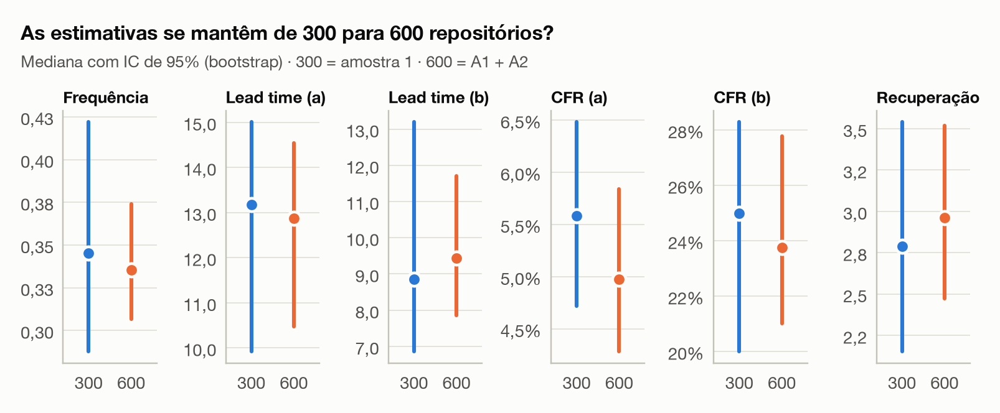

# 3. Resultados (esboço v2)

> Esboço da issue #151 para discutirmos em grupo. As análises finais de cada RQ ficam nas issues #140, #141, #142 e #158.
>
> - **Dados:** amostra 1 (A1, 300 repositórios, `data/dataset_dora.csv`) e amostra 2 (A2, 300 repositórios novos, `data/amostra2/dataset_dora.csv`). A A2 usa a mesma janela e os mesmos filtros, outra semente, e exclui os repositórios da A1.
> - **Todo resultado aparece em paralelo: 300 (A1) × 600 (A1 + A2).** A comparação formal entre as duas amostras está na seção 3.9.
> - **Como regenerar:** `python -m analise`, de dentro de `lab-expe-03`. As figuras de 300 ficam em `analise/saida/figuras/`, as de 600 em `analise/saida/600/figuras/` e as de comparação em `analise/saida/comparacao/figuras/`.
> - **[PRELIMINAR]** O CFR (b) usa a heurística v0 de release corretiva, até chegar a da #138.

Seguindo o enunciado, todas as métricas são resumidas por **mediana e IQR** (1º–3º quartil).

**Tabela 3 — Resumo das métricas, 300 × 600** (`analise/saida/comparacao/tabelas/estimativas_300_600.csv`).

| Métrica | n (300 / 600) | Mediana 300 [IQR] | Mediana 600 [IQR] |
| :--- | :--- | :--- | :--- |
| Frequência de deploy (releases/semana) | 300 / 600 | 0,35 [0,19 – 0,81] | 0,34 [0,19 – 0,84] |
| Lead time (a), por release (dias) | 293 / 582 | 13,2 [3,1 – 37,3] | 12,9 [3,5 – 37,8] |
| Lead time (b), por commit (dias) | 293 / 582 | 8,8 [2,8 – 29,4] | 9,4 [2,8 – 27,3] |
| CFR (a), proxy de CI | 300 / 600 | 5,6% [2,2% – 11,2%] | 5,0% [2,1% – 10,8%] |
| CFR (b), proxy de entrega [PRELIMINAR] | 300 / 600 | 25,0% [5,2% – 56,5%] | 23,8% [5,2% – 50,0%] |
| Tempo de recuperação (horas) | 278 / 554 | 2,8 [0,9 – 11,9] | 3,0 [1,0 – 14,9] |

Ficam sem lead time os repositórios com mais de 300 releases na janela, porque o cálculo foi omitido para preservar a cota da API (coluna `lt_release_omitido`): 7 na A1 e 18 no total. Ficam sem tempo de recuperação os que não tiveram nenhum episódio de falha fechado na janela: 22 na A1 e 46 no total.

**Leitura geral:** com o dobro de repositórios, **todas as medianas ficam praticamente no mesmo lugar** e dentro do intervalo de confiança da amostra 1. O detalhe está na seção 3.9.

---

## 3.1 RQ 01 — Frequência de deploy

| Amostra 1 (300) | A1 + A2 (600) |
| :---: | :---: |
|  |  |

**Como ler.**
- Cada ponto é um repositório, posicionado pela quantidade de releases por semana. A altura não tem significado: os pontos só se empilham para não se sobrepor.
- O eixo está em escala log: cada marca multiplica o valor, e não soma.
- As faixas ao fundo são as categorias da tabela de referência DORA, com a contagem de cada uma no topo.

**Resultado.**
- A mediana é de **0,35 release por semana** (0,34 com 600), cerca de uma release a cada 20 dias.
- Quase metade é **Medium**, entre 1 por mês e 1 por semana (46% com 300; 47% com 600). Um terço é **Low**, menos de 1 por mês (33%; 32%).
- Só 2% chegam a Elite, ≥ 7 por semana: 6 repositórios com 300 e 13 com 600.

Para a discussão: release publicada é um proxy conservador de deploy. Projetos que entregam continuamente sem publicar releases ficam subestimados. Os que nem chegam a 5 releases já foram descartados no funil, onde caíram 57% (A1) e 60% (A2) dos que usam Actions.

## 3.2 RQ 02 — Lead time for changes

| Amostra 1 (300) | A1 + A2 (600) |
| :---: | :---: |
|  |  |

**Como ler.**
- Cada ponto é um repositório: a posição horizontal é o lead time pela variante (a) e a vertical, pela variante (b), ambos em escala log.
- Na diagonal cinza as duas variantes coincidem.
- As linhas de grade marcam as fronteiras DORA: 1 dia, 1 semana e 30 dias.

**Resultado.**
- As medianas são **13,2 dias pela variante (a)** e **8,8 dias pela (b)** com 300, e 12,9 e 9,4 com 600.
- Em **65% dos repositórios a variante (b) dá um valor menor**, com o ponto abaixo da diagonal (67% com 600).

**Por que as variantes divergem** (o enunciado pede essa explicação):
- A variante (a) mede o tempo desde o commit **mais antigo** de cada release. Um único commit que esperou muito puxa o valor da release inteira para cima.
- A variante (b) usa a mediana de **todos** os commits. Releases grandes pesam mais, e a maioria dos commits entra perto da data de publicação.
- Quando cada release tem poucos commits, as duas variantes convergem. Os pontos acima da diagonal merecem uma inspeção caso a caso: uma hipótese é que poucas releases concentrem muitos commits antigos.

## 3.3 RQ 03 — Change failure rate

| Amostra 1 (300) | A1 + A2 (600) |
| :---: | :---: |
|  |  |

**Como ler.**
- É uma curva acumulada. Para cada valor de CFR no eixo horizontal, a altura da curva é a % de repositórios com CFR até aquele valor.
- Quanto mais cedo a curva sobe, mais repositórios têm taxa de falha baixa.
- As linhas verticais são as fronteiras DORA (15%, 30% e 45%). O ponto marca quantos repositórios são Elite (≤ 15%).

**Resultado.** Os dois proxies contam histórias opostas, e isso se repete nas duas amostras:
- Pela **falha de CI**, CFR (a), **84% dos repositórios são Elite** com 300 (83% com 600), com mediana de 5,6% (5,0%).
- Pela **release corrigida em até 7 dias**, CFR (b), só **37%** são Elite (38%), com mediana de 25% (24%). Cerca de 23% dos repositórios têm CFR (b) igual a zero, o degrau vertical no início da curva laranja.

Para a discussão: o CFR (a) mede a falha do *pipeline*, não a falha em produção. Testes instáveis e falhas corrigidas antes do merge entram como falha. O CFR (b) depende da heurística de corretiva, e a v0 provavelmente o infla.

## 3.4 RQ 04 — Tempo de recuperação

| Amostra 1 (300) | A1 + A2 (600) |
| :---: | :---: |
|  |  |

**Como ler.**
- É a mesma lógica de curva acumulada, com a mediana do tempo de recuperação de cada repositório no eixo horizontal, em escala log.
- Os pontos marcados respondem diretamente "que % dos repositórios se recupera em menos de X".

**Resultado.**
- A mediana é de **2,8 horas** (3,0 com 600).
- Em menos de 1 hora (Elite) recuperam-se **27%** (26% com 600). Em menos de 1 dia, **83%** (82%). Em menos de 1 semana, **97%** (95%).
- Os episódios **censurados** (sem recuperação até o fim da janela) são **0,7%** dos 20.077 episódios da A1 e 0,6% dos 41.546 das duas amostras.

## 3.5 Classificação DORA (combinação de referência C1)

| Amostra 1 (300) | A1 + A2 (600) |
| :---: | :---: |
|  |  |

**Como ler.**
- Cada barra soma 100% dos repositórios, divididos pela categoria DORA de cada métrica.
- O azul mais escuro é Elite e o mais claro é Low.
- **Geral** é a classificação final do enunciado: a mediana dos pontos das quatro métricas (Elite = 4 … Low = 1), arredondada para baixo.

**Resultado.**

| Classificação geral | Elite | High | Medium | Low |
| :--- | ---: | ---: | ---: | ---: |
| 300 | 8% | 35% | 50% | 7% |
| 600 | 7% | 36% | 48% | 9% |

- **Cerca de metade é Medium e um terço é High**, nas duas versões.
- Cada métrica puxa para um lado diferente:
  - o **CFR (a)** quase todo em Elite puxa para cima;
  - a **frequência**, com ~80% entre Medium e Low, puxa para baixo;
  - o **lead time** está espalhado pelas quatro categorias.

## 3.6 RQ 05 — Velocidade × estabilidade

| Amostra 1 (300) | A1 + A2 (600) |
| :---: | :---: |
|  |  |

**Como ler.**
- Cada ponto é um repositório, com a frequência de deploy no eixo horizontal (escala log) e o CFR no vertical.
- O ρ de Spearman vai de −1 a 1: perto de 0 indica ausência de relação monotônica, e valores positivos indicam que o CFR sobe junto com a frequência.

**Resultado.**

| Correlação de Spearman com a frequência | 300 | 600 |
| :--- | :--- | :--- |
| CFR (a), proxy de CI | ρ = 0,18 (p = 0,002) | ρ = 0,12 (p = 0,004) |
| CFR (b), proxy de entrega [PRELIMINAR] | ρ = 0,60 (p < 0,001) | ρ = 0,56 (p < 0,001) |

- **Pelo CI**, a correlação é significativa mas **fraca**, e fica ainda menor com 600. Na prática, publicar mais não se associa a quebrar mais o CI.
- **Pela entrega**, a correlação é **forte** nas duas, mas em boa parte é um artefato da definição: quem publica muitas releases tem, por construção, mais chance de que uma delas seja uma "corretiva" publicada em até 7 dias.

Para a discussão: o resultado com o proxy de CI é coerente com a afirmação do DORA de que velocidade e estabilidade não são *trade-off*. O resultado com o proxy de entrega não deve ser lido como evidência do contrário antes da heurística validada (#138). Em nenhum dos dois casos a correlação implica causalidade.

## 3.7 RQ 06 — Características associadas ao desempenho

| Amostra 1 (300) | A1 + A2 (600) |
| :---: | :---: |
|  |  |

**Como ler.**
- Cada célula cruza uma característica do repositório (linha) com uma métrica (coluna).
- O valor é o tamanho de efeito **ε² = H/(n−1)** do teste de Kruskal-Wallis: quanto da variação da métrica a característica explica. A referência é < 0,01 desprezível, < 0,06 pequeno, < 0,14 médio e ≥ 0,14 grande.
- Os valores em **negrito com \*** continuam significativos depois da correção de Holm para os 24 testes.
- Linguagem considera as linguagens com pelo menos 15 repositórios: 6 com 300 e 10 com 600. Os demais fatores estão divididos em quartis.

**Resultado, com 300.**

| Fator | Q1 → Q4 | Lead time (a) Q1 → Q4 | Frequência Q1 → Q4 | CFR (b) Q1 → Q4 |
| :--- | :--- | :--- | :--- | :--- |
| Idade | ≤ 2 anos → > 10,9 anos | 2,0 → 28,5 dias | 0,67 → 0,23 por semana | 57% → 10% |
| Contribuidores | ≤ 48 → > 338 | 4,7 → 18,5 dias | sem efeito | 37% → 18% |
| Estrelas | quartis | 6,1 → 18,4 dias | sem efeito | sem efeito |

- **A idade é o fator com maior efeito**, e isso se mantém com 600: ε² de 0,25 → 0,21 no lead time (a), efeito grande. Repositórios com até 2 anos publicam com mais frequência e mais rápido, com lead time mediano de 2 dias contra 28,5 nos mais antigos. Também têm mais releases corretivas.
- **Equipes maiores têm lead time maior**, também nas duas: ε² de 0,11–0,14 com 300 e 0,08–0,11 com 600, efeito médio.
- **O que muda com 600: a linguagem passa a ser significativa.**
  - Com 300 ela não tinha efeito após Holm. Com 600 aparece no lead time (ε² = 0,10, efeito médio), na frequência e no CFR (b).
  - Lead time (a) mediano por linguagem: TypeScript 7,1 dias, JavaScript 8,9, Python 11,5, Rust 14,1, Go 16,7, Java 22,9, C 35,3, C++ 60,6.
  - É o exemplo clássico de **poder estatístico**: o efeito existia, mas 300 repositórios divididos em 6 grupos não bastavam para detectá-lo depois da correção.
- **O CFR (a) não se associa a nenhum fator** nas duas versões. Com 600, a idade passa a ter um efeito pequeno no tempo de recuperação (ε² = 0,03).

Para a discussão: idade, contribuidores, estrelas e linguagem são correlacionados entre si. Projetos em C/C++ tendem a ser mais antigos, e projetos antigos tendem a ser maiores e mais populares. O Kruskal-Wallis univariado não separa esses efeitos: **a #141 testa cada fator controlando os demais**. Uma hipótese é que projetos jovens estejam em fase de iteração rápida, com muitas releases de *patch*.

## 3.8 RQ 07 — Sensibilidade à definição operacional

| Amostra 1 (300) | A1 + A2 (600) |
| :---: | :---: |
|  |  |

**Como ler.**
- **À esquerda:** a distribuição das categorias DORA gerais em cada combinação de definições.
- **À direita:** para cada par de combinações, a % de repositórios que **ficou na mesma categoria**, **subiu** ou **desceu**, e o κ de Cohen ponderado linear, em que 1 é concordância perfeita.

| Combinação | Unidade de deploy | Lead time | CFR |
| :--- | :--- | :--- | :--- |
| C1 (referência) | release | (a) | (a) |
| C2 | release + pré-release | (b) | (b) [PRELIMINAR] |
| C3 | tag | (b) | (a) |

**Resultado.**

| Par | Mudam de categoria (300 → 600) | κ ponderado (300 → 600) |
| :--- | :--- | :--- |
| C1 × C2 | 36% → 35% | 0,42 → 0,46 |
| C1 × C3 | 28% → 28% | 0,63 → 0,64 |
| C2 × C3 | 33% → 34% | 0,54 → 0,53 |

- **Entre 28% e 36% dos repositórios mudam de categoria** só por trocar a definição. A proporção praticamente não muda de 300 para 600, então o efeito não é ruído amostral.
- A concordância é **moderada**, com κ entre 0,42 e 0,64.
- A direção das mudanças segue o componente trocado:
  - em **C2**, ~23% descem e ~13% sobem, porque o CFR (b) é mais severo que o (a);
  - em **C3**, ~23% sobem e só ~5% descem, porque tags são mais frequentes que releases e o lead time (b) é menor.

Para a discussão: a classificação DORA de um repositório **não é robusta à definição operacional**, e isso se mantém com o dobro da amostra. As comparações entre estudos que usam proxies diferentes precisam ser feitas com cautela. A RQ07 final (#142) deve recalcular C2 com a heurística validada.

---

## 3.9 Comparação entre amostras

A pergunta desta seção é: **as conclusões dependem dos 300 repositórios que foram sorteados?** Ela é respondida de dois jeitos complementares:
1. **A1 × A2**, duas amostras **independentes**, sem nenhum repositório em comum: testes de hipótese por métrica.
2. **300 → 600:** se as estimativas ficam estáveis e mais precisas quando a amostra dobra. Como as duas se sobrepõem (a de 600 contém a de 300), aqui não cabe teste de hipótese, só a comparação das estimativas e dos intervalos.

### Funil da amostra 2

O funil da A2 se comporta como o da A1:

| Filtro | Passaram na A1 | Passaram na A2 |
| :--- | ---: | ---: |
| Usa Actions | 85% | 84% |
| ≥ 5 releases | 43% | 40% |
| ≥ 50 runs | 75% | 79% |

Foram avaliados 1.108 candidatos para a A1 e 1.127 para a A2, e nenhum descarte foi por erro de coleta. O dataset da A2 se reproduz de forma idêntica a partir do cache.

### A1 × A2: as distribuições são as mesmas?

**Como ler.** Uma curva acumulada por métrica, com a A1 em azul e a A2 em laranja. Curvas sobrepostas indicam distribuições iguais. No canto de cada painel aparecem o delta de Cliff (δ, tamanho da diferença, entre −1 e 1) e o p do Mann-Whitney corrigido por Holm.

**Tabela 4 — A1 × A2** (`analise/saida/comparacao/tabelas/a1_x_a2_mann_whitney.csv`).

| Métrica | Mediana A1 | Mediana A2 | δ de Cliff | p (Holm) |
| :--- | ---: | ---: | ---: | ---: |
| Frequência (releases/semana) | 0,35 | 0,33 | 0,01 | 1,00 |
| Lead time (a) (dias) | 13,2 | 12,7 | −0,02 | 1,00 |
| Lead time (b) (dias) | 8,8 | 10,0 | 0,02 | 1,00 |
| CFR (a) | 5,6% | 4,2% | 0,05 | 1,00 |
| CFR (b) [PRELIMINAR] | 25,0% | 22,2% | 0,03 | 1,00 |
| Recuperação (horas) | 2,8 | 3,0 | −0,06 | 1,00 |

**Resultado: as duas amostras são estatisticamente indistinguíveis.**
- Em nenhuma métrica há diferença significativa.
- Todos os |δ| são < 0,07, bem abaixo do limite de efeito desprezível (0,147).

### 300 → 600: as estimativas se mantêm?

**Como ler.** Para cada métrica, o ponto é a mediana e a barra é o intervalo de confiança de 95% (bootstrap), com 300 em azul e 600 em laranja. Se a mediana de 600 cai dentro do intervalo de 300, a estimativa se manteve. Uma barra mais curta indica mais precisão.

**Resultado.**
- **Todas as medianas de 600 caem dentro do intervalo de confiança de 300.**
- **Os intervalos ficam de 11% a 50% mais estreitos**, como esperado ao dobrar a amostra. Por exemplo, o IC da frequência vai de 0,29–0,42 para 0,31–0,37.
- As conclusões qualitativas das RQ01–RQ05 e da RQ07 **não mudam**: mesmo perfil DORA, mesma divergência entre os proxies de CFR, mesma proporção de reclassificação.
- **A exceção é a RQ06:** com 600, a linguagem passa a ter efeito significativo, que antes estava escondido pela falta de poder estatístico. É o principal argumento para chegar a 900 (#157).

Para a discussão (validade de conclusão): os resultados descritivos são **robustos à amostra sorteada**. Já os testes com muitos grupos (RQ06) são sensíveis ao tamanho da amostra, e por isso devem ser reportados com o `n` e o tamanho de efeito, não só com o p-valor.
