# Mineração de métricas DORA em repositórios open-source populares

**Laboratório de Experimentação de Software** · Engenharia de Software, 6º período
Guilherme Costa · Henrique Jardim Melo · Gabriel Afonso

> Documento consolidado, gerado por `python artigo/montar.py`. Não editar diretamente:
> altere as seções em `artigo/0N-*.md` e rode o script de novo.

---

# 2. Metodologia

> Rascunho da issue #139, a ser revisado por Henrique e Gabriel antes de ir para o Overleaf. Os números da coleta são os do `data/` desta versão. Os trechos marcados com **[PENDENTE]** dependem das issues #137 (kappa) e #138 (F1 da heurística) ou das datas da janela.

## 2.1 Fonte de dados

Os dados vêm da API pública do GitHub e foram coletados por um script próprio do grupo, sem bibliotecas prontas de acesso à API. O script usa a API REST para busca, releases, comparações entre releases e workflow runs, e a GraphQL para as tags com data. O pipeline inteiro roda com um único comando (`python -m pipeline --config config.yaml`). Cada resposta da API fica em cache local, então interromper a coleta e rodá-la de novo continua de onde parou e reproduz o mesmo dataset sem novas chamadas. O cliente HTTP respeita os cabeçalhos de rate limit e repete com *backoff* exponencial as respostas 5xx e as falhas de rede.

## 2.2 Janela de observação

A janela tem 12 meses, de **1º de outubro de 2025 a 30 de setembro de 2026** **[PENDENTE: confirmar com as datas fixadas pelo professor]**. Isso dá aproximadamente 52,1 semanas. Só entram nas métricas as releases publicadas e os workflow runs criados dentro dela. A exceção é a release imediatamente anterior a uma release da janela, que é usada como base para obter os commits incluídos, mesmo estando fora.

## 2.3 Seleção dos repositórios e funil

1. **Candidatos.** Foi usada a busca de repositórios com mais de 1.000 estrelas, não arquivados e com *push* depois do início da janela. Como cada consulta devolve no máximo 1.000 resultados, a busca foi fatiada em nove faixas de estrelas (1.000–1.199, 1.200–1.499, 1.500–1.999, 2.000–2.999, 3.000–4.999, 5.000–9.999, 10.000–19.999, 20.000–49.999 e ≥ 50.000).
2. **Ordem de avaliação.** Os candidatos foram embaralhados com semente fixa (42) e avaliados nessa ordem até a amostra chegar a 300 repositórios. Isso evita que a amostra fique concentrada nos repositórios mais estrelados de cada faixa.
3. **Filtros**, aplicados do mais barato para o mais caro:
   - (i) usa GitHub Actions (`actions/workflows` com `total_count > 0`);
   - (ii) tem ≥ 5 releases publicadas, sem pré-release, na janela;
   - (iii) tem ≥ 50 workflow runs válidos (`success` ou falha) disparados por `push` no *default branch* na janela.

O funil é gerado automaticamente pelo pipeline (`data/funil.csv`), e cada descarte fica registrado com o motivo em `data/descartes.csv`.

**Tabela 1 — Funil de seleção** (`data/funil.csv`).

| Etapa | Restantes | Descartados | Motivo do descarte |
| :--- | ---: | ---: | :--- |
| Candidatos da busca | 8.457 | — | — |
| Avaliados (ordem aleatória, até o alvo) | 1.108 | 7.349 | não avaliados: alvo de 300 já atingido |
| Usam GitHub Actions | 937 | 171 | nenhum workflow cadastrado |
| ≥ 5 releases na janela | 399 | 538 | menos de 5 releases publicadas (sem pré-release) |
| ≥ 50 runs válidos na janela | 300 | 99 | menos de 50 runs válidos em `push` no *default branch* |
| **Amostra final** | **300** | 0 | — |

O filtro mais restritivo é o de releases: 57% dos repositórios que usam Actions publicaram menos de 5 releases em 12 meses. Isso indica que muitos projetos populares entregam por outros meios, como *rolling release*, publicação direta em registros de pacotes ou ausência de versionamento formal. Esse ponto é retomado nas ameaças à validade.

Como cada faixa de estrelas contribui com no máximo 1.000 candidatos, os mais estrelados de cada faixa, a amostra fica deslocada para repositórios mais populares do que uma amostra uniforme de todos os repositórios com mais de 1.000 estrelas. A mediana é de 9.485 estrelas (IQR 2.844–28.694).

## 2.4 Definições operacionais

Todas as definições seguem a seção 3 do enunciado, comum à turma. Em resumo:

- **Deploy:** release publicada (`draft = false`), sem pré-release na definição principal. A data do deploy é `published_at`.
- **Data do commit:** `commit.author.date`.
- **Execuções de CI:** workflow runs do *default branch* com `event = push`. São consultadas mês a mês, e um mês com mais de 1.000 resultados é dividido ao meio recursivamente até caber. A classificação usa o campo `conclusion`:
  - `success` conta como sucesso;
  - `failure`, `timed_out` e `startup_failure` contam como falha;
  - os demais valores são ignorados.

Métricas por repositório:

- **Deployment frequency (RQ 01):** deploys na janela ÷ semanas da janela.
- **Lead time (RQ 02):** os commits de cada deploy D vêm de `compare/{deploy anterior}...{D}`, paginado.
  - (a) Por release: `data(D) − commit mais antigo de D`. O valor do repositório é a mediana entre os deploys.
  - (b) Por commit: `data(D) − data de cada commit`. O valor do repositório é a mediana de todos os commits.
  - Ficam fora do cálculo, e são contados à parte:
    - o primeiro deploy da história;
    - os *compare* com resposta 404 (tag apagada ou reescrita);
    - os *compare* com mais de 1.000 commits, ou que a API se recusa a gerar (HTTP 422, *diff* demorado demais). Esse último critério é do grupo: são quase sempre comparações entre linhas de versão diferentes ou entre pacotes distintos de um monorepo, intercalados por data, e não representam o que entrou no deploy.
- **Change failure rate (RQ 03):**
  - (a) Proxy de CI: falhas ÷ (falhas + sucessos), com todos os workflows juntos.
  - (b) Proxy de entrega: o deploy D falhou se um deploy **corretivo** foi publicado em até 7 dias depois dele. Deploys dos últimos 7 dias da janela ficam fora do denominador (censura). O dataset desta versão usa a heurística **v0** (SemVer: mantém `maior.menor` do deploy anterior e sobe só o `patch`). Três outras versões foram implementadas e comparadas de forma descritiva na amostra 1 (`validacao/comparar_versoes.py`, `validacao/heuristica_versoes.md`):
    - **v1 mensagens:** corretiva se pelo menos metade dos commits da release tem prefixo `fix`/`revert` (Conventional Commits).
    - **v2 patch + poucos commits:** v0 **e** a release tem no máximo 3 commits.
    - **v3 combinada:** v0 **ou** v1 **ou** o nome da tag contém `hotfix`/`patch`.

    | Versão | Mediana do CFR (b) | IQR | Releases marcadas corretivas |
    | :--- | :---: | :---: | :---: |
    | v0 (semver) | 25,0% | 5,2% – 56,5% | 8.186 |
    | v1 (mensagens) | 0,0% | 0,0% – 12,6% | 1.479 |
    | v2 (patch + poucos commits) | 2,4% | 0,0% – 21,6% | 1.903 |
    | v3 (combinada) | 25,0% | 6,0% – 57,2% | 8.597 |

    A v0 sozinha já marca um quarto das releases como corretivas, bem acima do CFR (a) (mediana 2,6%, seção 3.1); a v1, baseada só na mensagem do commit, é bem mais conservadora. **[PENDENTE: escolher a versão final (#138) a partir da precisão, recall e F1 contra a amostra-ouro, quando o consenso da #137 existir, e atualizar esta tabela e o dataset.]**
- **Tempo de recuperação (RQ 04):** os runs são agrupados por workflow e ordenados por `run_started_at`.
  - Um episódio começa na primeira falha depois de um sucesso e termina no sucesso seguinte, com duração `updated_at(sucesso) − run_started_at(1ª falha)`. O valor do repositório é a mediana dos episódios fechados, em horas.
  - Episódios sem sucesso até o fim da janela são **censurados**: não entram na mediana, mas são contados, e a proporção é reportada por repositório.
  - Falhas no início da janela, antes do primeiro sucesso, não abrem episódio, porque não é possível saber quando a falha começou.

## 2.5 Variantes para a análise de sensibilidade (RQ 07)

As métricas de velocidade e o CFR (b) são calculados para três unidades de deploy:

| Unidade | Definição | Data |
| :--- | :--- | :--- |
| `release` (referência) | Release publicada sem pré-release | `published_at` |
| `release_pre` | Release publicada, incluindo pré-releases | `published_at` |
| `tag` | Tag do repositório | Data de autoria do commit apontado |

Para não esgotar a cota, o lead time de uma unidade não é calculado quando ela tem mais de 300 deploys na janela. Isso acontece sobretudo com tags em monorepos. Esses casos ficam marcados na coluna `lt_<unidade>_omitido`. As combinações C1–C3 da RQ 07 são montadas a partir dessas colunas na S03 (#142).

## 2.6 Dataset

O dataset final (`data/dataset_dora.csv`) tem uma linha por repositório. Ele traz os metadados usados na RQ 06 (estrelas, linguagem, idade e número de contribuidores), as métricas de cada unidade de deploy e as contagens de qualidade da coleta:

- releases ignoradas por *compare* 404 ou grande demais;
- meses que bateram o teto de 1.000 runs;
- episódios censurados.

Cada coluna está descrita em `data/DICIONARIO.md`, com nome, tipo, unidade e fórmula ou campo de origem na API.

A amostra final tem **300 repositórios** em 27 linguagens. As mais frequentes são TypeScript (61), Python (55), Go (49), Rust (28), C++ (20) e JavaScript (19). A idade mediana é de 5,8 anos (IQR 2,0–10,9), e o número mediano de contribuidores é 142 (IQR 49–337). A coleta somou 17.217 releases, 28.792 tags e 833.582 workflow runs válidos na janela. A Tabela 2 resume a qualidade da coleta.

**Tabela 2 — Contagens de qualidade da coleta.**

| Ocorrência | Quantidade |
| :--- | :--- |
| Repositórios com algum mês acima de 1.000 runs (subdividido) | 34 |
| Dias ainda acima de 1.000 runs após a subdivisão (dados incompletos) | 19 dias em 4 repositórios |
| Releases ignoradas no lead time por *compare* 404 | 8 |
| Releases ignoradas no lead time por *compare* com mais de 1.000 commits ou que a API não conseguiu gerar (422) | 244 |
| Repositórios com lead time de release omitido (mais de 300 releases na janela) | 7 |
| Episódios de falha de CI censurados (sem recuperação até o fim da janela) | 139 de 20.077, em 74 repositórios |

## 2.7 Validação manual (amostra-ouro)

1. **Sorteio.** Foram sorteados 60 repositórios da amostra final com semente fixa. **[PENDENTE: semente e lista (#137).]**
2. **Rotulagem independente.** Cada integrante rotulou sozinho, sem consultar os demais nem ver a saída da heurística, três dimensões:
   - (i) tipo do projeto (biblioteca/framework, aplicação/serviço, ferramenta CLI ou outro);
   - (ii) se as releases representam entregas reais ao usuário (sim/não/incerto);
   - (iii) para 5 releases sorteadas por repositório, se a release é corretiva.
3. **Concordância.** Foi medida pelo kappa de Fleiss por dimensão e interpretada segundo Landis e Koch (1977). **[PENDENTE: valores de κ (#137).]**
4. **Consenso.** As divergências foram resolvidas por consenso, seguindo o protocolo de desempate registrado no repositório.
5. **Avaliação da heurística.** A heurística de release corretiva foi avaliada contra o consenso por precisão, recall e F1. Com F1 < 0,70, ela foi refinada e reavaliada, e cada versão foi documentada. **[PENDENTE: P/R/F1 por versão (#138).]**

---

# 3. Resultados (esboço v2)

> Esboço da issue #151 para discutirmos em grupo. As análises finais de cada RQ ficam nas issues #140, #141, #142 e #158.
>
> - **Dados:** amostra 1 (A1, 300 repositórios, `data/dataset_dora.csv`) e amostra 2 (A2, 300 repositórios novos, `data/amostra2/dataset_dora.csv`). A A2 usa a mesma janela e os mesmos filtros, outra semente, e exclui os repositórios da A1.
> - **Todo resultado aparece em paralelo: 300 (A1) × 600 (A1 + A2).** A comparação formal entre as duas amostras está na seção 3.9.
> - **Como regenerar:** `python -m analise`, de dentro de `lab-expe-03`. As figuras de 300 ficam em `analise/saida/figuras/`, as de 600 em `analise/saida/600/figuras/` e as de comparação em `analise/saida/comparacao/figuras/`.
> - **[PRELIMINAR]** O CFR (b) usa a heurística v0 de release corretiva, até chegar a da #138.

Seguindo o enunciado, todas as métricas são resumidas por **mediana e IQR** (1º–3º quartil).

**Tabela 3 — Resumo das métricas, 300 × 600** (`analise/saida/comparacao/tabelas/estimativas_300_600.csv`).

| Métrica | n (300 / 600) | Mediana 300 [IQR] | Mediana 600 [IQR] |
| :--- | :--- | :--- | :--- |
| Frequência de deploy (releases/semana) | 300 / 600 | 0,35 [0,19 – 0,81] | 0,34 [0,19 – 0,84] |
| Lead time (a), por release (dias) | 293 / 582 | 13,2 [3,1 – 37,3] | 12,9 [3,5 – 37,8] |
| Lead time (b), por commit (dias) | 293 / 582 | 8,8 [2,8 – 29,4] | 9,4 [2,8 – 27,3] |
| CFR (a), proxy de CI | 300 / 600 | 5,6% [2,2% – 11,2%] | 5,0% [2,1% – 10,8%] |
| CFR (b), proxy de entrega [PRELIMINAR] | 300 / 600 | 25,0% [5,2% – 56,5%] | 23,8% [5,2% – 50,0%] |
| Tempo de recuperação (horas) | 278 / 554 | 2,8 [0,9 – 11,9] | 3,0 [1,0 – 14,9] |

Ficam sem lead time os repositórios com mais de 300 releases na janela, porque o cálculo foi omitido para preservar a cota da API (coluna `lt_release_omitido`): 7 na A1 e 18 no total. Ficam sem tempo de recuperação os que não tiveram nenhum episódio de falha fechado na janela: 22 na A1 e 46 no total.

**Leitura geral:** com o dobro de repositórios, **todas as medianas ficam praticamente no mesmo lugar** e dentro do intervalo de confiança da amostra 1. O detalhe está na seção 3.9.

---

## 3.1 RQ 01 — Frequência de deploy

| Amostra 1 (300) | A1 + A2 (600) |
| :---: | :---: |
| 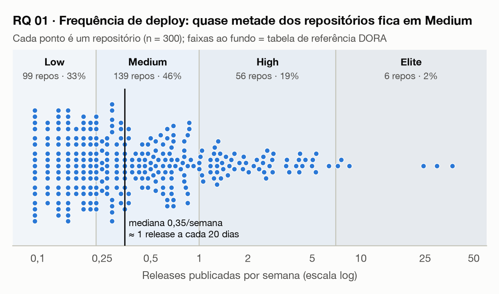 | 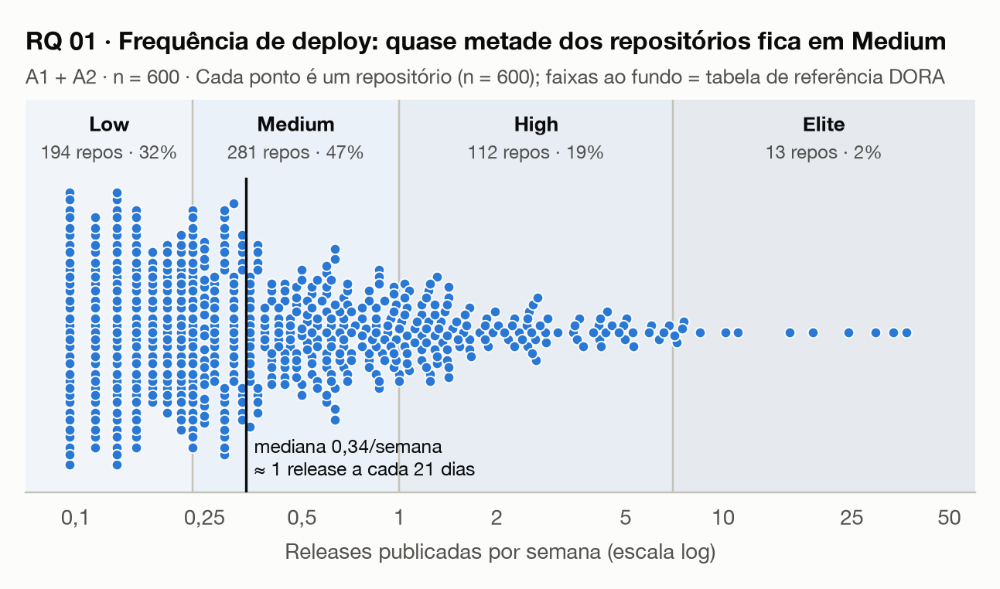 |

**Como ler.**
- Cada ponto é um repositório, posicionado pela quantidade de releases por semana. A altura não tem significado: os pontos só se empilham para não se sobrepor.
- O eixo está em escala log: cada marca multiplica o valor, e não soma.
- As faixas ao fundo são as categorias da tabela de referência DORA, com a contagem de cada uma no topo.

**Resultado.**
- A mediana é de **0,35 release por semana** (0,34 com 600), cerca de uma release a cada 20 dias.
- Quase metade é **Medium**, entre 1 por mês e 1 por semana (46% com 300; 47% com 600). Um terço é **Low**, menos de 1 por mês (33%; 32%).
- Só 2% chegam a Elite, ≥ 7 por semana: 6 repositórios com 300 e 13 com 600.

Para a discussão: release publicada é um proxy conservador de deploy. Projetos que entregam continuamente sem publicar releases ficam subestimados. Os que nem chegam a 5 releases já foram descartados no funil, onde caíram 57% (A1) e 60% (A2) dos que usam Actions.

## 3.2 RQ 02 — Lead time for changes

| Amostra 1 (300) | A1 + A2 (600) |
| :---: | :---: |
| 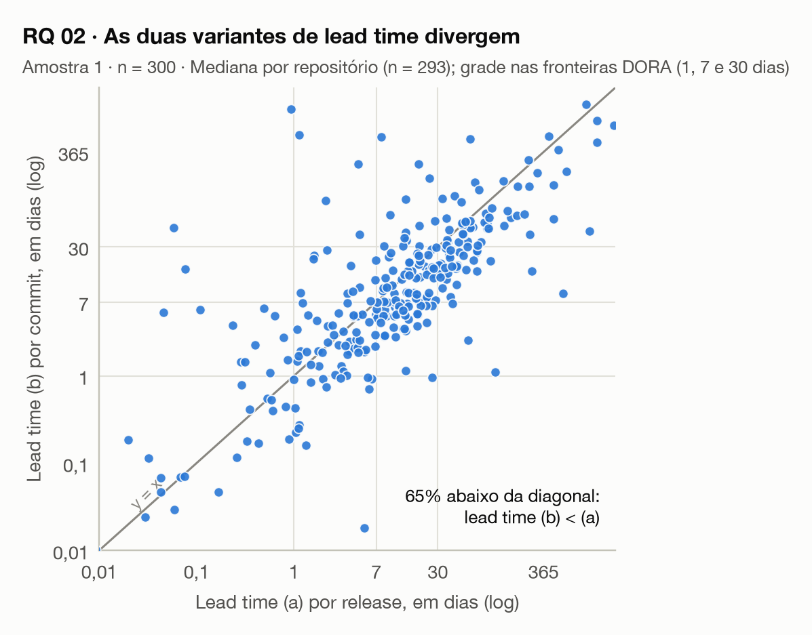 | 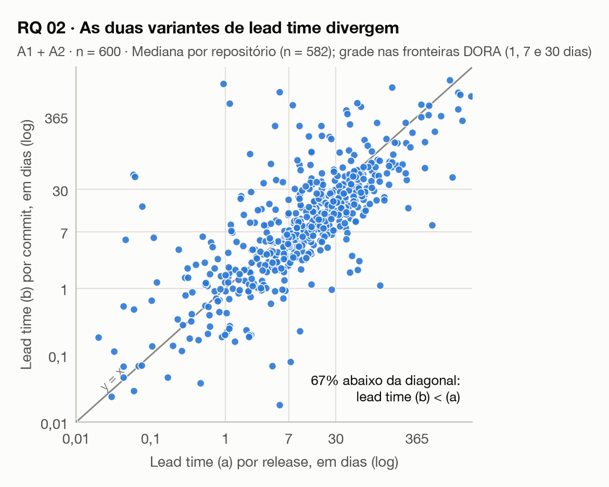 |

**Como ler.**
- Cada ponto é um repositório: a posição horizontal é o lead time pela variante (a) e a vertical, pela variante (b), ambos em escala log.
- Na diagonal cinza as duas variantes coincidem.
- As linhas de grade marcam as fronteiras DORA: 1 dia, 1 semana e 30 dias.

**Resultado.**
- As medianas são **13,2 dias pela variante (a)** e **8,8 dias pela (b)** com 300, e 12,9 e 9,4 com 600.
- Em **65% dos repositórios a variante (b) dá um valor menor**, com o ponto abaixo da diagonal (67% com 600).

**Por que as variantes divergem** (o enunciado pede essa explicação):
- A variante (a) mede o tempo desde o commit **mais antigo** de cada release. Um único commit que esperou muito puxa o valor da release inteira para cima.
- A variante (b) usa a mediana de **todos** os commits. Releases grandes pesam mais, e a maioria dos commits entra perto da data de publicação.
- Quando cada release tem poucos commits, as duas variantes convergem. Os pontos acima da diagonal merecem uma inspeção caso a caso: uma hipótese é que poucas releases concentrem muitos commits antigos.

## 3.3 RQ 03 — Change failure rate

| Amostra 1 (300) | A1 + A2 (600) |
| :---: | :---: |
| 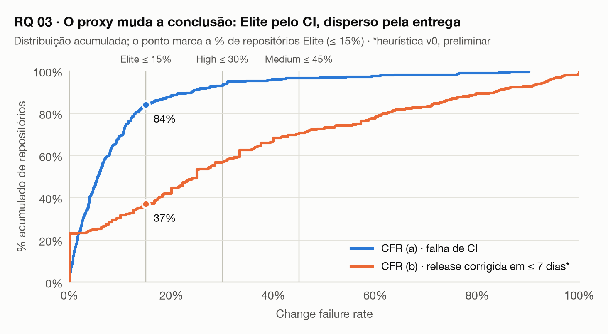 | 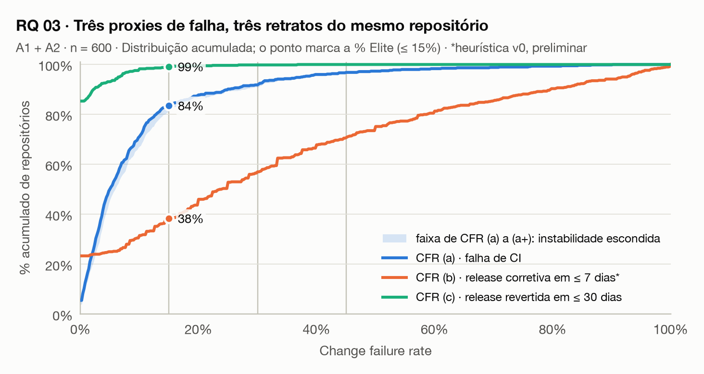 |

**Como ler.**
- É uma curva acumulada. Para cada valor de CFR no eixo horizontal, a altura da curva é a % de repositórios com CFR até aquele valor.
- Quanto mais cedo a curva sobe, mais repositórios têm taxa de falha baixa.
- As linhas verticais são as fronteiras DORA (15%, 30% e 45%). O ponto marca quantos repositórios são Elite (≤ 15%).

**Resultado.** Os dois proxies contam histórias opostas, e isso se repete nas duas amostras:
- Pela **falha de CI**, CFR (a), **84% dos repositórios são Elite** com 300 (83% com 600), com mediana de 5,6% (5,0%).
- Pela **release corrigida em até 7 dias**, CFR (b), só **37%** são Elite (38%), com mediana de 25% (24%). Cerca de 23% dos repositórios têm CFR (b) igual a zero, o degrau vertical no início da curva laranja.

Para a discussão: o CFR (a) mede a falha do *pipeline*, não a falha em produção. Testes instáveis e falhas corrigidas antes do merge entram como falha. O CFR (b) depende da heurística de corretiva, e a v0 provavelmente o infla.

## 3.4 RQ 04 — Tempo de recuperação

| Amostra 1 (300) | A1 + A2 (600) |
| :---: | :---: |
| 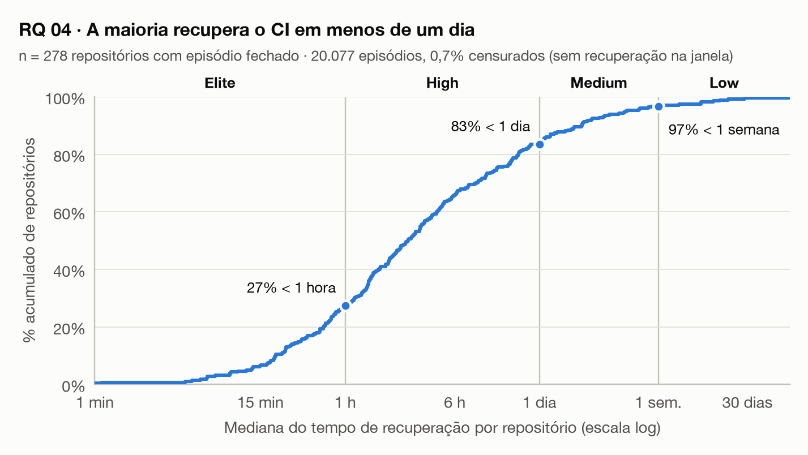 | 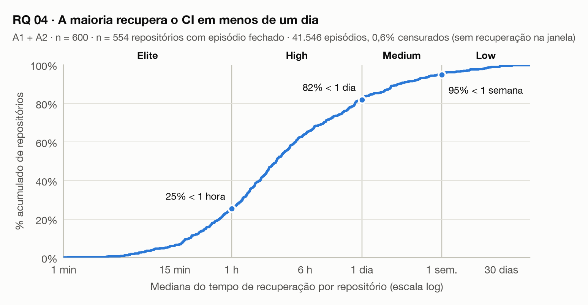 |

**Como ler.**
- É a mesma lógica de curva acumulada, com a mediana do tempo de recuperação de cada repositório no eixo horizontal, em escala log.
- Os pontos marcados respondem diretamente "que % dos repositórios se recupera em menos de X".

**Resultado.**
- A mediana é de **2,8 horas** (3,0 com 600).
- Em menos de 1 hora (Elite) recuperam-se **27%** (26% com 600). Em menos de 1 dia, **83%** (82%). Em menos de 1 semana, **97%** (95%).
- Os episódios **censurados** (sem recuperação até o fim da janela) são **0,7%** dos 20.077 episódios da A1 e 0,6% dos 41.546 das duas amostras.

## 3.5 Classificação DORA (combinação de referência C1)

| Amostra 1 (300) | A1 + A2 (600) |
| :---: | :---: |
|  | 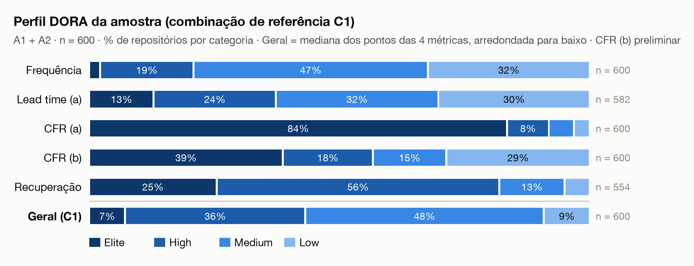 |

**Como ler.**
- Cada barra soma 100% dos repositórios, divididos pela categoria DORA de cada métrica.
- O azul mais escuro é Elite e o mais claro é Low.
- **Geral** é a classificação final do enunciado: a mediana dos pontos das quatro métricas (Elite = 4 … Low = 1), arredondada para baixo.

**Resultado.**

| Classificação geral | Elite | High | Medium | Low |
| :--- | ---: | ---: | ---: | ---: |
| 300 | 8% | 35% | 50% | 7% |
| 600 | 7% | 36% | 48% | 9% |

- **Cerca de metade é Medium e um terço é High**, nas duas versões.
- Cada métrica puxa para um lado diferente:
  - o **CFR (a)** quase todo em Elite puxa para cima;
  - a **frequência**, com ~80% entre Medium e Low, puxa para baixo;
  - o **lead time** está espalhado pelas quatro categorias.

## 3.6 RQ 05 — Velocidade × estabilidade

| Amostra 1 (300) | A1 + A2 (600) |
| :---: | :---: |
| 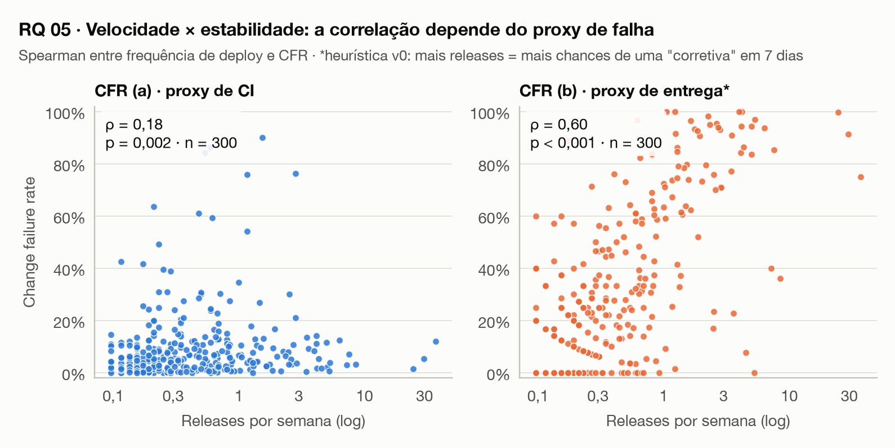 | 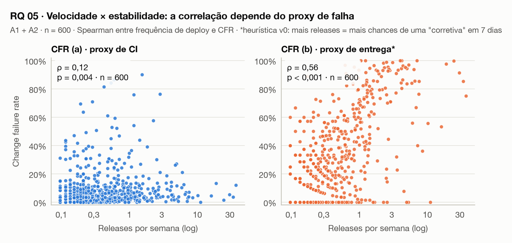 |

**Como ler.**
- Cada ponto é um repositório, com a frequência de deploy no eixo horizontal (escala log) e o CFR no vertical.
- O ρ de Spearman vai de −1 a 1: perto de 0 indica ausência de relação monotônica, e valores positivos indicam que o CFR sobe junto com a frequência.

**Resultado.**

| Correlação de Spearman com a frequência | 300 | 600 |
| :--- | :--- | :--- |
| CFR (a), proxy de CI | ρ = 0,18 (p = 0,002) | ρ = 0,12 (p = 0,004) |
| CFR (b), proxy de entrega [PRELIMINAR] | ρ = 0,60 (p < 0,001) | ρ = 0,56 (p < 0,001) |

- **Pelo CI**, a correlação é significativa mas **fraca**, e fica ainda menor com 600. Na prática, publicar mais não se associa a quebrar mais o CI.
- **Pela entrega**, a correlação é **forte** nas duas, mas em boa parte é um artefato da definição: quem publica muitas releases tem, por construção, mais chance de que uma delas seja uma "corretiva" publicada em até 7 dias.

Para a discussão: o resultado com o proxy de CI é coerente com a afirmação do DORA de que velocidade e estabilidade não são *trade-off*. O resultado com o proxy de entrega não deve ser lido como evidência do contrário antes da heurística validada (#138). Em nenhum dos dois casos a correlação implica causalidade.

## 3.7 RQ 06 — Características associadas ao desempenho

| Amostra 1 (300) | A1 + A2 (600) |
| :---: | :---: |
| 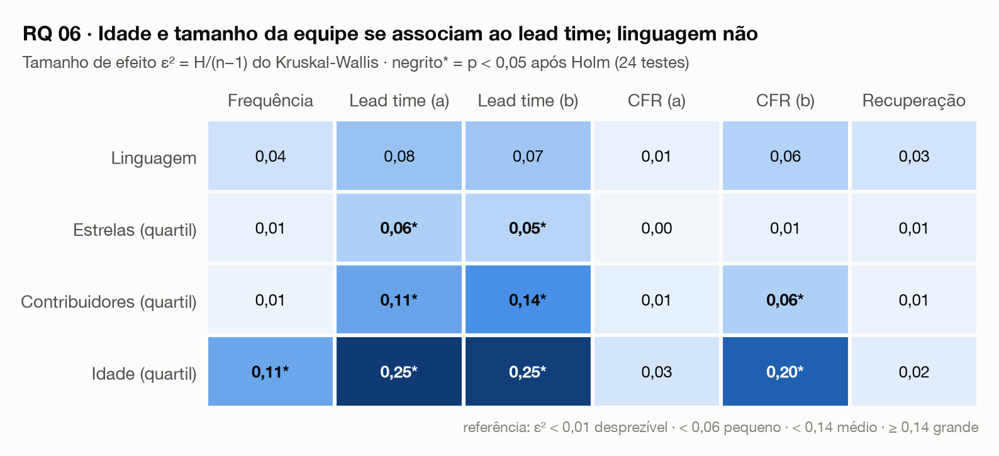 | 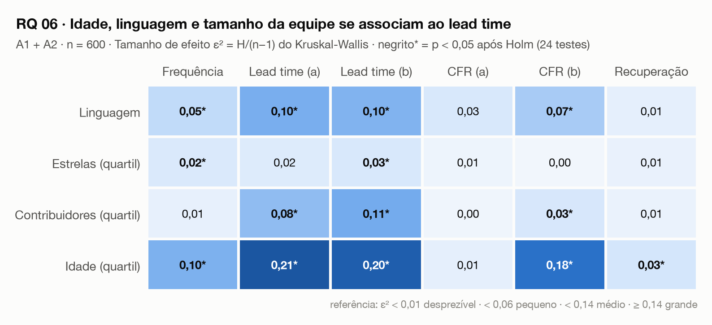 |

**Como ler.**
- Cada célula cruza uma característica do repositório (linha) com uma métrica (coluna).
- O valor é o tamanho de efeito **ε² = H/(n−1)** do teste de Kruskal-Wallis: quanto da variação da métrica a característica explica. A referência é < 0,01 desprezível, < 0,06 pequeno, < 0,14 médio e ≥ 0,14 grande.
- Os valores em **negrito com \*** continuam significativos depois da correção de Holm para os 24 testes.
- Linguagem considera as linguagens com pelo menos 15 repositórios: 6 com 300 e 10 com 600. Os demais fatores estão divididos em quartis.

**Resultado, com 300.**

| Fator | Q1 → Q4 | Lead time (a) Q1 → Q4 | Frequência Q1 → Q4 | CFR (b) Q1 → Q4 |
| :--- | :--- | :--- | :--- | :--- |
| Idade | ≤ 2 anos → > 10,9 anos | 2,0 → 28,5 dias | 0,67 → 0,23 por semana | 57% → 10% |
| Contribuidores | ≤ 48 → > 338 | 4,7 → 18,5 dias | sem efeito | 37% → 18% |
| Estrelas | quartis | 6,1 → 18,4 dias | sem efeito | sem efeito |

- **A idade é o fator com maior efeito**, e isso se mantém com 600: ε² de 0,25 → 0,21 no lead time (a), efeito grande. Repositórios com até 2 anos publicam com mais frequência e mais rápido, com lead time mediano de 2 dias contra 28,5 nos mais antigos. Também têm mais releases corretivas.
- **Equipes maiores têm lead time maior**, também nas duas: ε² de 0,11–0,14 com 300 e 0,08–0,11 com 600, efeito médio.
- **O que muda com 600: a linguagem passa a ser significativa.**
  - Com 300 ela não tinha efeito após Holm. Com 600 aparece no lead time (ε² = 0,10, efeito médio), na frequência e no CFR (b).
  - Lead time (a) mediano por linguagem: TypeScript 7,1 dias, JavaScript 8,9, Python 11,5, Rust 14,1, Go 16,7, Java 22,9, C 35,3, C++ 60,6.
  - É o exemplo clássico de **poder estatístico**: o efeito existia, mas 300 repositórios divididos em 6 grupos não bastavam para detectá-lo depois da correção.
- **O CFR (a) não se associa a nenhum fator** nas duas versões. Com 600, a idade passa a ter um efeito pequeno no tempo de recuperação (ε² = 0,03).

Para a discussão: idade, contribuidores, estrelas e linguagem são correlacionados entre si. Projetos em C/C++ tendem a ser mais antigos, e projetos antigos tendem a ser maiores e mais populares. O Kruskal-Wallis univariado não separa esses efeitos: **a #141 testa cada fator controlando os demais**. Uma hipótese é que projetos jovens estejam em fase de iteração rápida, com muitas releases de *patch*.

### Robustez (issue #141): o efeito se mantém controlando os demais fatores?

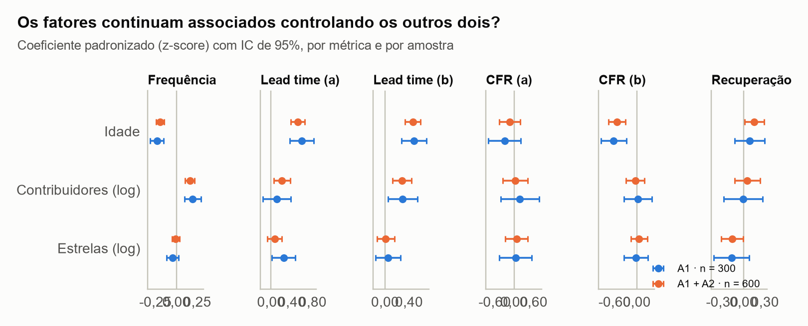

A correlação entre os três fatores contínuos é moderada: estrelas × contribuidores ρ = 0,59, contribuidores × idade ρ = 0,44, estrelas × idade ρ = 0,07 (com 600). O VIF de cada preditor na regressão fica entre 1,2 e 1,9, abaixo do corte de 5 — a multicolinearidade não impede separar os efeitos.

A correlação parcial de Spearman, controlando os outros dois fatores contínuos, confirma a leitura da idade e reduz a dos contribuidores:

- **Idade** continua associada a quase todas as métricas depois de controlar contribuidores e estrelas, com 600: ρ parcial = 0,34 no lead time (a), −0,39 na frequência, −0,34 no CFR (b), todas com p ajustado < 0,001. Na regressão log-log, o coeficiente padronizado da idade no lead time (a) é 0,52 (IC 95% [0,38; 0,65]), o maior dos três fatores.
- **Contribuidores** perde a associação com o lead time (a) depois de controlar idade e estrelas: a correlação parcial cai para ρ = 0,10 (p ajustado = 0,17, não significativo), e o coeficiente padronizado da regressão (0,21, IC [0,05; 0,37]) é menos da metade do da idade. A associação com a frequência se mantém (ρ parcial = 0,21, p ajustado < 0,001).
- **Estrelas** não tem associação parcial significativa com nenhuma métrica, em nenhuma das duas amostras.

A leitura muda em relação à seção 3.7: parte do efeito de "equipes maiores" que o Kruskal-Wallis univariado atribuía aos contribuidores parece, na verdade, efeito da idade. Repositórios mais antigos acumulam contribuidores e, ao mesmo tempo, têm lead time maior, por uma razão que não é só o tamanho da equipe. É uma associação, não uma relação causal — outras variáveis não medidas (maturidade do processo de release, dívida técnica acumulada) podem explicar a idade.

## 3.8 RQ 07 — Sensibilidade à definição operacional

| Amostra 1 (300) | A1 + A2 (600) |
| :---: | :---: |
| 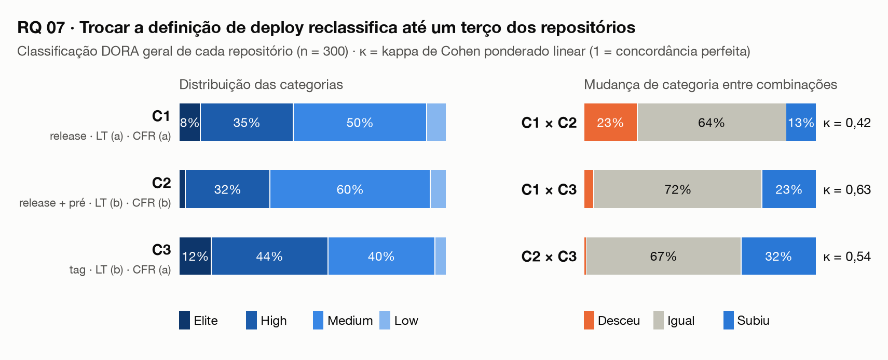 | 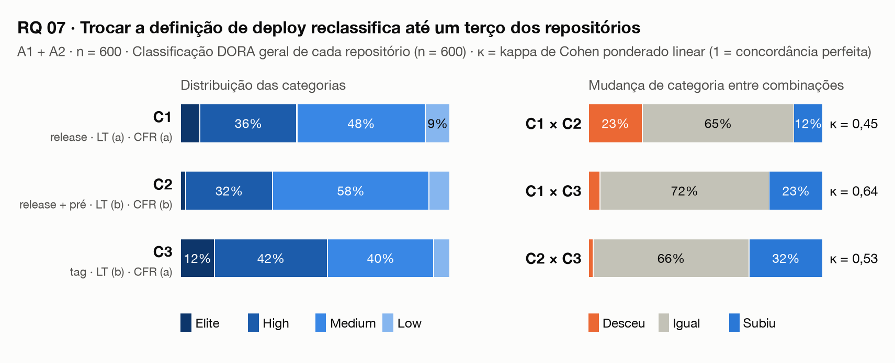 |

**Como ler.**
- **À esquerda:** a distribuição das categorias DORA gerais em cada combinação de definições.
- **À direita:** para cada par de combinações, a % de repositórios que **ficou na mesma categoria**, **subiu** ou **desceu**, e o κ de Cohen ponderado linear, em que 1 é concordância perfeita.

| Combinação | Unidade de deploy | Lead time | CFR |
| :--- | :--- | :--- | :--- |
| C1 (referência) | release | (a) | (a) |
| C2 | release + pré-release | (b) | (b) [PRELIMINAR] |
| C3 | tag | (b) | (a) |

**Resultado.**

| Par | Mudam de categoria (300 → 600) | κ ponderado (300 → 600) |
| :--- | :--- | :--- |
| C1 × C2 | 36% → 35% | 0,42 → 0,46 |
| C1 × C3 | 28% → 28% | 0,63 → 0,64 |
| C2 × C3 | 33% → 34% | 0,54 → 0,53 |

- **Entre 28% e 36% dos repositórios mudam de categoria** só por trocar a definição. A proporção praticamente não muda de 300 para 600, então o efeito não é ruído amostral.
- A concordância é **moderada**, com κ entre 0,42 e 0,64.
- A direção das mudanças segue o componente trocado:
  - em **C2**, ~23% descem e ~13% sobem, porque o CFR (b) é mais severo que o (a);
  - em **C3**, ~23% sobem e só ~5% descem, porque tags são mais frequentes que releases e o lead time (b) é menor.

Para a discussão: a classificação DORA de um repositório **não é robusta à definição operacional**, e isso se mantém com o dobro da amostra. As comparações entre estudos que usam proxies diferentes precisam ser feitas com cautela. A RQ07 final (#142) deve recalcular C2 com a heurística validada.

---

## 3.9 Comparação entre amostras

A pergunta desta seção é: **as conclusões dependem dos 300 repositórios que foram sorteados?** Ela é respondida de dois jeitos complementares:
1. **A1 × A2**, duas amostras **independentes**, sem nenhum repositório em comum: testes de hipótese por métrica.
2. **300 → 600 → 900:** se as estimativas ficam estáveis e mais precisas conforme a amostra cresce. Como os níveis se contêm (900 contém 600, que contém 300), aqui não cabe teste de hipótese, só a comparação das estimativas e dos intervalos.

As três amostras foram sorteadas com sementes distintas (42, 2026 e 2027) e **não têm nenhum repositório em comum**: a união das três dá exatamente 900 repositórios distintos. Esse desenho é o que operacionaliza o critério de **confiabilidade** da IEEE 1061 — uma métrica é confiável quando satisfaz os demais critérios de forma repetida, e não em um único conjunto de dados.

### Funil da amostra 2

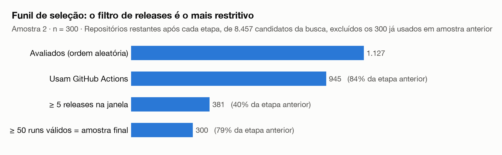

O funil da A2 se comporta como o da A1:

| Filtro | Passaram na A1 | Passaram na A2 |
| :--- | ---: | ---: |
| Usa Actions | 85% | 84% |
| ≥ 5 releases | 43% | 40% |
| ≥ 50 runs | 75% | 79% |

Foram avaliados 1.108 candidatos para a A1 e 1.127 para a A2, e nenhum descarte foi por erro de coleta. O dataset da A2 se reproduz de forma idêntica a partir do cache.

### A1 × A2: as distribuições são as mesmas?

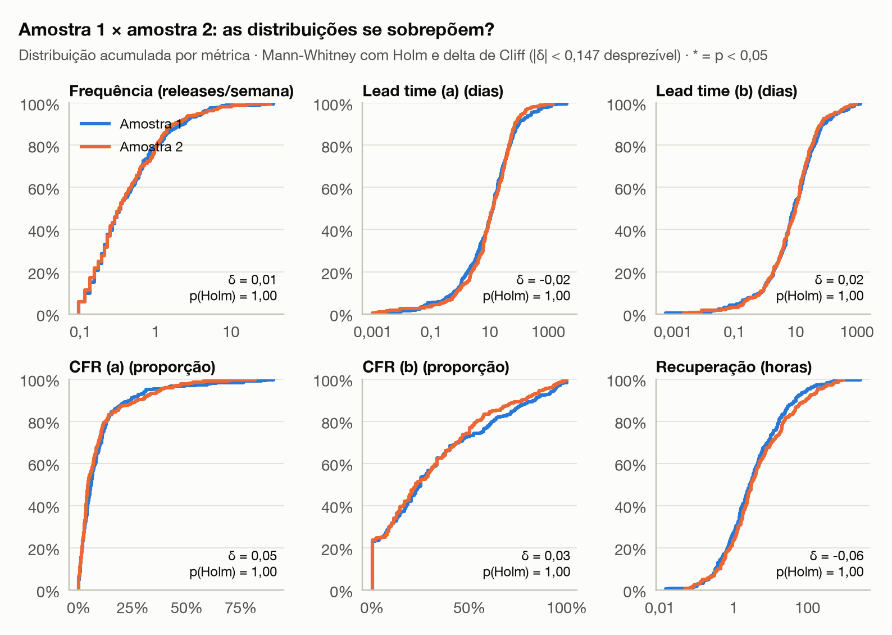

**Como ler.** Uma curva acumulada por métrica, com a A1 em azul e a A2 em laranja. Curvas sobrepostas indicam distribuições iguais. No canto de cada painel aparecem o delta de Cliff (δ, tamanho da diferença, entre −1 e 1) e o p do Mann-Whitney corrigido por Holm.

**Tabela 4 — A1 × A2** (`analise/saida/comparacao/tabelas/a1_x_a2_mann_whitney.csv`).

| Métrica | Mediana A1 | Mediana A2 | δ de Cliff | p (Holm) |
| :--- | ---: | ---: | ---: | ---: |
| Frequência (releases/semana) | 0,35 | 0,33 | 0,01 | 1,00 |
| Lead time (a) (dias) | 13,2 | 12,7 | −0,02 | 1,00 |
| Lead time (b) (dias) | 8,8 | 10,0 | 0,02 | 1,00 |
| CFR (a) | 5,6% | 4,2% | 0,05 | 1,00 |
| CFR (b) [PRELIMINAR] | 25,0% | 22,2% | 0,03 | 1,00 |
| Recuperação (horas) | 2,8 | 3,0 | −0,06 | 1,00 |

**Resultado: as duas amostras são estatisticamente indistinguíveis.**
- Em nenhuma métrica há diferença significativa.
- Todos os |δ| são < 0,07, bem abaixo do limite de efeito desprezível (0,147).

### 300 → 600 → 900: as estimativas se mantêm?

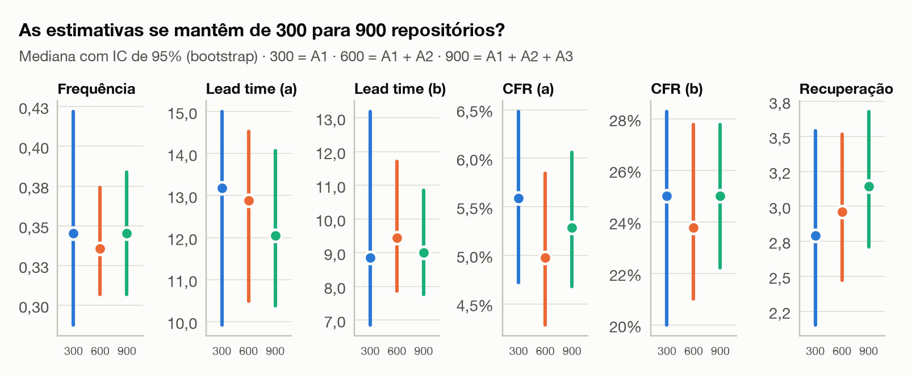

**Como ler.** Para cada métrica, o ponto é a mediana e a barra é o intervalo de confiança de 95% (bootstrap), com 300 em azul, 600 em laranja e 900 em verde. Se a mediana de um nível cai dentro do intervalo do anterior, a estimativa se manteve. Uma barra mais curta indica mais precisão.

**Tabela 4b — Estimativas nos três níveis** (`analise/saida/comparacao/tabelas/estimativas_300_600_900.csv`). Mediana com IC de 95%.

| Métrica | 300 | 600 | 900 | Redução do IC |
| :--- | ---: | ---: | ---: | ---: |
| Frequência (releases/semana) | 0,35 [0,29; 0,42] | 0,34 [0,31; 0,37] | 0,35 [0,31; 0,38] | 43% |
| Lead time (a) (dias) | 13,17 [9,92; 15,00] | 12,88 [10,48; 14,54] | 12,04 [10,38; 14,06] | 27% |
| Lead time (b) (dias) | 8,85 [6,86; 13,19] | 9,44 [7,86; 11,71] | 9,01 [7,76; 10,85] | 51% |
| CFR (a) | 5,6% [4,7%; 6,5%] | 5,0% [4,3%; 5,9%] | 5,3% [4,8%; 6,1%] | 21% |
| CFR (b) | 25,0% [20,0%; 28,4%] | 23,8% [20,9%; 27,8%] | 25,0% [22,3%; 27,9%] | 33% |
| Recuperação (horas) | 2,79 [2,15; 3,54] | 2,96 [2,47; 3,52] | 3,14 [2,71; 3,68] | 30% |

**Resultado.**
- **Todas as medianas de 600 e de 900 caem dentro do intervalo de confiança de 300.** A frequência e o CFR (b) voltam ao mesmo valor em 900 que tinham em 300.
- **Os intervalos ficam de 21% a 51% mais estreitos** ao triplicar a amostra, como esperado. O lead time (b) é o que mais ganha precisão.
- As conclusões qualitativas das RQ01–RQ05 e da RQ07 **não mudam** em nenhum dos três níveis: mesmo perfil DORA, mesma divergência entre os proxies de CFR, mesma proporção de reclassificação.
- **A exceção é a RQ06:** com 600, a linguagem passa a ter efeito significativo, que em 300 estava escondido pela falta de poder estatístico. Isso não é a métrica mudando, é o teste ganhando poder — motivo para reportar sempre o `n` e o tamanho de efeito ao lado do p-valor.

**Leitura para a validade de conclusão.** A estabilidade acima é evidência **positiva** de confiabilidade. Ela não vale, porém, para toda medida do estudo: a cobertura da API de Deployments varia de forma detectável entre as três amostras (seção 3.12), e esse contraste é informativo — o mesmo desenho que confirma a robustez das métricas DORA detecta a fragilidade de uma medida auxiliar.

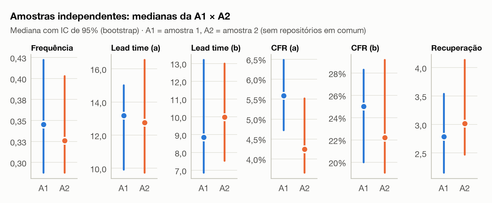

Para a discussão (validade de conclusão): os resultados descritivos são **robustos à amostra sorteada**. Já os testes com muitos grupos (RQ06) são sensíveis ao tamanho da amostra, e por isso devem ser reportados com o `n` e o tamanho de efeito, não só com o p-valor.

---

## 3.10 Medidas alternativas (issue #154)

As métricas DORA aqui são proxies. Esta seção acrescenta quatro medidas, calculadas dos mesmos dados (`data/*/medidas_alternativas.csv`, sem novas chamadas à API), para checar e complementar esses proxies. A análise formal de convergência entre eles fica na #156.

**Tabela 5 — Medidas alternativas, 300 × 600** (`analise/saida/tabelas/medidas_alternativas.csv` e `analise/saida/600/tabelas/medidas_alternativas.csv`).

| Medida | Mediana 300 [IQR] | Mediana 600 [IQR] | % Elite (≤ 15%) 300 / 600 |
| :--- | :--- | :--- | :--- |
| CFR (a), falha de CI | 5,6% [2,2% – 11,2%] | 5,0% [2,2% – 10,8%] | 84% / 84% |
| CFR (a+), com reexecuções | 6,2% [2,5% – 12,3%] | 5,9% [2,6% – 12,2%] | 82% / 81% |
| Taxa de reexecução de runs | 0,2% [0% – 1,1%] | 0,2% [0% – 1,1%] | — |
| CFR (b), release corretiva [PRELIMINAR] | 25,0% [5,2% – 56,5%] | 23,8% [5,2% – 50,0%] | 37% / 38% |
| CFR (c), release revertida | 0% [0% – 0%] | 0% [0% – 0%] | 99% / 99% |
| Feedback do CI (minutos) | 3,0 [1,2 – 7,1] | 3,0 [1,2 – 7,1] | — |
| Commits no padrão convencional | 34% [4% – 74%] | 33% [4% – 76%] | — |
| Repositórios que adotam o padrão (≥ 50%) | 41% | 40% | — |

### CFR (a+): instabilidade escondida no CI

A API do GitHub devolve **só a última tentativa** de cada run. Se o CI falhou e alguém mandou rodar de novo e passou, o CFR (a) enxerga só o sucesso, e essa instabilidade (testes *flaky*, falhas de infraestrutura) fica escondida. O CFR (a+) conta esses runs como falha e funciona como **limite pessimista**: o CFR de CI real fica entre (a) e (a+).

- 68% dos repositórios reexecutaram algum run, mas a taxa é baixa: mediana de 0,2% dos runs.
- O intervalo entre (a) e (a+) é estreito, cerca de 1 ponto percentual na mediana, e a proporção Elite cai só de 84% para 81–82%.
- **Conclusão:** a reexecução escondida **não muda** a leitura do CFR de CI. A objeção de que testes instáveis inflariam o CFR (a) vale para falhas que ninguém reexecutou, e essas o GitHub não permite separar.

### CFR (c): releases revertidas

Uma release R conta como falha se algum commit dela foi desfeito (`This reverts commit <sha>`) por um commit de uma release publicada até 30 dias depois. É o sinal mais explícito de "a mudança deu errado" que existe nos dados (Shimagaki et al., ICSME 2016).

- **Revert é raro:** 223 de 17.726 releases avaliadas (1,3%). Em 82% dos repositórios nenhuma release foi revertida, e 99% são Elite por esse proxy.
- O CFR (c) é um **limite inferior** de falha: só capta falhas resolvidas por revert. Correções por novo commit (*fix forward*) ficam de fora.

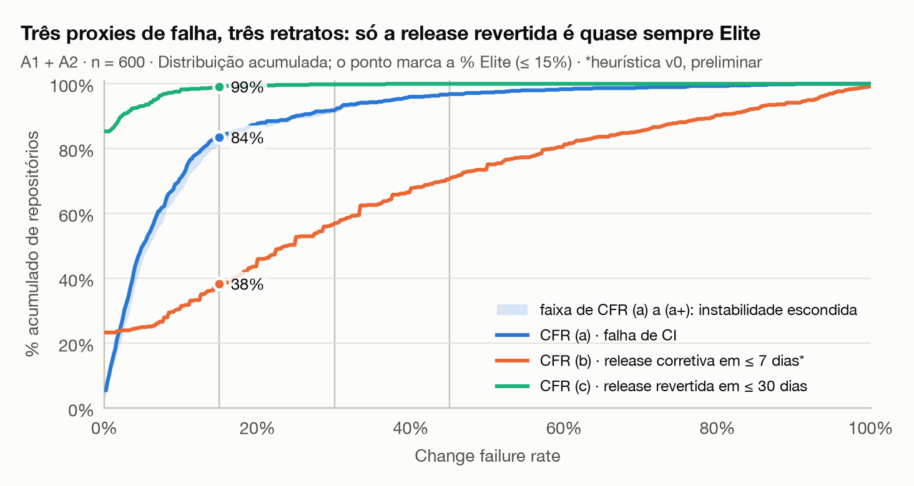

**Como ler.** É a mesma curva acumulada da RQ03, agora com três proxies:
- a faixa azul clara vai do CFR (a) ao CFR (a+);
- os pontos marcam a % Elite de cada proxy.

A versão com 300 está em `analise/saida/figuras/fig13_cfr_proxies.png`.

**Resultado:** o mesmo conjunto de repositórios aparece como **99% Elite** (revert), **84% Elite** (CI) ou **38% Elite** (release corretiva v0), conforme o proxy. Os três também quase não se correlacionam entre si (Spearman de 0,03 a 0,16 com 600). É um primeiro indício, a ser formalizado na #156, de que **"falha" depende inteiramente do proxy** e de que cada um mede um fenômeno diferente.

### Ciclo de feedback do CI

| Amostra 1 (300) | A1 + A2 (600) |
| :---: | :---: |
| 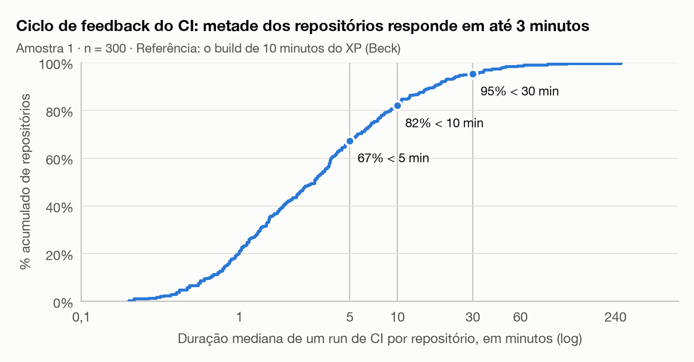 | 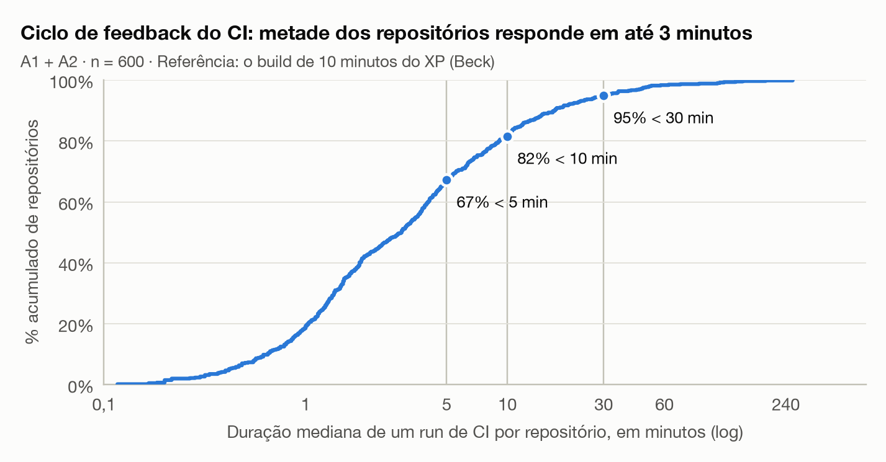 |

**Como ler.** É a curva acumulada da duração mediana de um run de CI em cada repositório, em escala log. Os pontos marcam a % abaixo de 5, 10 e 30 minutos.

**Resultado:** metade dos repositórios tem CI que responde em até **3 minutos**, e **82%** ficam abaixo dos 10 minutos do "build de 10 minutos" do XP. O feedback rápido é uma das três dimensões do framework DevEx (Noda et al., 2023).

### Distribuição do trabalho (Conventional Commits)

| Amostra 1 (300) | A1 + A2 (600) |
| :---: | :---: |
| 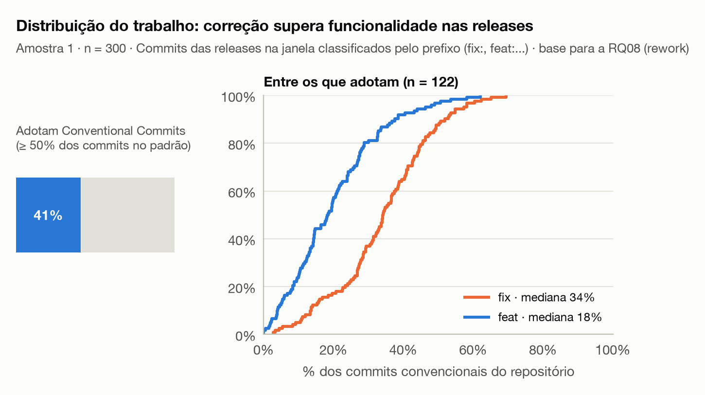 | 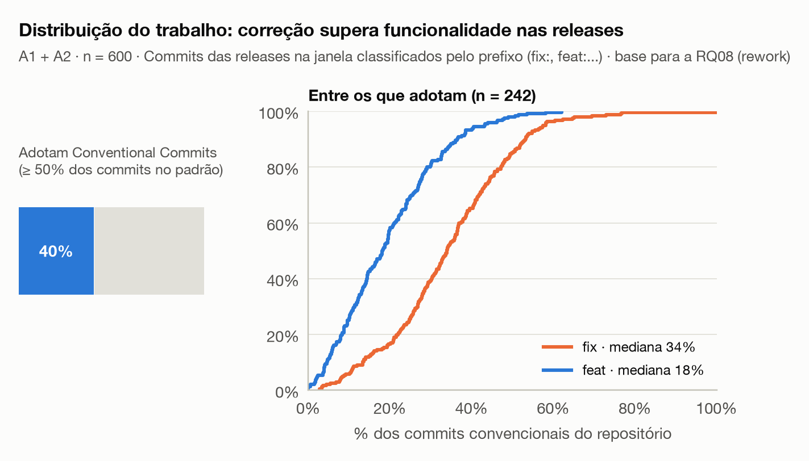 |

**Como ler.**
- À esquerda: a % de repositórios que adotam Conventional Commits (pelo menos metade dos commits no padrão).
- À direita: entre os que adotam, a curva acumulada da % de commits `fix` e `feat` de cada repositório.

**Resultado:**
- **40% dos repositórios adotam o padrão.**
- Entre eles, os commits de **correção superam os de funcionalidade**: mediana de 34% de `fix` contra 18% de `feat`.
- Isso dá uma medida de **retrabalho** independente de releases e de CI, e alimenta a RQ08 (rework rate, #142).
- Limitação: só vale para quem adota o padrão, o que restringe a amostra a 40%.

### O que muda de 300 para 600

Nenhuma das medidas alternativas muda de forma relevante: as medianas, os IQR e as proporções da Tabela 5 são praticamente iguais nas duas versões, o que reforça a robustez vista na seção 3.9.

## 3.11 RQ 08 (bônus) — Evolução temporal

> A outra opção do bônus, a rework rate, está na seção 3.10 (issue #142). Esta seção responde à RQ08 pela opção de evolução temporal (issue #158): os repositórios melhoram ou pioram nas métricas DORA ao longo dos 12 meses da janela?

**Armadilha estatística, decidida antes de olhar o resultado.** O enunciado sugere métricas por trimestre com o teste de Mann-Kendall. Com só 4 pontos por série, esse teste nunca alcança p < 0,05, mesmo com a série perfeitamente monótona (o menor p bilateral possível com n = 4 é ≈ 0,089). Por isso a análise principal usa a **série mensal** (12 pontos), em que o teste tem poder de verdade; o recorte trimestral fica só como leitura visual na Figura 18 (linhas verticais), sem teste de hipótese.

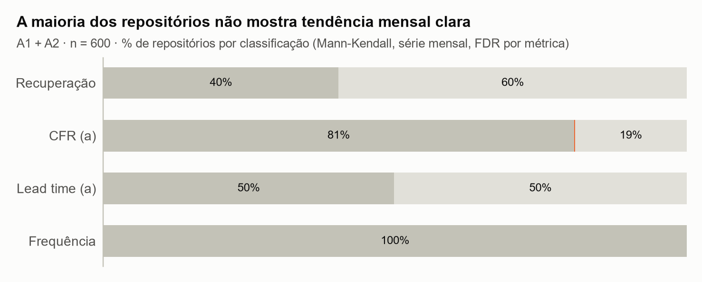

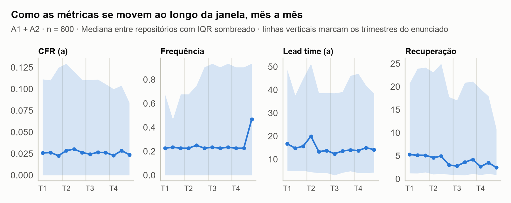

**Como ler.**
- Mann-Kendall por repositório e por métrica, mês a mês, mínimo de 8 dos 12 meses com dado (senão "dados insuficientes"). "Melhora" e "piora" dependem da métrica: frequência melhora subindo; lead time, CFR e recuperação melhoram descendo.
- São ~250 a 600 testes por métrica (repositórios com menos de 8 meses de dado ficam fora): correção de **Benjamini-Hochberg (FDR)**, reportada ao lado do Holm nas tabelas. Com tantos testes simultâneos, o Holm fica conservador demais; o FDR é o resultado principal.
- A Figura 18 mostra a mediana entre repositórios a cada mês, com a faixa entre Q1 e Q3 sombreada.

**Resultado, com 600 (A1 + A2).**

| Métrica | % com p bruto < 0,05 | % significativo após FDR | % "dados insuficientes" |
| :--- | :---: | :---: | :---: |
| Frequência | 16,8% | 0% | 0% |
| Lead time (a) | 16,7% | 0% | 50,2% |
| CFR (a) | 13,2% | 0,17% (1 repositório, piora) | 19,2% |
| Recuperação | 16,5% | 0% | 59,7% |

- **O teste bruto, sem correção, "encontra" tendência em 13% a 17% dos repositórios em todas as métricas** — bem mais que os 5% esperados por acaso num teste isolado, o que sugere que há, sim, alguma oscilação mensal real nas séries.
- **Depois da correção por FDR, quase nada sobrevive**: só 1 dos 600 repositórios mantém uma tendência significativa (CFR a, piora). Com 250 a 600 testes simultâneos por métrica, o FDR exige um p bruto bem menor que 0,05 pra sobreviver (o menor p-valor FDR observado foi 0,033, só na CFR). É o retrato didático de por que a correção de múltiplos testes importa: a aparência de 1 em cada 6 repositórios "mudando" vira ruído estatístico quase por completo quando se testa centenas deles ao mesmo tempo.
- **"Dados insuficientes" é alto em lead time e recuperação** (50% e 60%) porque nem todo repositório publica release ou tem episódio de falha em pelo menos 8 dos 12 meses — frequência nunca é "insuficiente" porque zero releases no mês é um valor válido (zero), não um dado faltante.
- **A Figura 18 mostra um salto na mediana de frequência no último mês da janela** (de ≈ 0,23 para ≈ 0,47 release/semana). Não há teste de hipótese que sustente isso como tendência (o Mann-Kendall olha a série inteira, não só a ponta), e o padrão é compatível com um viés de seleção: o critério de inclusão (seção 3.2) exige atividade mínima dentro da janela, o que tende a favorecer repositórios com releases recentes bem próximas do fim da coleta. Fica registrado como limitação, não como achado de tendência.

Para a discussão: o resultado da RQ08 não aponta melhora nem piora sistemática nas métricas DORA ao longo do ano, na amostra estudada. A conclusão mais defensável é metodológica, não substantiva: com 12 meses e centenas de repositórios testados ao mesmo tempo, a correção de múltiplos testes consome quase todo o poder estatístico disponível para detectar tendência individual por repositório. Uma análise de tendência agregada (por exemplo, a mediana por mês ao longo da amostra inteira, sem testar repositório por repositório) teria mais poder, mas também mistura tendência real com mudança de composição da amostra ao longo do tempo — e não foi o que esta issue pediu.

---

## 3.12 Validade das medidas (issues #156 e #166)

As seções anteriores respondem **quanto** vale cada métrica. Esta responde uma pergunta anterior: **as métricas medem o que dizem medir, e os números suportam as operações que fazemos com eles?** O material completo está em `docs/base-teorica.md`.

### Por que mediana e IQR, demonstrado

O enunciado exige mediana e IQR. Os dados permitem demonstrar que é obrigatório, e não apenas aceitar como praxe.

| Métrica | Assimetria | p (Shapiro-Wilk) | Normal? | Média ÷ mediana |
| :--- | ---: | ---: | :--- | ---: |
| Frequência | 8,26 | 1,1 × 10⁻³² | não | 3,19× |
| Lead time (a) | 9,96 | 2,6 × 10⁻³³ | não | 5,71× |
| Lead time (b) | 5,38 | 4,1 × 10⁻³¹ | não | 5,70× |
| CFR (b) | 0,73 | 3,7 × 10⁻¹⁴ | não | — |
| Recuperação | 12,9 | 1,7 × 10⁻³³ | não | — |

Nenhuma das cinco é normal. A média do lead time é quase **seis vezes** a mediana: dizer que "o lead time típico é de 75 dias" descreveria um repositório que não existe, já que três quartos da amostra está abaixo de 37 dias. O logaritmo melhora muito (a assimetria da frequência cai de 8,26 para 1,01) mas não alcança normalidade — as métricas são **aproximadamente**, não exatamente, lognormais, o que sustenta o uso de testes não paramétricos em vez de transformar e aplicar teste paramétrico.

### A contagem de releases não é Poisson

A Poisson é o modelo natural para contagem de eventos em intervalo fixo, e exige **E[X] = Var[X]**. Na amostra:

```
n = 300     média = 57,39     variância = 28.302,10
índice de dispersão Var/E = 493,2        (Poisson exige ≈ 1)
qui-quadrado χ² = 147.453, gl = 299, p < 10⁻³⁰⁰
```

**Rejeitada, com superdispersão de 493×.** As duas premissas falham por motivos reconhecíveis: a taxa não é constante entre repositórios — alguns publicam *nightly*, outros duas vezes por ano — e as releases não são independentes dentro de um repositório, já que vêm em rajadas e uma release corretiva é causada pela anterior. O modelo compatível é a **binomial negativa**, que acrescenta um parâmetro de dispersão.

A superdispersão é, por si, uma caracterização da amostra: a população de repositórios é profundamente heterogênea em ritmo de entrega, o que ajuda a explicar por que a classificação DORA em quatro faixas discrimina tão pouco (adiante).

### A recuperação tem taxa decrescente

Ajustando uma Weibull por repositório aos episódios de falha (238 repositórios com episódios suficientes), o parâmetro de forma β indica o regime: β < 1 é taxa de falha decrescente, β = 1 volta à exponencial, β > 1 é taxa crescente.

```
β mediano = 0,557       IQR = [0,459; 0,724]
β < 1 em 90,3% dos repositórios
```

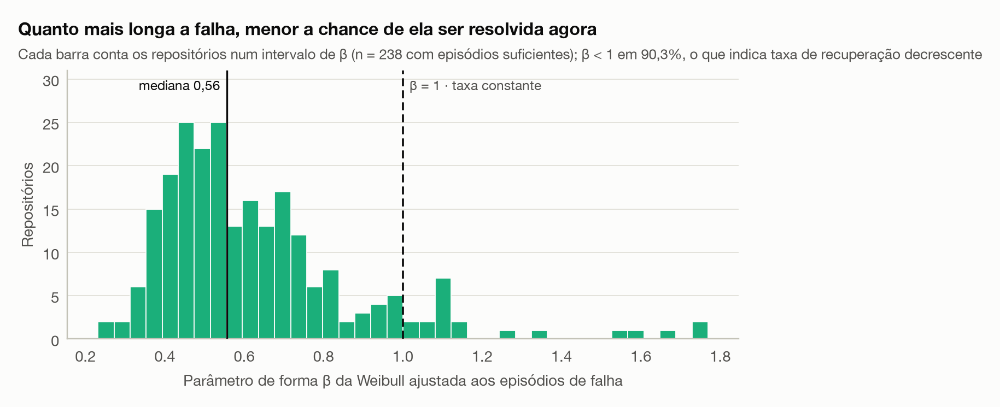

**Quanto mais tempo um episódio de falha já dura, menor a probabilidade de ele ser resolvido no instante seguinte.** Falhas curtas são corrigidas rápido; o episódio que se arrasta tende a se arrastar muito mais. Isso é invisível na mediana do MTTR reportada na RQ04 — duas populações com a mesma mediana podem ter dinâmicas opostas — e qualifica a métrica de recuperação do DORA, que trata todos os episódios como equivalentes.

### A normal aparece na média, e só com amostra grande

A normal não descreve as métricas brutas, mas sustenta a distribuição amostral via Teorema Central do Limite, e é isso que faz os testes das RQ05 e RQ06 valerem apesar de os dados não serem normais. Reamostrando a própria população (10.000 reamostragens por tamanho):

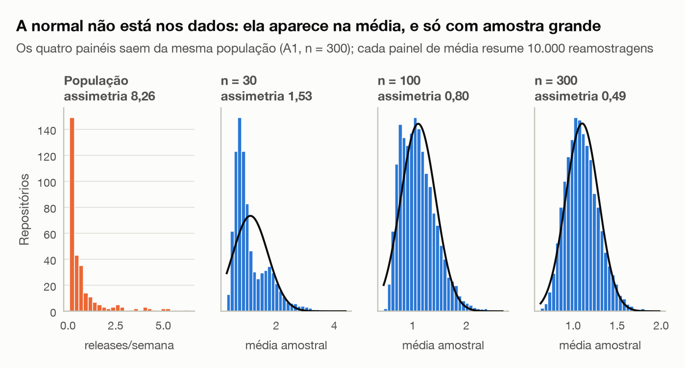

| Distribuição | Assimetria |
| :--- | ---: |
| População (frequência de deploy) | 8,26 |
| Média de amostras de n = 30 | 1,53 |
| Média de amostras de n = 100 | 0,80 |
| Média de amostras de n = 300 | 0,49 |

**A regra de bolso "n ≥ 30 basta" falha nesta população.** A convergência só fica convincente perto de n = 300. Os testes sobre a amostra inteira estão em terreno firme; os de **subgrupo** da RQ06 — quartis de estrelas, linguagens com poucos repositórios — operam com n muito menor, onde a aproximação não vale. É mais um argumento para os testes não paramétricos e para reportar tamanho de efeito.

### As faixas DORA separam o que as define, e pouco além

Um valor de corte só é útil se separar os componentes em alguma dimensão que não seja a própria métrica que o construiu. Kruskal-Wallis entre Elite/High/Medium/Low, p corrigido por Holm:

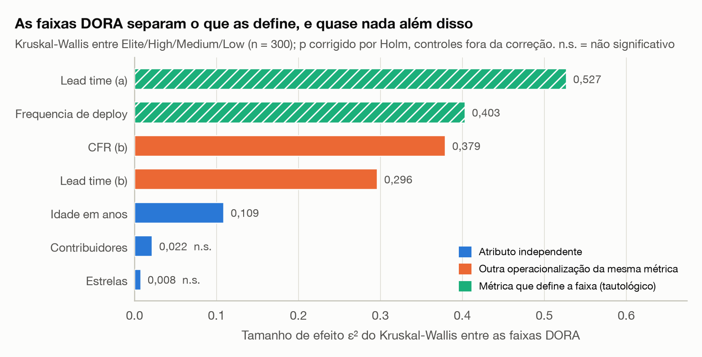

| Atributo | Tipo | ε² | p (Holm) | Separa? |
| :--- | :--- | ---: | ---: | :--- |
| Lead time (a) | controle tautológico | 0,527 | — | — |
| Frequência de deploy | controle tautológico | 0,403 | — | — |
| CFR (b) | outra operacionalização | 0,379 | 1,0 × 10⁻²³ | sim |
| Lead time (b) | outra operacionalização | 0,296 | 4,9 × 10⁻¹⁸ | sim |
| Idade em anos | independente | 0,109 | 1,2 × 10⁻⁶ | sim |
| Contribuidores | independente | 0,022 | 0,179 | **não** |
| Estrelas | independente | 0,008 | 0,512 | **não** |

**A classificação é quase toda autorreferente.** Ela separa fortemente nas variantes alternativas das próprias métricas — o CFR (b) chega a ε² = 0,379, perto do controle tautológico de 0,403 —, o que é **validade convergente** e serve à RQ07, mas não é poder discriminante. Contra popularidade e tamanho de equipe, as faixas não separam nada.

A limitação precisa constar: o critério fala em separar alta e baixa **qualidade**, e o estudo não dispõe de desfecho externo de qualidade — nenhuma medida de incidente em produção ou de satisfação independente do pipeline. É a mesma lacuna que impede avaliar a **previsibilidade** das métricas, e tem a mesma causa: todo o processo de entrega é medido por proxies do próprio GitHub.

### A relação da RQ05 não é tamanho disfarçado

Repositórios grandes têm mais releases, mais runs, mais contribuidores e mais issues ao mesmo tempo, o que torna o tamanho um candidato natural a variável de confusão — é o padrão que El Emam et al. (2001) encontraram ao controlar o tamanho da classe nas métricas CK. Testado por estratificação em quartis e por correlação parcial de Spearman, em frequência × CFR (b):

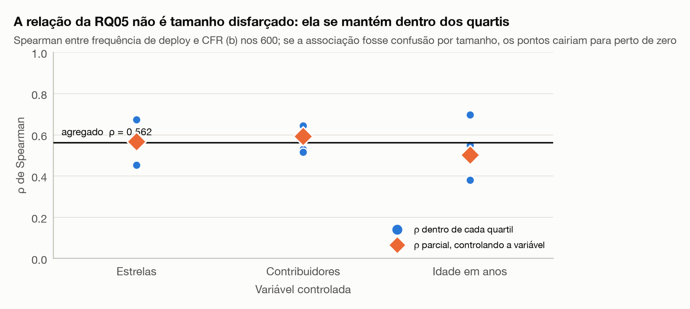

| Controle | Q1 | Q2 | Q3 | Q4 | ρ parcial |
| :--- | ---: | ---: | ---: | ---: | ---: |
| Estrelas | 0,547 | 0,577 | 0,454 | 0,674 | 0,568 |
| Contribuidores | 0,612 | 0,645 | 0,529 | 0,517 | 0,593 |
| Idade em anos | 0,698 | 0,550 | 0,387 | 0,381 | 0,503 |

ρ agregado = 0,562. A maior queda na parcial é de 0,059, e os doze estratos mantêm o mesmo sinal. **A ameaça de validade interna fica fechada**, com resultado negativo — verificação feita, confusão não encontrada.

Fica, porém, um alerta de **validade de constructo** em aberto: o ρ de 0,562 é positivo e forte, e o CFR (b) conta releases seguidas de corretiva em até 7 dias. Quem publica com mais frequência tem naturalmente mais chance de ter *alguma* release nessa janela, então parte da associação pode estar embutida na definição da métrica. É verificável comparando o CFR (b) observado com o esperado sob publicação aleatória na mesma cadência.

### DORA e fluxo por PR não medem a mesma coisa

Com as medidas de fluxo coletadas via GraphQL para os 900 repositórios (padrões CHAOSS, Flow Framework e SPACE), é possível perguntar se o DORA por release e o fluxo por PR são duas medições do mesmo constructo. Spearman por repositório, p corrigido por Holm:

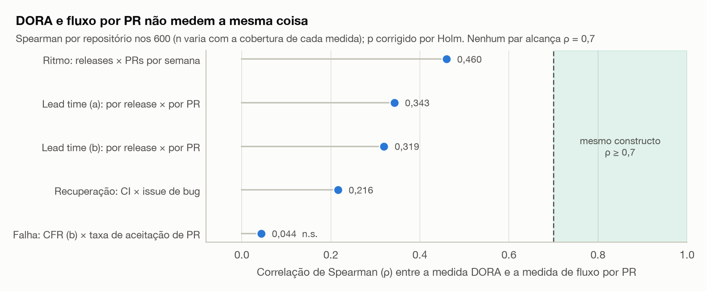

| Par | n | ρ | ρ² | p (Holm) |
| :--- | ---: | ---: | ---: | ---: |
| Ritmo: releases × PRs por semana | 600 | 0,460 | 0,211 | 5,2 × 10⁻³² |
| Lead time (a): por release × por PR | 574 | 0,343 | 0,117 | 1,2 × 10⁻¹⁶ |
| Lead time (b): por release × por PR | 574 | 0,319 | 0,102 | 1,3 × 10⁻¹⁴ |
| Recuperação: CI × issue de bug | 461 | 0,216 | 0,047 | 5,7 × 10⁻⁶ |
| Falha: CFR (b) × taxa de aceitação de PR | 597 | 0,044 | 0,002 | 0,288 (n.s.) |

**Nenhum par alcança ρ = 0,7**, o limiar convencional para tratar duas medidas como do mesmo constructo. O par mais direto — "quanto tempo uma mudança leva para chegar ao usuário", medido por release e medido por PR — compartilha **10% da variância**; os outros 90% são outra coisa. E o último par é o mais contundente: o CFR por release e a taxa de aceitação de PR têm associação **estatisticamente nula** mesmo com n = 597, ou seja, qualidade medida na entrega e qualidade medida na revisão não são a mesma dimensão.

**Esta é a evidência mais direta contra tratar o DORA como *a* medida de desempenho de engenharia.** Ele é *uma* lente — a da entrega por release — e outra lente legítima, a do fluxo de trabalho por PR, ordena os mesmos repositórios de maneira substancialmente diferente.

### Cobertura das medidas de fluxo, e uma instabilidade

| Medida | A1 | A2 | A3 | 900 | Papel |
| :--- | ---: | ---: | ---: | ---: | :--- |
| Lead time por PR | 99,3% | 98,0% | 97,7% | 98,3% | principal |
| Primeira resposta | 98,7% | 99,3% | 98,3% | 98,8% | principal |
| Taxa de aceitação de PR | 99,3% | 99,7% | 99,7% | 99,6% | principal |
| Resolução de issue de bug | 81,0% | 82,7% | 77,7% | 80,4% | principal |
| **Deployments API** | **31,3%** | **41,7%** | **43,3%** | **38,8%** | subamostra |

As quatro primeiras medidas têm cobertura alta e medianas estáveis entre as três amostras (lead time de PR 8,99 / 9,47 / 10,12 h; taxa de aceitação 0,76 / 0,76 / 0,78). A **cobertura da API de Deployments, porém, sobe monotonicamente**, e o padrão não é ruído: qui-quadrado 3×2 com p = 0,0048 e teste de tendência de Cochran-Armitage com z = 3,02, p = 0,0026.

Duas explicações foram testadas e nenhuma se sustentou. **Não é perfil dos repositórios:** estrelas, contribuidores, idade e número de releases não diferem entre as amostras (Kruskal-Wallis com p entre 0,35 e 0,92). **Não é linguagem:** a associação existe mas é fraca e vai na direção contrária ao esperado (Rust 51,2%, JavaScript 29,8%), e a diferença entre amostras sobrevive ao controle (p = 0,0395 fora de TypeScript e JavaScript).

O resultado honesto é que **a cobertura dessa medida varia entre amostras independentes do mesmo desenho, de forma estatisticamente detectável, e a causa não foi identificada**. Isso reforça mantê-la como subamostra de validação e não como medida principal, e é evidência **negativa** sobre a confiabilidade — que vale tanto quanto a positiva da seção 3.9. Hipóteses remanescentes, que os dados atuais não separam: a API devolve o estado corrente e as três coletas ocorreram em dias diferentes; ou o truncamento da paginação age de forma desigual; ou é variação amostral sem causa estrutural.

---

## 3.13 O CFR (b) mede falha ou mede cadência? (proposta além do escopo)

A seção 3.12 deixou um alerta de validade de constructo em aberto: a correlação positiva entre frequência de deploy e CFR (b) poderia estar **embutida na definição da métrica**. Esta seção testa essa hipótese, e o resultado obriga a reinterpretar a RQ05 na variante (b).

### O mecanismo suspeito

O CFR (b) classifica uma release como falha se ela for seguida, em até 7 dias, por uma release corretiva. Isso cria uma dependência estrutural: **uma release só pode ser classificada como falha se existir alguma release nos 7 dias seguintes.** Quem publica com mais frequência tem, por construção, mais releases dentro dessa janela — e portanto mais oportunidades de ser classificado como falha, independentemente da qualidade do que entrega.

Chamamos de **taxa de oportunidade** a proporção de releases avaliadas que têm alguma release seguinte em até 7 dias. Ela é o limite superior do CFR (b): nenhum repositório pode ter CFR (b) maior que sua taxa de oportunidade. Nos 300 repositórios da A1, essa restrição é satisfeita em **todos** eles, o que valida o cálculo.

### O teste

Se o CFR (b) mede qualidade, a associação com a frequência deve sobreviver ao controle da oportunidade. Se mede cadência, ela deve desaparecer. O **CFR (b) condicional** é a razão entre o CFR (b) e a taxa de oportunidade: entre as releases que *tiveram* a chance de ser classificadas como falha, quantas de fato foram.

**Tabela 11 — Acoplamento entre CFR (b) e cadência de publicação** (`analise/saida/tabelas/distribuicoes_acoplamento.csv`). Spearman contra a frequência de deploy, n = 300.

| Série | ρ | p | Mediana |
| :--- | ---: | ---: | ---: |
| Taxa de oportunidade | **0,784** | 1,2 × 10⁻⁶³ | 0,400 |
| CFR (b) bruto | **0,604** | 3,3 × 10⁻³¹ | 0,250 |
| CFR (b) \| oportunidade | **−0,039** | **0,522 (n.s.)** | 0,856 |

### O resultado

**A associação entre frequência de deploy e CFR (b) desaparece por completo ao condicionar na oportunidade** (ρ = −0,039, p = 0,52). Ela não apenas enfraquece: some, e o sinal residual é negativo e indistinguível de zero.

A leitura é direta. A taxa de oportunidade, que é puramente um artefato de cadência, correlaciona-se com a frequência a ρ = 0,784 — mais forte que o próprio CFR (b) (ρ = 0,604). **O que a RQ05 detecta na variante (b) é predominantemente a cadência de publicação, e não uma relação entre velocidade e qualidade.**

Um segundo número reforça o diagnóstico: a mediana do CFR (b) condicional é **0,856**. Entre as releases que têm alguma release seguinte em até 7 dias, cerca de 86% dessas sucessoras são classificadas como corretivas pela heurística. Em outras palavras, **publicar de novo em menos de uma semana é, na prática, quase sinônimo de "falhou"** segundo a operacionalização adotada — o que é mais uma consequência da definição do que uma descoberta sobre os projetos.

### O que isso muda, e o que não muda

**Não invalida a métrica.** O CFR (b) continua sendo um proxy razoável de retrabalho de entrega, e a heurística corretiva foi validada contra a amostra-ouro (seção 2). O que ele não suporta é a leitura causal.

**Invalida uma leitura específica.** A conclusão "repositórios que entregam com mais frequência falham mais" não se sustenta para a variante (b). O resultado da RQ05 deve ser reportado com essa ressalva explícita, e a variante (a), que não tem esse acoplamento, passa a ser a leitura preferencial para a pergunta de velocidade × estabilidade.

**Sugere uma correção simples para trabalhos futuros.** Reportar o CFR (b) condicional ao lado do bruto separa as duas coisas: o bruto mistura cadência e qualidade, o condicional isola a parcela de qualidade. O custo é uma coluna a mais no dataset.

Esta análise não foi pedida pelo enunciado. Ela nasceu do alerta registrado na seção 3.12 e é o tipo de verificação que a teoria da medição exige de qualquer métrica derivada: **antes de interpretar uma correlação entre duas medidas, é preciso checar se uma delas não está definida em função da outra.**

---

## 3.14 Um modelo compatível para a contagem de releases (proposta além do escopo)

A seção 3.12 rejeitou a Poisson para `n_release` por superdispersão de 493×. Rejeitar um modelo é metade do trabalho; esta seção ajusta o modelo compatível e mede o ganho.

A **binomial negativa** acrescenta um parâmetro de dispersão `r` que acomoda heterogeneidade entre unidades: quanto menor o `r`, mais heterogênea a população. Ajustada por momentos sobre os 900 repositórios e comparada à Poisson por qui-quadrado de aderência em 8 faixas de quantil:

**Tabela 12 — Aderência da contagem de releases** (`analise/saida/tabelas/distribuicoes_aderencia.csv`).

| Modelo | χ² | gl | Parâmetro |
| :--- | ---: | ---: | :--- |
| Poisson | 3,05 × 10¹³ | 6 | λ = média |
| Binomial negativa | 1,60 × 10³ | 5 | r = 0,148 |

O χ² cai **dez ordens de grandeza**. A binomial negativa é incomparavelmente melhor que a Poisson — e ainda assim é formalmente rejeitada (p < 0,001). A leitura honesta é que ela captura a superdispersão, que é a violação dominante, mas a distribuição real tem estrutura adicional que nenhum dos dois modelos de um ou dois parâmetros descreve.

O valor de **r = 0,148** é o achado substantivo. Um `r` abaixo de 1 indica heterogeneidade extrema: a população de repositórios não se comporta como um grupo com ritmo comum e variação aleatória em torno dele, mas como uma mistura de regimes de publicação muito diferentes. Isso dá base quantitativa a uma afirmação que até aqui era qualitativa — **não existe "o" ritmo de entrega de um projeto open-source popular**, e qualquer sumário de tendência central para a população inteira esconde mais do que mostra.

É também a explicação estrutural para o resultado da seção seguinte: uma população com essa heterogeneidade não é bem representada por quatro faixas fixas.

---

## 3.15 Um índice contínuo em lugar das quatro faixas (proposta além do escopo)

A seção 3.12 mostrou que as faixas Elite/High/Medium/Low quase não discriminam fora das métricas que as definem. Esta seção propõe a alternativa que a teoria da medição indica e mede o que a categorização custa.

### Por que posto percentílico, e não escore z

Um índice composto precisa somar métricas em unidades diferentes — releases por semana, dias, proporções, horas. A padronização usual é o escore z, `(x − μ) ÷ σ`, mas ele é **inadequado aqui**: μ e σ não representam distribuições assimétricas como as da seção 3.12, e o resultado seria dominado pelos extremos.

O **posto percentílico** é a padronização correta para este caso. Ele é invariante a qualquer transformação monotônica, o que o torna lícito em escala ordinal, e é robusto a outliers por construção. Cada métrica é convertida ao seu posto percentílico, invertido quando menor é melhor (lead time, CFR, recuperação), e o índice é a média dos quatro postos — um número entre 0 e 1, em que 1 é o melhor desempenho relativo da amostra.

### O que as faixas escondem

| Faixa | n | Índice mediano | Mínimo | Máximo | Amplitude |
| :--- | ---: | ---: | ---: | ---: | ---: |
| Elite | 71 | 0,760 | 0,556 | 0,981 | 0,425 |
| High | 324 | 0,630 | 0,369 | 0,908 | 0,539 |
| Medium | 422 | 0,412 | 0,127 | 0,713 | 0,586 |
| Low | 83 | 0,259 | 0,083 | 0,497 | 0,414 |

A ordenação das medianas confirma que o índice e as faixas medem a mesma coisa (ρ = 0,804 entre eles). O problema está nas amplitudes: **as faixas se sobrepõem fortemente**. Um repositório classificado como Medium pode ter índice 0,713, acima da mediana da faixa High; um classificado como High pode ter índice 0,369, abaixo da mediana de Medium.

Dois números quantificam a perda:

**A categorização retém 64,2% da variância do índice.** Colapsar quatro medidas contínuas em quatro rótulos descarta mais de um terço da informação disponível.

**8,2% de todos os pares em faixas diferentes estão invertidos** — ou seja, em 21.121 dos 257.505 pares possíveis, o repositório da faixa supostamente melhor tem índice igual ou pior que o da faixa supostamente pior. A inversão não é uniforme:

| Par de faixas | Pares | Invertidos | Taxa |
| :--- | ---: | ---: | ---: |
| Elite × High | 23.004 | 3.614 | **15,7%** |
| High × Medium | 136.728 | 10.800 | 7,9% |
| Medium × Low | 35.026 | 6.247 | **17,8%** |
| Elite × Medium | 29.962 | 183 | 0,6% |
| High × Low | 26.892 | 277 | 1,0% |
| Elite × Low | 5.893 | 0 | 0,0% |

As faixas **extremas se separam perfeitamente** — nenhum par Elite × Low está invertido. O problema está nas fronteiras adjacentes: entre Elite e High, e entre Medium e Low, **cerca de um sexto dos pares contradiz a classificação**.

### O que isso significa

A classificação DORA funciona bem para o que ela foi desenhada: distinguir os extremos. Para comparar repositórios vizinhos, ela é pouco confiável, e a fronteira entre duas faixas adjacentes não corresponde a uma diferença real de desempenho em boa parte dos casos.

Isso conecta diretamente à seção 3.14: uma população com `r = 0,148` — heterogeneidade extrema — não é bem particionada por cortes fixos. E conecta à 3.12: se as faixas quase não discriminam atributos independentes, parte da razão é que elas descartam 35,8% da informação que as próprias métricas carregavam.

**A proposta prática é reportar os dois.** As faixas servem à comunicação e à comparação com a literatura do DORA; o índice contínuo serve à análise, porque preserva a ordenação e o tamanho das diferenças. O custo é uma coluna adicional no dataset, calculada em quatro linhas de código.

---

# 4. Discussão

Esta seção confronta o que o grupo esperava encontrar com o que os dados mostraram, e discute o que surpreendeu. As hipóteses informais foram registradas na Introdução, antes da análise.

## 4.1 O que confirmou a expectativa

**A entrega é bem mais lenta do que o discurso sobre CI/CD sugere.** A mediana de frequência fica em 0,35 release por semana nos 900 repositórios, ou aproximadamente uma release a cada vinte dias. Projetos open-source populares com GitHub Actions configurado não entregam continuamente; entregam em ciclos. A faixa Elite do DORA, que exige entrega diária ou mais, é ocupada por uma minoria pequena.

**As distribuições são fortemente assimétricas à direita.** Era a expectativa, e os dados a confirmam com folga: nenhuma das cinco métricas passa em teste de normalidade, e a média do lead time chega a ser quase seis vezes a mediana. A exigência do enunciado de reportar mediana e IQR deixou de ser convenção e passou a ser um resultado demonstrado (seção 3.12).

**Os dois proxies de CFR discordam.** A taxa de falha medida por CI (5,3%) e a medida por release corretiva (25,0%) diferem por um fator de quase cinco. Elas não medem a mesma coisa — falha de pipeline não é falha em produção — e a divergência confirma que a escolha de proxy domina o resultado da RQ03.

## 4.2 O que surpreendeu

### A classificação DORA discrimina muito pouco

A expectativa era que as faixas Elite/High/Medium/Low separassem repositórios em dimensões reconhecíveis. Elas não separam. Contra popularidade (ε² = 0,008) e número de contribuidores (ε² = 0,022), a classificação não tem poder discriminante algum, e nenhuma das duas sobrevive à correção de Holm.

O que as faixas separam bem são **variantes alternativas das próprias métricas que as definem** — o CFR (b) alcança ε² = 0,379, perto do controle tautológico de 0,403. Isso é validade convergente, não discriminância. A leitura honesta é que a classificação DORA, nesta amostra, é em grande medida uma relabelagem de variáveis contínuas, e não um agrupamento com significado externo.

Esse achado conversa com a superdispersão encontrada na contagem de releases (índice 493×): a população é tão heterogênea em ritmo de entrega que quatro faixas fixas não capturam a estrutura real.

### DORA e fluxo por PR são constructos distintos

Esta foi a maior surpresa. A expectativa implícita em boa parte da literatura é que medidas de desempenho de entrega convirjam — que um time "rápido" apareça rápido em qualquer lente. Não é o que acontece.

O par mais direto, lead time medido por release contra lead time medido por PR, compartilha **10% da variância** (ρ = 0,319, n = 574). E o CFR por release contra a taxa de aceitação de PR não tem associação alguma (ρ = 0,044, p = 0,288 após Holm, n = 597), apesar de ambos pretenderem falar sobre qualidade.

A consequência é direta e incômoda: **o DORA não é *a* medida de desempenho de engenharia, é *uma* medida**, e uma lente igualmente legítima — a do fluxo de trabalho por pull request, nos padrões CHAOSS e SPACE — ordena os mesmos 900 repositórios de maneira substancialmente diferente. Um repositório bem classificado pela cadência de release pode ser lento na revisão de código, e vice-versa.

### A recuperação não tem taxa constante

A métrica de tempo de recuperação do DORA é reportada como mediana, o que implicitamente trata todos os episódios de falha como equivalentes. O ajuste de uma Weibull aos episódios mostra que não são: o parâmetro de forma tem mediana 0,557, com β < 1 em 90,3% dos repositórios.

Isso significa **taxa de recuperação decrescente** — quanto mais tempo um episódio de falha já dura, menor a probabilidade de ele terminar no instante seguinte. Falhas curtas se resolvem rápido; o episódio que se arrasta tende a se arrastar muito mais. Duas populações com o mesmo MTTR mediano podem ter dinâmicas opostas, e a mediana não distingue.

### A regra "n ≥ 30" não vale aqui

Com a população tendo assimetria 8,26, a distribuição amostral da média ainda tem assimetria 1,53 em n = 30, e só se aproxima da normal perto de n = 300. A consequência prática recai sobre a RQ06: os testes por subgrupo — quartis de estrelas, linguagens com poucos repositórios — operam exatamente na faixa onde a aproximação não vale, o que reforça o uso de testes não paramétricos e a obrigação de reportar tamanho de efeito junto do p-valor.

## 4.3 O que o tamanho da amostra mudou, e o que não mudou

Triplicar a amostra de 300 para 900 **não alterou nenhuma conclusão qualitativa** das RQ01 a RQ05 nem da RQ07. Todas as medianas de 600 e de 900 caíram dentro do intervalo de confiança de 300, e os intervalos estreitaram de 21% a 51%.

A exceção é a RQ06: com 600 repositórios, a linguagem passa a apresentar efeito significativo que em 300 estava abaixo do limiar de detecção. Isso não é a métrica mudando de comportamento, é o teste ganhando poder — e é a razão de reportar sempre o `n` e o tamanho de efeito ao lado do p-valor.

Houve, porém, um resultado na direção oposta. A cobertura da API de Deployments **varia de forma detectável entre as três amostras independentes** (31,3%, 41,7% e 43,3%; qui-quadrado p = 0,0048, tendência de Cochran-Armitage p = 0,0026), e nem o perfil dos repositórios nem a linguagem explicam a diferença. O mesmo desenho amostral que confirma a robustez das métricas DORA detecta a fragilidade de uma medida auxiliar — e esse contraste é o que dá credibilidade ao primeiro resultado.

## 4.4 O que o estudo não consegue responder

Duas perguntas ficam estruturalmente fora de alcance, e por uma única causa: **todo o processo de entrega é medido por proxies do próprio GitHub**, sem nenhum desfecho externo de qualidade.

**Previsibilidade.** Não é possível verificar se as métricas preveem algum resultado que interesse — incidente em produção, satisfação de usuário, custo de manutenção —, porque nenhum desses desfechos está disponível.

**Poder discriminante contra qualidade.** Pelo mesmo motivo, o máximo que se consegue avaliar é se as faixas separam repositórios em atributos observáveis, e não se separam alta de baixa qualidade. O resultado negativo da seção 3.12 deve ser lido com essa ressalva: ele mostra que as faixas não separam popularidade nem tamanho de equipe, o que é informativo, mas não equivale a dizer que não separam qualidade.

Fechar essas lacunas exigiria dados de fora do GitHub — relatórios de incidente, pesquisas com mantenedores, dados de uso — e é a direção natural para uma extensão do estudo.

---

# 5. Ameaças à validade

As ameaças seguem a taxonomia de Cook & Campbell adotada por Wohlin et al. em engenharia de software. Cada uma é apoiada nos resultados da validação manual (seção 2) e das análises de sensibilidade e validade (seções 3.8 e 3.12), e é classificada entre **mitigada**, **parcialmente mitigada** e **aberta**.

## 5.1 Validade de construto

*Medimos o que achamos que medimos?*

### Release não é deploy — **aberta, por construção**

O GitHub não registra deploy em produção. A frequência de entrega é medida por releases publicadas, e o lead time pelo intervalo entre commit e release. Um projeto que publica release sem implantar, ou que implanta continuamente sem publicar release, é medido errado por este estudo.

A tentativa de medir deploy diretamente, pela API de Deployments, esbarrou em **cobertura de 38,8% nos 900 repositórios** — e numa cobertura que varia entre amostras de forma detectável (seção 3.12). Por isso ela entra como subamostra de validação, não como medida principal. A ameaça permanece aberta e é a limitação mais importante do trabalho.

### Falha de CI não é falha em produção — **parcialmente mitigada**

O CFR (a) mede falha de pipeline. A diferença em relação ao CFR (b), que mede release seguida de corretiva, é de quase cinco vezes (5,3% contra 25,0%), o que mostra que os dois proxies não são intercambiáveis. A mitigação adotada foi reportar as duas variantes lado a lado em todas as análises, em vez de escolher uma.

### O CFR (b) pode estar acoplado à cadência de publicação — **aberta**

A correlação entre frequência de deploy e CFR (b) é positiva e forte (ρ = 0,562). O CFR (b) conta releases seguidas de uma corretiva em até 7 dias, e quem publica com mais frequência tem naturalmente mais chance de ter *alguma* release nessa janela. **Parte da associação pode estar embutida na definição da métrica.**

A verificação é possível e não foi feita: bastaria comparar o CFR (b) observado com o esperado sob publicação aleatória na mesma cadência. Fica registrado como limitação conhecida.

### Mono-método — **parcialmente mitigada**

Todas as métricas vêm da mesma fonte, a API do GitHub. A mitigação foi medir os mesmos constructos por caminhos independentes: releases e CI (DORA clássico) contra pull requests e issues (CHAOSS, Flow, SPACE). O resultado foi revelador — **nenhum par de medidas do mesmo constructo alcança ρ = 0,7** (seção 3.12), o que indica que a operacionalização escolhida determina boa parte do resultado.

### Ausência de desfecho externo — **aberta**

Não há nenhuma medida de qualidade independente do pipeline: nem incidente em produção, nem satisfação de usuário, nem custo de manutenção. Isso impede avaliar a **previsibilidade** das métricas e limita a avaliação do **poder discriminante** a atributos observáveis, não a qualidade de fato.

## 5.2 Validade interna

*Há fatores não controlados que explicam os resultados?*

### Tamanho e popularidade como variável de confusão — **mitigada**

Repositórios grandes têm mais releases, mais runs, mais contribuidores e mais issues ao mesmo tempo, o que é o padrão que El Emam et al. (2001) encontraram ao controlar o tamanho da classe nas métricas CK.

A ameaça foi **testada por dois caminhos independentes** (seção 3.12): estratificação em quartis e correlação parcial de Spearman. O ρ agregado de 0,562 cai no máximo 0,059 na parcial, e os doze estratos mantêm o mesmo sinal, variando entre 0,381 e 0,698. **Verificação feita, confusão não encontrada.**

Reforça o resultado o fato de as faixas DORA não separarem estrelas (ε² = 0,008) nem contribuidores (ε² = 0,022).

### Repositórios antigos acumulam mais releases — **parcialmente mitigada**

A idade é o único atributo independente que as faixas DORA separam (ε² = 0,109, p = 1,2 × 10⁻⁶), ainda que com efeito pequeno. Como as métricas são normalizadas pela janela de 12 meses, o efeito de acumulação histórica é limitado, mas repositórios mais maduros podem ter processos mais estabelecidos. A idade entra como fator na RQ06 e o efeito é reportado.

### Heterogeneidade da população — **documentada, não mitigável**

A contagem de releases tem índice de dispersão de **493×** em relação ao que a Poisson exigiria (seção 3.12). A população não é homogênea em ritmo de entrega, e nenhum agrupamento em quatro faixas fixas captura essa estrutura. Isso não é um defeito do estudo, mas precisa ser considerado ao interpretar qualquer média ou classificação.

## 5.3 Validade externa

*Os resultados valem para além da amostra?*

### Amostra de repositórios populares — **aberta, por desenho**

O critério de inclusão exige no mínimo 1.000 estrelas, 5 releases publicadas e 50 workflow runs válidos na janela. Isso seleciona projetos open-source maduros e visíveis. **Nada aqui se generaliza para projetos corporativos, projetos pequenos ou projetos sem CI/CD estabelecido**, e as conclusões devem ser lidas restritas a esse contexto.

### Sobrevivência do funil — **documentada**

Dos 8.457 candidatos da busca, apenas uma fração chega à amostra: o filtro de releases é o mais severo, eliminando a maioria. O funil completo é reportado por amostra (seções 3.9 e 2), e a caracterização dos descartados está na seção de viés de seleção.

### Estabilidade entre amostras independentes — **mitigada para as métricas DORA**

Três amostras com sementes distintas e **nenhum repositório em comum** produzem estimativas que se sobrepõem em todas as seis métricas, com os intervalos estreitando de 21% a 51% ao triplicar o n (seção 3.9). É evidência de que os resultados não dependem do sorteio.

A mitigação **não se estende** à cobertura da API de Deployments, que varia entre as amostras de forma estatisticamente detectável e sem causa identificada (seção 3.12).

### Janela de observação única — **aberta**

Os dados cobrem 12 meses (01/10/2025 a 30/09/2026). A RQ08 não encontrou tendência sistemática dentro da janela, mas nada garante que outro período produziria os mesmos valores absolutos.

## 5.4 Validade de conclusão

*A análise estatística é adequada?*

### Múltiplas comparações — **mitigada**

Todas as famílias de testes são corrigidas por **Holm**, e a RQ08, com centenas de testes simultâneos, usa FDR. O efeito da correção é visível e foi reportado: na RQ08, apenas 1 dos 600 repositórios mantém tendência significativa após o FDR.

### Pressupostos de normalidade — **mitigada**

Nenhuma das cinco métricas passa em teste de normalidade (p entre 10⁻¹⁴ e 10⁻³³). Por isso **todos os testes são não paramétricos** — Spearman, Mann-Whitney, Kruskal-Wallis — e as estimativas centrais são medianas com IQR, nunca média e desvio.

### Poder estatístico em subgrupos — **parcialmente mitigada**

A demonstração do Teorema Central do Limite (seção 3.12) mostra que, nesta população, a distribuição amostral só se aproxima da normal perto de n = 300. Os testes por subgrupo da RQ06 operam com n muito menor. A mitigação é dupla: testes não paramétricos, que não dependem da aproximação, e **relato obrigatório do tamanho de efeito** (ε² e delta de Cliff) junto do p-valor.

O caso da linguagem na RQ06 ilustra o ponto: o efeito só passa a ser significativo com 600 repositórios, o que é ganho de poder e não mudança de fenômeno.

### Dados censurados — **mitigada**

Episódios de falha que não terminam dentro da janela e releases publicadas nos últimos 7 dias ficam fora dos denominadores, e a proporção censurada é reportada por repositório em vez de ser descartada em silêncio.

### Truncamento da paginação — **documentada**

A coleta GraphQL tem limite por repositório. O truncamento atinge cerca de 3% dos PRs e 8% a 10% dos deployments, e é marcado por repositório, de modo que as medidas afetadas são lidas como limite inferior.

---

# 6. Replicação cruzada

> **Seção pendente da entrega final.** O professor sorteia, para cada grupo, o pipeline de outro grupo da turma. Esta seção só pode ser escrita depois do sorteio e da execução.

## 6.1 O que esta seção deve conter

Conforme a seção 9 do enunciado, o grupo **replicador** deve registrar aqui:

1. **Execução do pipeline do grupo sorteado usando apenas o README**, sobre uma subamostra de 30 repositórios do dataset original, sem pedir ajuda ao grupo autor. Travar é um resultado a registrar, não um fracasso a esconder.
2. **Comparação com o CSV original:** diferença relativa por métrica e percentual de repositórios com a mesma classificação DORA. Pequenas diferenças são esperadas, porque os repositórios continuam recebendo commits e as datas de coleta diferem.
3. **Issues abertas no repositório do grupo autor**, com evidências: comando executado, mensagem de erro, valores esperados e obtidos.
4. **Resposta:** o estudo foi reproduzível? O que impediu ou dificultou?

Responsáveis: execução pelo Henrique (#143), comparação e abertura de issues pelo Gabriel (#144).

## 6.2 O lado autor: o que já está pronto para quem for nos replicar

O grupo autor precisa responder às issues recebidas (#145). Independente do sorteio, os pontos abaixo determinam se este pipeline é replicável, e valem ser conferidos antes:

**Dados versionados, sem necessidade de recoleta.** Os três datasets, os eventos por repositório e as medidas GraphQL estão no Git. Quem replicar não precisa gastar cota de API nem as ~15 h de coleta: `data/DICIONARIO.md` documenta cada coluna de cada arquivo.

**O cache não vai para o Git.** O diretório `.cache/` tem vários GB e existe apenas na máquina de quem coletou. Isso significa que **a recoleta a partir do zero não é bit a bit reprodutível** — ela depende do estado corrente da API. Reexecutar sobre os dados versionados é; recoletar não é. É a limitação mais provável de aparecer na replicação, e está declarada.

**Comando único.** `python -m pipeline --config config.yaml` para a coleta e `python -m analise` para figuras e tabelas, com as dependências fixadas em `requirements.txt` e `requirements-analise.txt`.

**Pontos frágeis conhecidos**, que provavelmente gerarão issues:

| Ponto | Por quê |
| :--- | :--- |
| Token do GitHub | o pipeline exige `GITHUB_TOKEN` no ambiente; sem ele, falha de imediato |
| Cota de API | uma recoleta completa consome a cota de 5.000 chamadas/hora por horas seguidas |
| Datas de coleta diferentes | repositórios recebem commits novos; as métricas mudam entre execuções |
| API de Deployments | cobertura instável entre amostras (seção 3.12), o que pode produzir divergência legítima |

## 6.3 Link do repositório e do Projects

- Repositório: `https://github.com/henriqjmelo/lab-expe-01`
- GitHub Projects: `<preencher com o link do Project v2 do grupo>`
