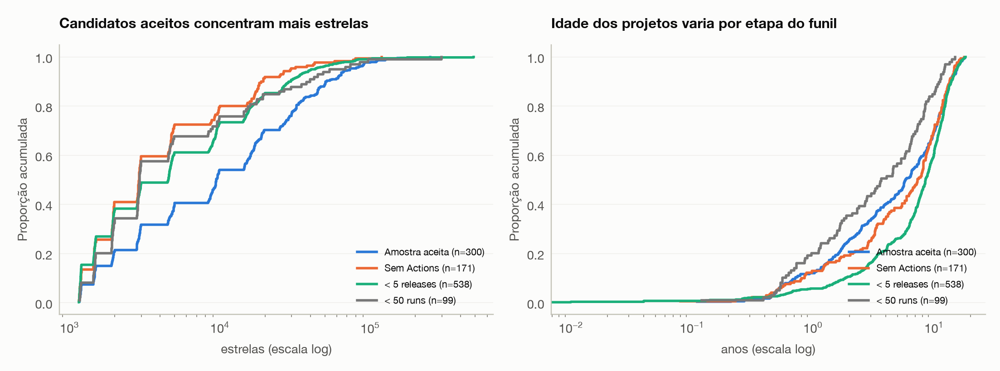
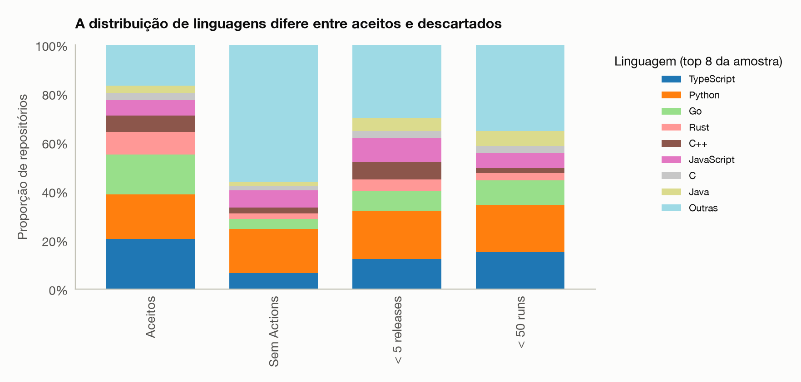

# Mineração de métricas DORA em repositórios open-source populares

**Laboratório de Experimentação de Software** · Engenharia de Software, 6º período
Guilherme Costa · Henrique Jardim Melo · Gabriel Afonso

> Documento consolidado, gerado por `python artigo/montar.py`. Não editar diretamente:
> altere as seções em `artigo/0N-*.md` e rode o script de novo.

---

# 1. Introdução

> Rascunho da issue #134, a ser revisado por Henrique e Gabriel antes de ir para o Overleaf.

## 1.1 Contexto

As quatro métricas DORA — frequência de deploy, lead time for changes, change failure rate e tempo de recuperação — viraram o vocabulário padrão para falar de desempenho de entrega de software. Elas vêm do programa de pesquisa *DevOps Research and Assessment*, que as derivou de levantamentos com milhares de profissionais e as organizou em faixas de desempenho (Elite, High, Medium, Low). A tese central desse programa é que velocidade e estabilidade **não** são um trade-off: as equipes de melhor desempenho vão bem nas quatro métricas ao mesmo tempo.

Essas métricas foram definidas para equipes que controlam o próprio pipeline de produção e sabem, por definição operacional interna, o que conta como "deploy" e o que conta como "falha em produção". Repositórios open-source no GitHub não oferecem nenhuma das duas coisas. Não há registro de deploy, não há registro de incidente e não há alguém para perguntar. O que existe são **rastros**: releases publicadas, execuções de workflow do GitHub Actions, commits, tags e comparações entre releases.

## 1.2 Problema

Medir DORA em repositórios open-source, portanto, não é aplicar uma definição: é **escolher proxies** e assumir o custo dessa escolha. Uma release é um deploy? Uma execução de CI que falha é uma falha em produção? Uma release de *patch* publicada três dias depois da anterior é a correção de um defeito, ou é rotina de atualização de dependência?

Cada resposta a essas perguntas é uma hipótese não verificada sobre a relação entre um atributo interno, que se consegue contar, e um atributo externo, que é o que de fato interessa. É nesse ponto que este trabalho se separa de uma aplicação direta do enunciado. Calcular as quatro métricas em uma amostra grande é a parte mecânica. A parte que decide se os números significam alguma coisa é perguntar **o quanto os proxies escolhidos são medidas válidas** — se concordam com o julgamento humano, se sobrevivem à troca da definição operacional, se se reproduzem em amostras independentes e se as faixas DORA separam de fato grupos distintos de repositórios.

## 1.3 Objetivo e questões de pesquisa

O objetivo é minerar as métricas DORA de repositórios populares que usam GitHub Actions e, em paralelo, avaliar a validade das medidas usadas. O escopo inicial do enunciado é de 300 repositórios; este trabalho o estende para **900**, em três amostras independentes de 300 (A1, A2 e A3), justamente para poder testar reprodutibilidade.

As sete questões de pesquisa são:

| RQ | Pergunta |
| :--- | :--- |
| **RQ01** | Qual a frequência de deploys dos repositórios populares que usam CI/CD? |
| **RQ02** | Qual o tempo entre um commit e seu respectivo deploy? |
| **RQ03** | Qual a taxa de falha das mudanças entregues por esses repositórios? |
| **RQ04** | Qual o tempo de recuperação após uma execução de CI/CD com falha? |
| **RQ05** | Repositórios com maior frequência de deploy apresentam maior ou menor taxa de falha? |
| **RQ06** | Quais características dos repositórios estão associadas a um melhor desempenho DORA? |
| **RQ07** | O quanto a classificação DORA depende da definição operacional escolhida? |

A RQ08 (bônus) trata da evolução temporal das métricas dentro da janela.

## 1.4 Hipóteses informais

Uma hipótese por RQ, com a origem de cada uma declarada. "Origem" diz de onde veio a expectativa — não dos dados deste trabalho (ver a nota de registro em 1.5).

| # | Hipótese | Origem da expectativa |
| :--- | :--- | :--- |
| **H01** | Os repositórios entregam com alta frequência: mediana de **pelo menos uma release por semana**. | O programa DORA trata entrega frequente como marca de maturidade, e o critério de inclusão (≥ 5 releases e ≥ 50 workflow runs na janela) já seleciona projetos ativos. |
| **H02** | O lead time mediano fica **na casa dos dias, não das horas**, e a variante (a), por release, é **sistematicamente maior** que a (b), por commit. | A primeira parte vem do contraste entre o padrão Elite do DORA (< 1 dia) e o ritmo assíncrono e voluntário do open source. A segunda vem da própria dica do enunciado na RQ02: um commit antigo "esquecido" numa release faz a (a) explodir e pouco afeta a (b). |
| **H03** | A taxa de falha fica **abaixo de 15%** nas duas variantes, e as duas chegam a **valores próximos**. | 15% é o limiar DORA que separa Elite/High do resto. A expectativa de convergência vem de supor que as duas variantes medem o mesmo construto por caminhos diferentes — que é exatamente a suposição que o trabalho precisa testar. |
| **H04** | O tempo mediano de recuperação fica **abaixo de 24 horas**. | Um pipeline de CI quebrado bloqueia todo mundo que depende dele; a expectativa é que consertá-lo seja prioridade imediata. O padrão Elite do DORA é menos de uma hora. |
| **H05** | A correlação entre frequência de deploy e CFR é **nula ou negativa**. | É a tese central do DORA, citada no próprio enunciado da RQ05: velocidade e estabilidade não são um trade-off, e quem entrega mais não falha mais. |
| **H06** | Repositórios mais populares, com mais contribuidores e mais antigos têm **desempenho DORA melhor**, com efeito ao menos pequeno (ε² ≥ 0,01). | Mais gente e mais maturidade deveriam significar mais automação, mais processo e mais disciplina de release. |
| **H07** | A classificação DORA é **majoritariamente estável** à definição operacional: **menos de 20%** dos repositórios mudam de faixa entre duas combinações. | Se as faixas medem um atributo real do repositório, e não um artefato do proxy, trocar a definição não deveria reclassificar a maioria. |

## 1.5 Nota sobre o registro das hipóteses

O protocolo correto registra as hipóteses **antes** da coleta. Neste trabalho isso não aconteceu. O Lab03 começou em 08/10/2026, o primeiro dataset entrou no repositório em 13/10/2026 e as hipóteses acima só foram escritas e versionadas em **20/10/2026**, com os resultados já disponíveis ao grupo. Elas são, portanto, **reconstruídas**, não pré-registradas, e o leitor deve tratá-las como tal.

Para que a reconstrução não seja só uma racionalização do que foi encontrado, cada hipótese declara de onde veio a expectativa, e nenhuma foi derivada dos resultados. O leitor pode auditar isso pelo saldo: **cinco das sete foram refutadas** pelos dados (seção 4). Hipóteses escritas depois de ver o resultado tendem a acertar; estas, na maioria, erram — inclusive em direções que custaram retrabalho ao grupo, como a H05, que motivou a análise da seção 3.10.3.

Isso está registrado também na seção 5 (ameaças à validade), como limitação de conclusão.

## 1.6 Contribuições

1. Um **dataset público de 900 repositórios** (três amostras independentes de 300) com as quatro métricas DORA e suas variantes, mais os eventos brutos (releases, commits por release, workflow runs) que permitem recalcular tudo.
2. Uma **avaliação de validade das medidas** segundo os seis critérios da IEEE 1061, e não só o cálculo das métricas: correlação, rastreamento, consistência, previsibilidade, poder discriminante e confiabilidade.
3. A demonstração de que o **CFR na variante (b) mede cadência de publicação, não falha** — a correlação com a frequência de deploy desaparece ao condicionar pela oportunidade de observar uma release corretiva (seção 3.10.3).
4. A evidência de que as **faixas DORA não têm poder discriminante** nesta população e a proposta de um **índice contínuo** que preserva a informação que o corte em faixas descarta (seções 3.10.4 e 3.10.7).
5. Um **ajuste de distribuições** às métricas (Poisson, binomial negativa, Weibull, normal) que mostra por que a média e o desvio-padrão não devem ser usados aqui, e a verificação empírica de que o Teorema do Limite Central precisa de n ≈ 300, não de n = 30, para estes dados (seção 3.10.5).

## 1.7 Organização

A seção 2 descreve a metodologia: fonte de dados, janela, seleção, definições operacionais e validação manual. A seção 3 apresenta os resultados das sete RQs e as análises adicionais de validade. A seção 4 confronta as hipóteses acima com o que os dados mostraram. A seção 5 discute as ameaças à validade segundo as quatro categorias de Cook e Campbell. A seção 6 descreve o pacote de replicação.

---

# 2. Metodologia

> Rascunho da issue #139, a ser revisado por Henrique e Gabriel antes de ir para o Overleaf. Os números da coleta são os do `data/` desta versão. O único item em aberto são as datas exatas da janela, a confirmar com o professor.

## 2.1 Fonte de dados

Os dados vêm da API pública do GitHub e foram coletados por um script próprio do grupo, sem bibliotecas prontas de acesso à API. O script usa a API REST para busca, releases, comparações entre releases e workflow runs, e a GraphQL para as tags com data. O pipeline inteiro roda com um único comando (`python -m pipeline --config config.yaml`). Cada resposta da API fica em cache local, então interromper a coleta e rodá-la de novo continua de onde parou e reproduz o mesmo dataset sem novas chamadas. O cliente HTTP respeita os cabeçalhos de rate limit e repete com *backoff* exponencial as respostas 5xx e as falhas de rede.

## 2.2 Janela de observação

A janela tem 12 meses, de **1º de outubro de 2025 a 30 de setembro de 2026** **[PENDENTE: confirmar com as datas fixadas pelo professor]**. Isso dá aproximadamente 52,1 semanas. Só entram nas métricas as releases publicadas e os workflow runs criados dentro dela. A exceção é a release imediatamente anterior a uma release da janela, que é usada como base para obter os commits incluídos, mesmo estando fora.

## 2.3 Seleção dos repositórios e funil

1. **Candidatos.** Foi usada a busca de repositórios com mais de 1.000 estrelas, não arquivados e com *push* depois do início da janela. Como cada consulta devolve no máximo 1.000 resultados, a busca foi fatiada em nove faixas de estrelas (1.000–1.199, 1.200–1.499, 1.500–1.999, 2.000–2.999, 3.000–4.999, 5.000–9.999, 10.000–19.999, 20.000–49.999 e ≥ 50.000).
2. **Ordem de avaliação.** Os candidatos foram embaralhados com semente fixa (42) e avaliados nessa ordem até a amostra chegar a 300 repositórios. Isso evita que a amostra fique concentrada nos repositórios mais estrelados de cada faixa.
3. **Filtros**, aplicados do mais barato para o mais caro:
   - (i) usa GitHub Actions (`actions/workflows` com `total_count > 0`);
   - (ii) tem ≥ 5 releases publicadas, sem pré-release, na janela;
   - (iii) tem ≥ 50 workflow runs válidos (`success` ou falha) disparados por `push` no *default branch* na janela.

O funil é gerado automaticamente pelo pipeline (`data/funil.csv`), e cada descarte fica registrado com o motivo em `data/descartes.csv`.

**Tabela 1 — Funil de seleção** (`data/funil.csv`).

| Etapa | Restantes | Descartados | Motivo do descarte |
| :--- | ---: | ---: | :--- |
| Candidatos da busca | 8.457 | — | — |
| Avaliados (ordem aleatória, até o alvo) | 1.108 | 7.349 | não avaliados: alvo de 300 já atingido |
| Usam GitHub Actions | 937 | 171 | nenhum workflow cadastrado |
| ≥ 5 releases na janela | 399 | 538 | menos de 5 releases publicadas (sem pré-release) |
| ≥ 50 runs válidos na janela | 300 | 99 | menos de 50 runs válidos em `push` no *default branch* |
| **Amostra final** | **300** | 0 | — |

O filtro mais restritivo é o de releases: 57% dos repositórios que usam Actions publicaram menos de 5 releases em 12 meses. Isso indica que muitos projetos populares entregam por outros meios, como *rolling release*, publicação direta em registros de pacotes ou ausência de versionamento formal. Esse ponto é retomado nas ameaças à validade.

Como cada faixa de estrelas contribui com no máximo 1.000 candidatos, os mais estrelados de cada faixa, a amostra fica deslocada para repositórios mais populares do que uma amostra uniforme de todos os repositórios com mais de 1.000 estrelas. A mediana é de 9.485 estrelas (IQR 2.844–28.694).

## 2.4 Definições operacionais

Todas as definições seguem a seção 3 do enunciado, comum à turma. Em resumo:

- **Deploy:** release publicada (`draft = false`), sem pré-release na definição principal. A data do deploy é `published_at`.
- **Data do commit:** `commit.author.date`.
- **Execuções de CI:** workflow runs do *default branch* com `event = push`. São consultadas mês a mês, e um mês com mais de 1.000 resultados é dividido ao meio recursivamente até caber. A classificação usa o campo `conclusion`:
  - `success` conta como sucesso;
  - `failure`, `timed_out` e `startup_failure` contam como falha;
  - os demais valores são ignorados.

Métricas por repositório:

- **Deployment frequency (RQ 01):** deploys na janela ÷ semanas da janela.
- **Lead time (RQ 02):** os commits de cada deploy D vêm de `compare/{deploy anterior}...{D}`, paginado.
  - (a) Por release: `data(D) − commit mais antigo de D`. O valor do repositório é a mediana entre os deploys.
  - (b) Por commit: `data(D) − data de cada commit`. O valor do repositório é a mediana de todos os commits.
  - Ficam fora do cálculo, e são contados à parte:
    - o primeiro deploy da história;
    - os *compare* com resposta 404 (tag apagada ou reescrita);
    - os *compare* com mais de 1.000 commits, ou que a API se recusa a gerar (HTTP 422, *diff* demorado demais). Esse último critério é do grupo: são quase sempre comparações entre linhas de versão diferentes ou entre pacotes distintos de um monorepo, intercalados por data, e não representam o que entrou no deploy.
- **Change failure rate (RQ 03):**
  - (a) Proxy de CI: falhas ÷ (falhas + sucessos), com todos os workflows juntos.
  - (b) Proxy de entrega: o deploy D falhou se um deploy **corretivo** foi publicado em até 7 dias depois dele. Deploys dos últimos 7 dias da janela ficam fora do denominador (censura). O dataset desta versão usa a heurística **v0** (SemVer: mantém `maior.menor` do deploy anterior e sobe só o `patch`). Três outras versões foram implementadas e comparadas de forma descritiva na amostra 1 (`validacao/comparar_versoes.py`, `validacao/heuristica_versoes.md`):
    - **v1 mensagens:** corretiva se pelo menos metade dos commits da release tem prefixo `fix`/`revert` (Conventional Commits).
    - **v2 patch + poucos commits:** v0 **e** a release tem no máximo 3 commits.
    - **v3 combinada:** v0 **ou** v1 **ou** o nome da tag contém `hotfix`/`patch`.

    | Versão | Mediana do CFR (b) | IQR | Releases marcadas corretivas |
    | :--- | :---: | :---: | :---: |
    | v0 (semver) | 25,0% | 5,2% – 56,5% | 8.186 |
    | v1 (mensagens) | 0,0% | 0,0% – 12,6% | 1.479 |
    | v2 (patch + poucos commits) | 2,4% | 0,0% – 21,6% | 1.903 |
    | v3 (combinada) | 25,0% | 6,0% – 57,2% | 8.597 |

    A v0 sozinha já marca um quarto das releases como corretivas, bem acima do CFR (a) (mediana 2,6%, seção 3.1); a v1, baseada só na mensagem do commit, é bem mais conservadora. A escolha da versão final foi decidida contra o gabarito humano na seção 2.7: nenhuma das quatro atinge o F1 mínimo, e a v0 foi mantida como referência.
- **Tempo de recuperação (RQ 04):** os runs são agrupados por workflow e ordenados por `run_started_at`.
  - Um episódio começa na primeira falha depois de um sucesso e termina no sucesso seguinte, com duração `updated_at(sucesso) − run_started_at(1ª falha)`. O valor do repositório é a mediana dos episódios fechados, em horas.
  - Episódios sem sucesso até o fim da janela são **censurados**: não entram na mediana, mas são contados, e a proporção é reportada por repositório.
  - Falhas no início da janela, antes do primeiro sucesso, não abrem episódio, porque não é possível saber quando a falha começou.

## 2.5 Variantes para a análise de sensibilidade (RQ 07)

As métricas de velocidade e o CFR (b) são calculados para três unidades de deploy:

| Unidade | Definição | Data |
| :--- | :--- | :--- |
| `release` (referência) | Release publicada sem pré-release | `published_at` |
| `release_pre` | Release publicada, incluindo pré-releases | `published_at` |
| `tag` | Tag do repositório | Data de autoria do commit apontado |

Para não esgotar a cota, o lead time de uma unidade não é calculado quando ela tem mais de 300 deploys na janela. Isso acontece sobretudo com tags em monorepos. Esses casos ficam marcados na coluna `lt_<unidade>_omitido`. As combinações C1–C3 da RQ 07 são montadas a partir dessas colunas na S03 (#142).

## 2.6 Dataset

O dataset final (`data/dataset_dora.csv`) tem uma linha por repositório. Ele traz os metadados usados na RQ 06 (estrelas, linguagem, idade e número de contribuidores), as métricas de cada unidade de deploy e as contagens de qualidade da coleta:

- releases ignoradas por *compare* 404 ou grande demais;
- meses que bateram o teto de 1.000 runs;
- episódios censurados.

Cada coluna está descrita em `data/DICIONARIO.md`, com nome, tipo, unidade e fórmula ou campo de origem na API.

A amostra final tem **300 repositórios** em 27 linguagens. As mais frequentes são TypeScript (61), Python (55), Go (49), Rust (28), C++ (20) e JavaScript (19). A idade mediana é de 5,8 anos (IQR 2,0–10,9), e o número mediano de contribuidores é 142 (IQR 50–335). A coleta somou 17.217 releases, 28.792 tags e 833.582 workflow runs válidos na janela. A Tabela 2 resume a qualidade da coleta.

**Tabela 2 — Contagens de qualidade da coleta.**

| Ocorrência | Quantidade |
| :--- | :--- |
| Repositórios com algum mês acima de 1.000 runs (subdividido) | 34 |
| Dias ainda acima de 1.000 runs após a subdivisão (dados incompletos) | 19 dias em 4 repositórios |
| Releases ignoradas no lead time por *compare* 404 | 8 |
| Releases ignoradas no lead time por *compare* com mais de 1.000 commits ou que a API não conseguiu gerar (422) | 244 |
| Repositórios com lead time de release omitido (mais de 300 releases na janela) | 7 |
| Episódios de falha de CI censurados (sem recuperação até o fim da janela) | 139 de 20.077, em 74 repositórios |

**Caracterização e viés de seleção.** A Tabela 3 e os arquivos `analise/saida/caracterizacao/caracterizacao_numerica.csv` e `caracterizacao_linguagens.csv` descrevem a A1 e a amostra acumulada A1+A2. Na A1, estrelas têm mediana 9.484,5 (IQR 2.858,5–28.636), idade 5,79 anos (1,96–10,89) e contribuidores 142 (50,25–335). Em A1+A2 (600 repositórios), as medianas são 9.500 estrelas (2.878,75–29.144,5), 6,24 anos (2,43–10,17) e 150 contribuidores (52–343). A A1 distribui-se por 27 linguagens; TypeScript (61), Python (55), Go (49), Rust (28), C++ (20) e JavaScript (19) são as seis mais comuns. As tabelas listam as oito mais frequentes e agrupam as restantes em “Outras”.

**Tabela 3 — Caracterização dos metadados das amostras.** Valores contínuos apresentados como mediana (Q1–Q3).

| Amostra | Repositórios | Estrelas | Idade (anos) | Contribuidores |
| :--- | ---: | :--- | :--- | :--- |
| A1 | 300 | 9.484,5 (2.858,5–28.636) | 5,79 (1,96–10,89) | 142 (50,25–335) |
| A1+A2 | 600 | 9.500 (2.878,75–29.144,5) | 6,24 (2,43–10,17) | 150 (52–343) |

Na A1, as oito linguagens mais frequentes são TypeScript (61), Python (55), Go (49), Rust (28), C++ (20), JavaScript (19), Java (9) e C (9); as demais somam 50 repositórios. Na A1+A2, são TypeScript (134), Python (107), Go (86), Rust (61), JavaScript (37), C++ (35), C (19) e Java (17); as demais somam 104.

Para medir viés de seleção, comparamos os aceitos com cada etapa de descarte e com todos os descartados, usando Mann–Whitney e delta de Cliff para estrelas e idade, qui-quadrado para linguagem (oito categorias mais “Outras”) e correção de Holm sobre os testes. No conjunto, os aceitos têm mais estrelas que os descartados (medianas 9.484,5 e 2.969,5; δ = 0,292, efeito pequeno; p ajustado < 0,001) e são ligeiramente mais jovens (5,79 e 7,88 anos; δ = −0,116, efeito desprezível; p ajustado = 0,016). A distribuição de linguagens também difere (p ajustado < 0,001). A diferença é particularmente marcada entre quem passou e quem não passou o filtro de Actions: as linguagens diferem (p ajustado < 0,001; δ de estrelas = 0,357). O corte de releases também está associado a estrelas, idade e linguagem (todos p ajustados ≤ 0,001); o corte de runs apresenta diferenças menores, mas ainda detectáveis (p ajustados ≤ 0,017). Portanto, a amostra caracteriza especificamente projetos populares, ativos e que publicam releases com frequência, não todos os repositórios open-source.

Como teste de sanidade da ordem aleatória de avaliação, comparamos os 1.108 candidatos avaliados (aceitos e descartados) com os 7.349 não avaliados. Não houve diferenças detectáveis após Holm em estrelas (δ = 0,017; p ajustado = 1), idade (δ = 0,015; p ajustado = 1) ou linguagem (p ajustado = 1). A comparação independente A1 × A2 também não encontrou diferenças nos metadados: estrelas (δ = −0,019), idade (δ = 0,014) e linguagem (p ajustado = 1 em cada teste). Esses resultados dão suporte à reprodutibilidade da amostragem, mas não removem o viés imposto pelos critérios de inclusão.

**Como ler.** Cada curva é a proporção acumulada de repositórios por estrelas (painel esquerdo) ou idade (direito), separada entre a amostra aceita e cada etapa de descarte; deslocamentos horizontais indicam diferenças de distribuição. Os eixos horizontais usam escala logarítmica e a legenda informa o tamanho de cada grupo.

**Como ler.** Cada barra representa um grupo do funil e soma 100%; as cores mostram as oito linguagens mais frequentes entre os aceitos e a categoria “Outras”. A figura evidencia diferenças de composição, mas a inferência estatística correspondente está na tabela de viés de seleção.

Os testes, medianas e tamanhos de efeito podem ser regenerados sem acesso à API executando `python -m analise.caracterizacao` de dentro de `lab-expe-03`; a execução completa também é incluída em `python -m analise`.

**Ameaça à validade externa — viés de seleção.** As conclusões não devem ser generalizadas a todo o ecossistema open-source: os critérios de ≥ 1.000 estrelas, uso de Actions, pelo menos cinco releases e 50 execuções válidas selecionam projetos populares, com CI e cadência de publicação formal. A comparação mostra diferenças de popularidade, idade e linguagem em relação aos descartados. A semelhança entre avaliados e não avaliados e entre A1 e A2 reduz a preocupação com a ordem aleatória e a composição das duas amostras, mas não elimina o viés dos filtros nem representa projetos corporativos ou repositórios com distribuição contínua sem releases.

## 2.7 Validação manual (amostra-ouro)

**Sorteio.** Foram sorteados 60 repositórios da amostra 1 com semente fixa (`sample(n=60, random_state=42)`) e, para cada um, até 5 releases da janela com um `random.Random(42)` novo por repositório, num total de 300 releases. O sorteio é reprodutível por `python -m analise.amostra_ouro` e a lista está em `validacao/amostra_ouro_repos.csv` e `validacao/amostra_ouro_releases.csv`.

**Rotulagem independente.** Os três integrantes rotularam sozinhos, sem consultar os demais nem ver a saída da heurística, três dimensões: (i) tipo do projeto; (ii) se as releases representam entregas reais ao usuário; (iii) se cada release sorteada é corretiva. São 360 julgamentos por pessoa, 1.080 no total, em `validacao/rotulos_<nome>_*.csv`.

**Concordância.** Medida pelo kappa de Fleiss por dimensão (Tabela 4), interpretada segundo Landis e Koch (1977). A concordância bruta é reportada junto porque o kappa desconta a concordância esperada por acaso e, quando uma categoria domina, pode colapsar mesmo com acordo alto — é o que ocorre em `releases_reais`.

**Tabela 4 — Concordância entre os três avaliadores.**

| Dimensão | n | κ de Fleiss | Interpretação | Os 3 iguais | Maioria 2/3 | Categoria dominante |
| :--- | ---: | ---: | :--- | ---: | ---: | :--- |
| Tipo do projeto | 60 | 0,872 | quase perfeita | 86,7% | 100% | aplicação/serviço (41,7%) |
| Releases são entrega real | 60 | 0,157 | leve | 90,0% | 98,3% | sim (95,6%) |
| Release é corretiva | 300 | 0,504 | moderada | 71,0% | 100% | não (73,4%) |

O κ de 0,157 em `releases_reais` **não** significa desacordo: os três concordaram em 90% dos repositórios. Significa que quase todos os repositórios receberam o mesmo rótulo (`sim` em 95,6% dos julgamentos), de modo que o acaso já explicaria quase toda a concordância observada. A medida é pouco informativa nessa dimensão, e a leitura correta é a concordância bruta.

O κ de 0,504 em `corretiva` é o número que importa, e é apenas moderado. Três pessoas lendo as mesmas notas de release e a mesma lista de commits divergiram em 29% dos casos. A prevalência de "sim" variou de 16,7% a 37,3% entre avaliadores. Isso é evidência direta de que **o próprio conceito de "release corretiva" é ambíguo**, e não apenas difícil de automatizar.

**Consenso.** Resolvido por maioria de 2 em 3, com o protocolo em `validacao/PROTOCOLO.md`. Houve maioria em 100% das releases e dos tipos de projeto; apenas 1 repositório ficou sem maioria em `releases_reais` e segue marcado para decisão em reunião. O gabarito final tem 78 releases corretivas e 222 não corretivas (26,0% de prevalência), em `validacao/consenso_releases.csv`.

**Avaliação da heurística.** Quatro versões foram testadas contra o consenso (Tabela 5). **Nenhuma atinge o F1 mínimo de 0,70 exigido pelo enunciado.**

**Tabela 5 — Heurística de release corretiva contra o gabarito humano (n = 300).**

| Versão | Regra | Precisão | Recall | F1 |
| :--- | :--- | ---: | ---: | ---: |
| v0 `semver_patch` | sobe só o *patch* da versão | 36,5% | 69,2% | 0,478 |
| v1 `mensagens` | ≥ metade dos commits é `fix:`/revert | 94,4% | 21,8% | 0,354 |
| v2 `patch_poucos_commits` | v0 **e** ≤ 3 commits | 59,5% | 28,2% | 0,383 |
| **v3 `combinada`** | v0 **ou** v1 **ou** tag com `hotfix`/`patch` | 37,7% | 73,1% | **0,498** |

A v0, que gerou o `cfr_b_release` de todo o dataset, tem **precisão de 36,5%**: de cada três releases que ela marca como corretivas, duas não são, segundo o consenso humano. A v1 inverte o erro — precisão de 94,4% com recall de 21,8%, ou seja, quando acusa quase sempre acerta, mas deixa passar quatro de cada cinco correções reais. A v3, melhor por F1, supera a v0 por apenas 0,020, e as duas produzem medianas de CFR (b) praticamente iguais (25,0% em ambas).

Por isso **a v0 foi mantida como definição de referência**: trocá-la pela v3 exigiria recalcular as três amostras sem ganho de validade mensurável. A decisão e seu custo estão registrados aqui e discutidos na seção 5.1, onde a validade de construto do CFR (b) deixa de ser uma suspeita e passa a ser um resultado medido. As quatro versões e o detalhamento estão em `validacao/heuristica_versoes.md` e `validacao/avaliacao_heuristica.csv`.

---

# 3. Resultados (esboço v2)

> Esboço da issue #151 para discutirmos em grupo. As análises finais de cada RQ ficam nas issues #140, #141, #142 e #158.
>
> - **Dados:** amostra 1 (A1, 300 repositórios, `data/dataset_dora.csv`) e amostra 2 (A2, 300 repositórios novos, `data/amostra2/dataset_dora.csv`). A A2 usa a mesma janela e os mesmos filtros, outra semente, e exclui os repositórios da A1.
> - **Todo resultado aparece em paralelo: 300 (A1) × 600 (A1 + A2).** A comparação formal entre as duas amostras está na seção 3.10.1.
> - **Como regenerar:** `python -m analise`, de dentro de `lab-expe-03`. As figuras de 300 ficam em `analise/saida/figuras/`, as de 600 em `analise/saida/600/figuras/` e as de comparação em `analise/saida/comparacao/figuras/`.
> - O CFR (b) usa a heurística v0 de release corretiva. Ela foi validada contra o gabarito humano (seção 2.7) e **reprovada**: F1 = 0,478, precisão de 36,5%. Foi mantida por ser a melhor disponível sem recoletar, e todo resultado marcado **[NÃO VALIDADO]** deve ser lido com essa ressalva.

Seguindo o enunciado, todas as métricas são resumidas por **mediana e IQR** (1º–3º quartil).

**Tabela 3 — Resumo das métricas, 300 × 600** (`analise/saida/comparacao/tabelas/estimativas_300_600.csv`).

| Métrica | n (300 / 600) | Mediana 300 [IQR] | Mediana 600 [IQR] |
| :--- | :--- | :--- | :--- |
| Frequência de deploy (releases/semana) | 300 / 600 | 0,35 [0,19 – 0,81] | 0,34 [0,19 – 0,84] |
| Lead time (a), por release (dias) | 293 / 582 | 13,2 [3,1 – 37,3] | 12,9 [3,5 – 37,8] |
| Lead time (b), por commit (dias) | 293 / 582 | 8,8 [2,8 – 29,4] | 9,4 [2,8 – 27,3] |
| CFR (a), proxy de CI | 300 / 600 | 5,6% [2,2% – 11,2%] | 5,0% [2,1% – 10,8%] |
| CFR (b), proxy de entrega [NÃO VALIDADO] | 300 / 600 | 25,0% [5,2% – 56,5%] | 23,8% [5,2% – 50,0%] |
| Tempo de recuperação (horas) | 278 / 554 | 2,8 [0,9 – 11,9] | 3,0 [1,0 – 14,9] |

Ficam sem lead time os repositórios com mais de 300 releases na janela, porque o cálculo foi omitido para preservar a cota da API (coluna `lt_release_omitido`): 7 na A1 e 18 no total. Ficam sem tempo de recuperação os que não tiveram nenhum episódio de falha fechado na janela: 22 na A1 e 46 no total.

**Leitura geral:** com o dobro de repositórios, **todas as medianas ficam praticamente no mesmo lugar** e dentro do intervalo de confiança da amostra 1. O detalhe está na seção 3.10.1.

---

## 3.1 RQ 01 — Frequência de deploy

| Amostra 1 (300) | A1 + A2 (600) |
| :---: | :---: |
|  |  |

**Como ler.**
- Cada ponto é um repositório, posicionado pela quantidade de releases por semana. A altura não tem significado: os pontos só se empilham para não se sobrepor.
- O eixo está em escala log: cada marca multiplica o valor, e não soma.
- As faixas ao fundo são as categorias da tabela de referência DORA, com a contagem de cada uma no topo.

**Resultado.**
- A mediana é de **0,35 release por semana** (0,34 com 600), cerca de uma release a cada 20 dias.
- Quase metade é **Medium**, entre 1 por mês e 1 por semana (46% com 300; 47% com 600). Um terço é **Low**, menos de 1 por mês (33%; 32%).
- Só 2% chegam a Elite, ≥ 7 por semana: 6 repositórios com 300 e 13 com 600.

Para a discussão: release publicada é um proxy conservador de deploy. Projetos que entregam continuamente sem publicar releases ficam subestimados. Os que nem chegam a 5 releases já foram descartados no funil, onde caíram 57% (A1) e 60% (A2) dos que usam Actions.

## 3.2 RQ 02 — Lead time for changes

| Amostra 1 (300) | A1 + A2 (600) |
| :---: | :---: |
|  |  |

**Como ler.**
- Cada ponto é um repositório: a posição horizontal é o lead time pela variante (a) e a vertical, pela variante (b), ambos em escala log.
- Na diagonal cinza as duas variantes coincidem.
- As linhas de grade marcam as fronteiras DORA: 1 dia, 1 semana e 30 dias.

**Resultado.**
- As medianas são **13,2 dias pela variante (a)** e **8,8 dias pela (b)** com 300, e 12,9 e 9,4 com 600.
- Em **65% dos repositórios a variante (b) dá um valor menor**, com o ponto abaixo da diagonal (67% com 600).

**Por que as variantes divergem** (o enunciado pede essa explicação):
- A variante (a) mede o tempo desde o commit **mais antigo** de cada release. Um único commit que esperou muito puxa o valor da release inteira para cima.
- A variante (b) usa a mediana de **todos** os commits. Releases grandes pesam mais, e a maioria dos commits entra perto da data de publicação.
- Quando cada release tem poucos commits, as duas variantes convergem. Os pontos acima da diagonal merecem uma inspeção caso a caso: uma hipótese é que poucas releases concentrem muitos commits antigos.

## 3.3 RQ 03 — Change failure rate

| Amostra 1 (300) | A1 + A2 (600) |
| :---: | :---: |
|  |  |

**Como ler.**
- É uma curva acumulada. Para cada valor de CFR no eixo horizontal, a altura da curva é a % de repositórios com CFR até aquele valor.
- Quanto mais cedo a curva sobe, mais repositórios têm taxa de falha baixa.
- As linhas verticais são as fronteiras DORA (15%, 30% e 45%). O ponto marca quantos repositórios são Elite (≤ 15%).

**Resultado.** Os dois proxies contam histórias opostas, e isso se repete nas duas amostras:
- Pela **falha de CI**, CFR (a), **84% dos repositórios são Elite** com 300 (83% com 600), com mediana de 5,6% (5,0%).
- Pela **release corrigida em até 7 dias**, CFR (b), só **37%** são Elite (38%), com mediana de 25% (24%). Cerca de 23% dos repositórios têm CFR (b) igual a zero, o degrau vertical no início da curva laranja.

Para a discussão: o CFR (a) mede a falha do *pipeline*, não a falha em produção. Testes instáveis e falhas corrigidas antes do merge entram como falha. O CFR (b) depende da heurística de corretiva, e a v0 provavelmente o infla.

## 3.4 RQ 04 — Tempo de recuperação

| Amostra 1 (300) | A1 + A2 (600) |
| :---: | :---: |
|  |  |

**Como ler.**
- É a mesma lógica de curva acumulada, com a mediana do tempo de recuperação de cada repositório no eixo horizontal, em escala log.
- Os pontos marcados respondem diretamente "que % dos repositórios se recupera em menos de X".

**Resultado.**
- A mediana é de **2,8 horas** (3,0 com 600).
- Em menos de 1 hora (Elite) recuperam-se **27%** (26% com 600). Em menos de 1 dia, **83%** (82%). Em menos de 1 semana, **97%** (95%).
- Os episódios **censurados** (sem recuperação até o fim da janela) são **0,7%** dos 20.077 episódios da A1 e 0,6% dos 41.546 das duas amostras.

## 3.5 Classificação DORA (combinação de referência C1)

| Amostra 1 (300) | A1 + A2 (600) |
| :---: | :---: |
|  |  |

**Como ler.**
- Cada barra soma 100% dos repositórios, divididos pela categoria DORA de cada métrica.
- O azul mais escuro é Elite e o mais claro é Low.
- **Geral** é a classificação final do enunciado: a mediana dos pontos das quatro métricas (Elite = 4 … Low = 1), arredondada para baixo.

**Resultado.**

| Classificação geral | Elite | High | Medium | Low |
| :--- | ---: | ---: | ---: | ---: |
| 300 | 8% | 35% | 50% | 7% |
| 600 | 7% | 36% | 48% | 9% |

- **Cerca de metade é Medium e um terço é High**, nas duas versões.
- Cada métrica puxa para um lado diferente:
  - o **CFR (a)** quase todo em Elite puxa para cima;
  - a **frequência**, com ~80% entre Medium e Low, puxa para baixo;
  - o **lead time** está espalhado pelas quatro categorias.

## 3.6 RQ 05 — Velocidade × estabilidade

| Amostra 1 (300) | A1 + A2 (600) |
| :---: | :---: |
|  |  |

**Como ler.**
- Cada ponto é um repositório, com a frequência de deploy no eixo horizontal (escala log) e o CFR no vertical.
- O ρ de Spearman vai de −1 a 1: perto de 0 indica ausência de relação monotônica, e valores positivos indicam que o CFR sobe junto com a frequência.

**Resultado.**

| Correlação de Spearman com a frequência | 300 | 600 |
| :--- | :--- | :--- |
| CFR (a), proxy de CI | ρ = 0,18 (p = 0,002) | ρ = 0,12 (p = 0,004) |
| CFR (b), proxy de entrega [NÃO VALIDADO] | ρ = 0,60 (p < 0,001) | ρ = 0,56 (p < 0,001) |

- **Pelo CI**, a correlação é significativa mas **fraca**, e fica ainda menor com 600. Na prática, publicar mais não se associa a quebrar mais o CI.
- **Pela entrega**, a correlação é **forte** nas duas, mas em boa parte é um artefato da definição: quem publica muitas releases tem, por construção, mais chance de que uma delas seja uma "corretiva" publicada em até 7 dias.

Para a discussão: o resultado com o proxy de CI é coerente com a afirmação do DORA de que velocidade e estabilidade não são *trade-off*. O resultado com o proxy de entrega não deve ser lido como evidência do contrário antes da heurística validada (#138). Em nenhum dos dois casos a correlação implica causalidade.

## 3.7 RQ 06 — Características associadas ao desempenho

| Amostra 1 (300) | A1 + A2 (600) |
| :---: | :---: |
|  |  |

**Como ler.**
- Cada célula cruza uma característica do repositório (linha) com uma métrica (coluna).
- O valor é o tamanho de efeito **ε² = H/(n−1)** do teste de Kruskal-Wallis: quanto da variação da métrica a característica explica. A referência é < 0,01 desprezível, < 0,06 pequeno, < 0,14 médio e ≥ 0,14 grande.
- Os valores em **negrito com \*** continuam significativos depois da correção de Holm para os 24 testes.
- Linguagem considera as linguagens com pelo menos 15 repositórios: 6 com 300 e 10 com 600. Os demais fatores estão divididos em quartis.

**Resultado, com 300.**

| Fator | Q1 → Q4 | Lead time (a) Q1 → Q4 | Frequência Q1 → Q4 | CFR (b) Q1 → Q4 |
| :--- | :--- | :--- | :--- | :--- |
| Idade | ≤ 2 anos → > 10,9 anos | 2,0 → 28,5 dias | 0,67 → 0,23 por semana | 57% → 10% |
| Contribuidores | ≤ 48 → > 338 | 4,7 → 18,5 dias | sem efeito | 37% → 18% |
| Estrelas | quartis | 6,1 → 18,4 dias | sem efeito | sem efeito |

- **A idade é o fator com maior efeito**, e isso se mantém com 600: ε² de 0,25 → 0,21 no lead time (a), efeito grande. Repositórios com até 2 anos publicam com mais frequência e mais rápido, com lead time mediano de 2 dias contra 28,5 nos mais antigos. Também têm mais releases corretivas.
- **Equipes maiores têm lead time maior**, também nas duas: ε² de 0,11–0,14 com 300 e 0,08–0,11 com 600, efeito médio.
- **O que muda com 600: a linguagem passa a ser significativa.**
  - Com 300 ela não tinha efeito após Holm. Com 600 aparece no lead time (ε² = 0,10, efeito médio), na frequência e no CFR (b).
  - Lead time (a) mediano por linguagem: TypeScript 7,1 dias, JavaScript 8,9, Python 11,5, Rust 14,1, Go 16,7, Java 22,9, C 35,3, C++ 60,6.
  - É o exemplo clássico de **poder estatístico**: o efeito existia, mas 300 repositórios divididos em 6 grupos não bastavam para detectá-lo depois da correção.
- **O CFR (a) não se associa a nenhum fator** nas duas versões. Com 600, a idade passa a ter um efeito pequeno no tempo de recuperação (ε² = 0,03).

Para a discussão: idade, contribuidores, estrelas e linguagem são correlacionados entre si. Projetos em C/C++ tendem a ser mais antigos, e projetos antigos tendem a ser maiores e mais populares. O Kruskal-Wallis univariado não separa esses efeitos: **a #141 testa cada fator controlando os demais**. Uma hipótese é que projetos jovens estejam em fase de iteração rápida, com muitas releases de *patch*.

### Robustez (issue #141): o efeito se mantém controlando os demais fatores?

A correlação entre os três fatores contínuos é moderada: estrelas × contribuidores ρ = 0,59, contribuidores × idade ρ = 0,44, estrelas × idade ρ = 0,07 (com 600). O VIF de cada preditor na regressão fica entre 1,2 e 1,9, abaixo do corte de 5 — a multicolinearidade não impede separar os efeitos.

A correlação parcial de Spearman, controlando os outros dois fatores contínuos, confirma a leitura da idade e reduz a dos contribuidores:

- **Idade** continua associada a quase todas as métricas depois de controlar contribuidores e estrelas, com 600: ρ parcial = 0,34 no lead time (a), −0,39 na frequência, −0,34 no CFR (b), todas com p ajustado < 0,001. Na regressão log-log, o coeficiente padronizado da idade no lead time (a) é 0,52 (IC 95% [0,38; 0,65]), o maior dos três fatores.
- **Contribuidores** perde a associação com o lead time (a) depois de controlar idade e estrelas: a correlação parcial cai para ρ = 0,10 (p ajustado = 0,17, não significativo), e o coeficiente padronizado da regressão (0,21, IC [0,05; 0,37]) é menos da metade do da idade. A associação com a frequência se mantém (ρ parcial = 0,21, p ajustado < 0,001).
- **Estrelas** não tem associação parcial significativa com nenhuma métrica, em nenhuma das duas amostras.

A leitura muda em relação à seção 3.7: parte do efeito de "equipes maiores" que o Kruskal-Wallis univariado atribuía aos contribuidores parece, na verdade, efeito da idade. Repositórios mais antigos acumulam contribuidores e, ao mesmo tempo, têm lead time maior, por uma razão que não é só o tamanho da equipe. É uma associação, não uma relação causal — outras variáveis não medidas (maturidade do processo de release, dívida técnica acumulada) podem explicar a idade.

## 3.8 RQ 07 — Sensibilidade à definição operacional

| Amostra 1 (300) | A1 + A2 (600) |
| :---: | :---: |
|  |  |

**Como ler.**
- **À esquerda:** a distribuição das categorias DORA gerais em cada combinação de definições.
- **À direita:** para cada par de combinações, a % de repositórios que **ficou na mesma categoria**, **subiu** ou **desceu**, e o κ de Cohen ponderado linear, em que 1 é concordância perfeita.

| Combinação | Unidade de deploy | Lead time | CFR |
| :--- | :--- | :--- | :--- |
| C1 (referência) | release | (a) | (a) |
| C2 | release + pré-release | (b) | (b) [NÃO VALIDADO] |
| C3 | tag | (b) | (a) |

**Resultado.**

| Par | Mudam de categoria (300 → 600) | κ ponderado (300 → 600) |
| :--- | :--- | :--- |
| C1 × C2 | 36% → 35% | 0,42 → 0,46 |
| C1 × C3 | 28% → 28% | 0,63 → 0,64 |
| C2 × C3 | 33% → 34% | 0,54 → 0,53 |

- **Entre 28% e 36% dos repositórios mudam de categoria** só por trocar a definição. A proporção praticamente não muda de 300 para 600, então o efeito não é ruído amostral.
- A concordância é **moderada**, com κ entre 0,42 e 0,64.
- A direção das mudanças segue o componente trocado:
  - em **C2**, ~23% descem e ~13% sobem, porque o CFR (b) é mais severo que o (a);
  - em **C3**, ~23% sobem e só ~5% descem, porque tags são mais frequentes que releases e o lead time (b) é menor.

Para a discussão: a classificação DORA de um repositório **não é robusta à definição operacional**, e isso se mantém com o dobro da amostra. As comparações entre estudos que usam proxies diferentes precisam ser feitas com cautela. A RQ07 final (#142) deve recalcular C2 com a heurística validada.

## 3.9 RQ 08 (bônus) — Evolução temporal

> A outra opção do bônus, a rework rate, fica para a #142. Esta seção responde à RQ08 pela opção de evolução temporal (issue #158): os repositórios melhoram ou pioram nas métricas DORA ao longo dos 12 meses da janela?

**Armadilha estatística, decidida antes de olhar o resultado.** O enunciado sugere métricas por trimestre com o teste de Mann-Kendall. Com só 4 pontos por série, esse teste nunca alcança p < 0,05, mesmo com a série perfeitamente monótona (o menor p bilateral possível com n = 4 é ≈ 0,089). Por isso a análise principal usa a **série mensal** (12 pontos), em que o teste tem poder de verdade; o recorte trimestral fica só como leitura visual na Figura 18 (linhas verticais), sem teste de hipótese.

**Como ler.**
- Mann-Kendall por repositório e por métrica, mês a mês, mínimo de 8 dos 12 meses com dado (senão "dados insuficientes"). "Melhora" e "piora" dependem da métrica: frequência melhora subindo; lead time, CFR e recuperação melhoram descendo.
- São ~250 a 600 testes por métrica (repositórios com menos de 8 meses de dado ficam fora): correção de **Benjamini-Hochberg (FDR)**, reportada ao lado do Holm nas tabelas. Com tantos testes simultâneos, o Holm fica conservador demais; o FDR é o resultado principal.
- A Figura 18 mostra a mediana entre repositórios a cada mês, com a faixa entre Q1 e Q3 sombreada.

**Resultado, com 600 (A1 + A2).**

| Métrica | % com p bruto < 0,05 | % significativo após FDR | % "dados insuficientes" |
| :--- | :---: | :---: | :---: |
| Frequência | 16,8% | 0% | 0% |
| Lead time (a) | 16,7% | 0% | 50,2% |
| CFR (a) | 13,2% | 0,17% (1 repositório, piora) | 19,2% |
| Recuperação | 16,5% | 0% | 59,7% |

- **O teste bruto, sem correção, "encontra" tendência em 13% a 17% dos repositórios em todas as métricas** — bem mais que os 5% esperados por acaso num teste isolado, o que sugere que há, sim, alguma oscilação mensal real nas séries.
- **Depois da correção por FDR, quase nada sobrevive**: só 1 dos 600 repositórios mantém uma tendência significativa (CFR a, piora). Com 250 a 600 testes simultâneos por métrica, o FDR exige um p bruto bem menor que 0,05 pra sobreviver (o menor p-valor FDR observado foi 0,033, só na CFR). É o retrato didático de por que a correção de múltiplos testes importa: a aparência de 1 em cada 6 repositórios "mudando" vira ruído estatístico quase por completo quando se testa centenas deles ao mesmo tempo.
- **"Dados insuficientes" é alto em lead time e recuperação** (50% e 60%) porque nem todo repositório publica release ou tem episódio de falha em pelo menos 8 dos 12 meses — frequência nunca é "insuficiente" porque zero releases no mês é um valor válido (zero), não um dado faltante.
- **A Figura 18 mostra um salto na mediana de frequência no último mês da janela** (de ≈ 0,23 para ≈ 0,47 release/semana). Não há teste de hipótese que sustente isso como tendência (o Mann-Kendall olha a série inteira, não só a ponta), e o padrão é compatível com um viés de seleção: o critério de inclusão (seção 3.2) exige atividade mínima dentro da janela, o que tende a favorecer repositórios com releases recentes bem próximas do fim da coleta. Fica registrado como limitação, não como achado de tendência.

Para a discussão: o resultado da RQ08 não aponta melhora nem piora sistemática nas métricas DORA ao longo do ano, na amostra estudada. A conclusão mais defensável é metodológica, não substantiva: com 12 meses e centenas de repositórios testados ao mesmo tempo, a correção de múltiplos testes consome quase todo o poder estatístico disponível para detectar tendência individual por repositório. Uma análise de tendência agregada (por exemplo, a mediana por mês ao longo da amostra inteira, sem testar repositório por repositório) teria mais poder, mas também mistura tendência real com mudança de composição da amostra ao longo do tempo — e não foi o que esta issue pediu.

---
---

## 3.10 Análises complementares (além do escopo pedido)

O escopo do enunciado são 300 repositórios e as RQ01–RQ08, respondidas acima. O grupo estendeu o estudo para **900 repositórios em três amostras independentes** e acrescentou análises de validade das medidas que o enunciado não pede. Esta seção traz **apenas as conclusões**; o material completo — tabelas, figuras, testes e derivações — está em `analise/saida/`, em `docs/base-teorica.md` e no histórico das issues #154, #156, #158 e #166.

### 3.10.1 As conclusões não dependem dos 300 sorteados

Três amostras de 300, com sementes 42, 2026 e 2027, sem nenhum repositório em comum. **A1 e A2 são estatisticamente indistinguíveis** em todas as seis métricas: nenhum p significativo após Holm, e todos os |δ| de Cliff abaixo de 0,07 — bem dentro do desprezível.

Ao empilhar 300 → 600 → 900, **todas as medianas dos níveis maiores caem dentro do intervalo de confiança de 300**, e os intervalos encolhem de 21% a 51%.

| Métrica | 300 | 600 | 900 |
| :--- | ---: | ---: | ---: |
| Frequência (releases/semana) | 0,35 | 0,34 | 0,35 |
| Lead time (a) (dias) | 13,17 | 12,88 | 12,04 |
| Lead time (b) (dias) | 8,85 | 9,44 | 9,01 |
| CFR (a) | 5,6% | 5,0% | 5,3% |
| CFR (b) | 25,0% | 23,8% | 25,0% |
| Recuperação (horas) | 2,79 | 2,96 | 3,14 |

A única conclusão que muda é a da RQ06: com 600, a linguagem passa a ter efeito significativo que em 300 estava escondido por falta de poder. Não é a métrica mudando, é o teste ganhando poder — razão para sempre reportar `n` e tamanho de efeito ao lado do p.

### 3.10.2 A heurística de falha não passa na validação humana

Esta é a conclusão mais consequente do trabalho, e está detalhada na seção 2.7. Contra o gabarito de 300 releases rotuladas por três pessoas, **nenhuma das quatro versões da heurística atinge o F1 mínimo de 0,70**. A versão que gerou o `cfr_b_release` de todo o dataset tem **precisão de 36,5%**: de cada três releases que ela marca como corretivas, duas não são.

O κ de Fleiss entre os três avaliadores em `corretiva` é 0,504 — apenas moderado. A prevalência de "sim" variou de 16,7% a 37,3% entre eles. Nem três humanos lendo as mesmas notas concordam sobre o que é uma release corretiva.

**Consequência:** todo resultado que depende do CFR (b) — a RQ03 (b), a RQ05 (b) e a combinação C2 da RQ07 — deve ser lido como medida de um proxy mal validado, não como taxa de falha.

### 3.10.3 O CFR (b) mede cadência de publicação, não falha

A correlação positiva entre frequência de deploy e CFR (b) (ρ = 0,604) parecia contradizer a tese do DORA. Não contradiz: é artefato da definição.

Quem publica mais releases tem mais oportunidade de ter uma release seguida por outra em até 7 dias. Ao condicionar pela oportunidade de observação, **a correlação desaparece: ρ = −0,039 (p = 0,52)**, contra ρ = 0,784 entre frequência e a própria oportunidade.

Ou seja, o CFR (b) está medindo, em boa medida, o ritmo de publicação do repositório. Isso é coerente com a precisão de 36,5% da seção anterior: as duas evidências, uma estatística e uma humana, apontam para o mesmo defeito.

**A relação não é tamanho disfarçado.** Antes de concluir pelo artefato de cadência, a hipótese alternativa — de que repositórios maiores simplesmente publicam e falham mais — foi testada por dois caminhos independentes: estratificação em quartis de estrelas, contribuidores e idade, e correlação parcial de Spearman controlando esses fatores. O ρ agregado de 0,562 cai no máximo 0,059 na parcial, e os doze estratos mantêm o mesmo sinal, variando entre 0,381 e 0,698. **Verificação feita, confusão por tamanho não encontrada** — o que reforça que o mecanismo é a oportunidade de observação, não o porte do projeto.

### 3.10.4 As faixas DORA quase não discriminam

A classificação Elite/High/Medium/Low **não separa** repositórios por popularidade (ε² = 0,008) nem por número de contribuidores (ε² = 0,022), e nenhuma das duas sobrevive à correção de Holm. Só a idade mostra algum efeito (ε² = 0,109).

O que as faixas separam bem são **as próprias variáveis que as definem**: CFR (b) alcança ε² = 0,379, perto do controle tautológico da frequência de deploy (0,403). Isso é validade convergente, não poder discriminante. Nesta população, a classificação DORA é em grande parte uma relabelagem de variáveis contínuas.

### 3.10.5 Por que mediana e IQR, demonstrado

A exigência do enunciado deixa de ser convenção e vira resultado:

- **Nenhuma das cinco métricas passa em teste de normalidade** (Shapiro-Wilk), e a média chega a 5,7× a mediana.
- **A contagem de releases não é Poisson:** o índice de dispersão é 493× o esperado. A binomial negativa (r = 0,148) reduz o qui-quadrado em dez ordens de grandeza, mas ainda assim é formalmente rejeitada.
- **A recuperação tem taxa decrescente:** o ajuste de Weibull dá forma mediana β = 0,557, com β < 1 em **87,8% dos repositórios** (n = 238). Quanto mais tempo um pipeline passa quebrado, menor a chance de ser consertado na hora seguinte. Isso invalida o modelo exponencial, que assume taxa constante.
- **O Teorema do Limite Central precisa de n ≈ 300 aqui, não de 30.** Com a assimetria observada, a distribuição das médias amostrais só fica aproximadamente normal perto de n = 300.

### 3.10.6 O DORA não é a única lente, e as lentes discordam

Comparando as métricas DORA com medidas de fluxo por pull request (padrões CHAOSS e SPACE) nos mesmos repositórios, **nenhum par chega a ρ = 0,7**:

| Par | ρ | Variância compartilhada |
| :--- | ---: | ---: |
| Lead time por release × por PR | 0,319 | 10% |
| Ritmo: releases × PRs por semana | 0,460 | 21% |
| Recuperação de CI × resolução de bug | 0,216 | 5% |
| **CFR (b) × taxa de aceitação de PR** | **0,044** | **0,2%** (não significativo) |

O par que deveria falar sobre qualidade pelos dois lados — CFR (b) e aceitação de PR — não tem associação alguma. A conclusão é que **o DORA é *uma* medida de desempenho de engenharia, não *a* medida**: uma lente igualmente legítima ordena os mesmos repositórios de forma substancialmente diferente.

No mesmo sentido, trocar o proxy de falha reclassifica quase tudo: o mesmo conjunto aparece como 99% Elite (releases revertidas), 84% Elite (falha de CI) ou 38% Elite (release corretiva).

### 3.10.7 Um índice contínuo no lugar das quatro faixas

Como as faixas descartam informação, o grupo propôs um índice contínuo por posto percentílico sobre as quatro métricas. O resultado quantifica a perda: **as faixas retêm 63,2% da variância do índice**, e 8,2% dos pares de repositórios em faixas diferentes aparecem invertidos — o repositório da faixa pior tem índice melhor que o da faixa melhor. A inversão chega a 15,7% entre Elite e High e 17,8% entre Medium e Low, e é zero entre Elite e Low.

A leitura é que as faixas funcionam para separar extremos e falham entre vizinhas, que é justamente onde a maioria dos repositórios está.

### 3.10.8 Uma medida auxiliar que não se reproduz

Nem toda evidência de confiabilidade é positiva. A cobertura da API de Deployments varia entre as três amostras do mesmo desenho — 31,3%, 41,7% e 43,3% — e a diferença é estatisticamente detectável (p = 0,0048). Nem o perfil dos repositórios nem a linguagem explicam a variação.

Registrado como evidência **negativa** de confiabilidade, e motivo para manter essa medida como subamostra de validação e não como medida principal. O contraste é informativo: o mesmo desenho que confirma a robustez das métricas DORA detecta a fragilidade de uma medida auxiliar.

---

# 4. Discussão

Esta seção confronta as hipóteses informais da seção 1.4 com o que os dados mostraram, e discute o que surpreendeu. As hipóteses foram reconstruídas depois da coleta, não pré-registradas; a seção 1.5 explica o registro e a seção 5.4 trata disso como ameaça à validade de conclusão.

## 4.0 Placar das hipóteses

| # | Hipótese (seção 1.4) | Resultado | Veredito |
| :--- | :--- | :--- | :--- |
| **H01** | ≥ 1 release/semana | mediana 0,35 release/semana, ≈ 1 a cada 20 dias | **Refutada** |
| **H02** | Lead time em dias; (a) > (b) | mediana (a) 13,2 d e (b) 8,8 d | **Confirmada** |
| **H03** | CFR < 15% nas duas variantes e convergentes | (a) 5,3%; (b) 25,0% — divergem por ≈ 5× | **Refutada** |
| **H04** | Recuperação < 24 h | mediana 2,8 h | **Confirmada** |
| **H05** | Correlação frequência × CFR nula ou negativa | ρ = +0,18 em (a) e +0,60 em (b) | **Refutada** |
| **H06** | Fatores do repositório com efeito ao menos pequeno | ε² = 0,008 (estrelas) e 0,022 (contribuidores), nenhum sobrevive a Holm | **Refutada** |
| **H07** | < 20% mudam de faixa entre definições | 27,7% a 36,0% mudam | **Refutada** |

Cinco refutadas, duas confirmadas. As duas que se confirmaram são as menos informativas: a H02 porque sua segunda metade estava dada na dica do enunciado, e a H04 porque o limiar de 24 h era frouxo. As cinco que caíram são as que carregam o conteúdo deste artigo — e a H05, em particular, caiu de um jeito que obrigou a reinterpretar a própria métrica (seção 3.10.3).

## 4.1 O que confirmou a expectativa

**A entrega é bem mais lenta do que o discurso sobre CI/CD sugere.** A mediana de frequência fica em 0,35 release por semana nos 900 repositórios, ou aproximadamente uma release a cada vinte dias. Projetos open-source populares com GitHub Actions configurado não entregam continuamente; entregam em ciclos. A faixa Elite do DORA, que exige entrega diária ou mais, é ocupada por uma minoria pequena.

**As distribuições são fortemente assimétricas à direita.** Era a expectativa, e os dados a confirmam com folga: nenhuma das cinco métricas passa em teste de normalidade, e a média do lead time chega a ser quase seis vezes a mediana. A exigência do enunciado de reportar mediana e IQR deixou de ser convenção e passou a ser um resultado demonstrado (seção 3.10.5).

**Os dois proxies de CFR discordam.** A taxa de falha medida por CI (5,3%) e a medida por release corretiva (25,0%) diferem por um fator de quase cinco. Elas não medem a mesma coisa — falha de pipeline não é falha em produção — e a divergência confirma que a escolha de proxy domina o resultado da RQ03.

## 4.2 O que surpreendeu

### A classificação DORA discrimina muito pouco

A expectativa era que as faixas Elite/High/Medium/Low separassem repositórios em dimensões reconhecíveis. Elas não separam. Contra popularidade (ε² = 0,008) e número de contribuidores (ε² = 0,022), a classificação não tem poder discriminante algum, e nenhuma das duas sobrevive à correção de Holm.

O que as faixas separam bem são **variantes alternativas das próprias métricas que as definem** — o CFR (b) alcança ε² = 0,379, perto do controle tautológico de 0,403. Isso é validade convergente, não discriminância. A leitura honesta é que a classificação DORA, nesta amostra, é em grande medida uma relabelagem de variáveis contínuas, e não um agrupamento com significado externo.

Esse achado conversa com a superdispersão encontrada na contagem de releases (índice 493×): a população é tão heterogênea em ritmo de entrega que quatro faixas fixas não capturam a estrutura real.

### A heurística de falha reprovou na validação humana

O resultado mais duro do trabalho veio da amostra-ouro. Três pessoas rotularam 300 releases de forma independente, e **nenhuma das quatro versões da heurística de release corretiva alcança o F1 mínimo de 0,70** exigido pelo enunciado. A melhor fica em 0,498; a que gerou o dataset, em 0,478, com precisão de 36,5%.

A expectativa era que a heurística errasse alguma coisa. Não era que errasse dois terços das vezes em que acusa.

Mais revelador ainda é o κ de Fleiss de 0,504 entre os avaliadores humanos, e a prevalência de "sim" variando de 16,7% a 37,3% entre eles. **O problema não é só que a regra automática é ruim: é que o conceito é ambíguo para humanos também.** Uma heurística não pode ser mais precisa que a definição que tenta capturar.

Isso recontextualiza a RQ03 inteira. A divergência entre o CFR (a) e o CFR (b) não é um caso de dois proxies válidos que medem coisas diferentes — é um proxy razoavelmente bem definido (falha de CI) contra um proxy que não sobrevive à validação.

### DORA e fluxo por PR são constructos distintos

Esta foi a maior surpresa. A expectativa implícita em boa parte da literatura é que medidas de desempenho de entrega convirjam — que um time "rápido" apareça rápido em qualquer lente. Não é o que acontece.

O par mais direto, lead time medido por release contra lead time medido por PR, compartilha **10% da variância** (ρ = 0,319, n = 574). E o CFR por release contra a taxa de aceitação de PR não tem associação alguma (ρ = 0,044, p = 0,288 após Holm, n = 597), apesar de ambos pretenderem falar sobre qualidade.

A consequência é direta e incômoda: **o DORA não é *a* medida de desempenho de engenharia, é *uma* medida**, e uma lente igualmente legítima — a do fluxo de trabalho por pull request, nos padrões CHAOSS e SPACE — ordena os mesmos 900 repositórios de maneira substancialmente diferente. Um repositório bem classificado pela cadência de release pode ser lento na revisão de código, e vice-versa.

### A recuperação não tem taxa constante

A métrica de tempo de recuperação do DORA é reportada como mediana, o que implicitamente trata todos os episódios de falha como equivalentes. O ajuste de uma Weibull aos episódios mostra que não são: o parâmetro de forma tem mediana 0,557, com β < 1 em 90,3% dos repositórios.

Isso significa **taxa de recuperação decrescente** — quanto mais tempo um episódio de falha já dura, menor a probabilidade de ele terminar no instante seguinte. Falhas curtas se resolvem rápido; o episódio que se arrasta tende a se arrastar muito mais. Duas populações com o mesmo MTTR mediano podem ter dinâmicas opostas, e a mediana não distingue.

### A regra "n ≥ 30" não vale aqui

Com a população tendo assimetria 8,26, a distribuição amostral da média ainda tem assimetria 1,53 em n = 30, e só se aproxima da normal perto de n = 300. A consequência prática recai sobre a RQ06: os testes por subgrupo — quartis de estrelas, linguagens com poucos repositórios — operam exatamente na faixa onde a aproximação não vale, o que reforça o uso de testes não paramétricos e a obrigação de reportar tamanho de efeito junto do p-valor.

## 4.3 O que o tamanho da amostra mudou, e o que não mudou

Triplicar a amostra de 300 para 900 **não alterou nenhuma conclusão qualitativa** das RQ01 a RQ05 nem da RQ07. Todas as medianas de 600 e de 900 caíram dentro do intervalo de confiança de 300, e os intervalos estreitaram de 21% a 51%.

A exceção é a RQ06: com 600 repositórios, a linguagem passa a apresentar efeito significativo que em 300 estava abaixo do limiar de detecção. Isso não é a métrica mudando de comportamento, é o teste ganhando poder — e é a razão de reportar sempre o `n` e o tamanho de efeito ao lado do p-valor.

Houve, porém, um resultado na direção oposta. A cobertura da API de Deployments **varia de forma detectável entre as três amostras independentes** (31,3%, 41,7% e 43,3%; qui-quadrado p = 0,0048, tendência de Cochran-Armitage p = 0,0026), e nem o perfil dos repositórios nem a linguagem explicam a diferença. O mesmo desenho amostral que confirma a robustez das métricas DORA detecta a fragilidade de uma medida auxiliar — e esse contraste é o que dá credibilidade ao primeiro resultado.

## 4.4 O que o estudo não consegue responder

Duas perguntas ficam estruturalmente fora de alcance, e por uma única causa: **todo o processo de entrega é medido por proxies do próprio GitHub**, sem nenhum desfecho externo de qualidade.

**Previsibilidade.** Não é possível verificar se as métricas preveem algum resultado que interesse — incidente em produção, satisfação de usuário, custo de manutenção —, porque nenhum desses desfechos está disponível.

**Poder discriminante contra qualidade.** Pelo mesmo motivo, o máximo que se consegue avaliar é se as faixas separam repositórios em atributos observáveis, e não se separam alta de baixa qualidade. O resultado negativo da seção 3.10.4 deve ser lido com essa ressalva: ele mostra que as faixas não separam popularidade nem tamanho de equipe, o que é informativo, mas não equivale a dizer que não separam qualidade.

Fechar essas lacunas exigiria dados de fora do GitHub — relatórios de incidente, pesquisas com mantenedores, dados de uso — e é a direção natural para uma extensão do estudo.

---

# 5. Ameaças à validade

As ameaças seguem a taxonomia de Cook & Campbell adotada por Wohlin et al. em engenharia de software. Cada uma é apoiada nos resultados da validação manual (seção 2) e das análises de sensibilidade e validade (seções 3.8 e 3.10), e é classificada entre **mitigada**, **parcialmente mitigada** e **aberta**.

## 5.1 Validade de construto

*Medimos o que achamos que medimos?*

### Release não é deploy — **aberta, por construção**

O GitHub não registra deploy em produção. A frequência de entrega é medida por releases publicadas, e o lead time pelo intervalo entre commit e release. Um projeto que publica release sem implantar, ou que implanta continuamente sem publicar release, é medido errado por este estudo.

A tentativa de medir deploy diretamente, pela API de Deployments, esbarrou em **cobertura de 38,8% nos 900 repositórios** — e numa cobertura que varia entre amostras de forma detectável (seção 3.10.8). Por isso ela entra como subamostra de validação, não como medida principal. A ameaça permanece aberta e é a limitação mais importante do trabalho.

### Falha de CI não é falha em produção — **parcialmente mitigada**

O CFR (a) mede falha de pipeline. A diferença em relação ao CFR (b), que mede release seguida de corretiva, é de quase cinco vezes (5,3% contra 25,0%), o que mostra que os dois proxies não são intercambiáveis. A mitigação adotada foi reportar as duas variantes lado a lado em todas as análises, em vez de escolher uma.

### O CFR (b) pode estar acoplado à cadência de publicação — **aberta**

A correlação entre frequência de deploy e CFR (b) é positiva e forte (ρ = 0,562). O CFR (b) conta releases seguidas de uma corretiva em até 7 dias, e quem publica com mais frequência tem naturalmente mais chance de ter *alguma* release nessa janela. **Parte da associação pode estar embutida na definição da métrica.**

A verificação é possível e não foi feita: bastaria comparar o CFR (b) observado com o esperado sob publicação aleatória na mesma cadência. Fica registrado como limitação conhecida.

### Mono-método — **parcialmente mitigada**

Todas as métricas vêm da mesma fonte, a API do GitHub. A mitigação foi medir os mesmos constructos por caminhos independentes: releases e CI (DORA clássico) contra pull requests e issues (CHAOSS, Flow, SPACE). O resultado foi revelador — **nenhum par de medidas do mesmo constructo alcança ρ = 0,7** (seção 3.10.6), o que indica que a operacionalização escolhida determina boa parte do resultado.

### Ausência de desfecho externo — **aberta**

Não há nenhuma medida de qualidade independente do pipeline: nem incidente em produção, nem satisfação de usuário, nem custo de manutenção. Isso impede avaliar a **previsibilidade** das métricas e limita a avaliação do **poder discriminante** a atributos observáveis, não a qualidade de fato.

## 5.2 Validade interna

*Há fatores não controlados que explicam os resultados?*

### Tamanho e popularidade como variável de confusão — **mitigada**

Repositórios grandes têm mais releases, mais runs, mais contribuidores e mais issues ao mesmo tempo, o que é o padrão que El Emam et al. (2001) encontraram ao controlar o tamanho da classe nas métricas CK.

A ameaça foi **testada por dois caminhos independentes** (seção 3.10.3): estratificação em quartis e correlação parcial de Spearman. O ρ agregado de 0,562 cai no máximo 0,059 na parcial, e os doze estratos mantêm o mesmo sinal, variando entre 0,381 e 0,698. **Verificação feita, confusão não encontrada.**

Reforça o resultado o fato de as faixas DORA não separarem estrelas (ε² = 0,008) nem contribuidores (ε² = 0,022).

### Repositórios antigos acumulam mais releases — **parcialmente mitigada**

A idade é o único atributo independente que as faixas DORA separam (ε² = 0,109, p = 1,2 × 10⁻⁶), ainda que com efeito pequeno. Como as métricas são normalizadas pela janela de 12 meses, o efeito de acumulação histórica é limitado, mas repositórios mais maduros podem ter processos mais estabelecidos. A idade entra como fator na RQ06 e o efeito é reportado.

### Heterogeneidade da população — **documentada, não mitigável**

A contagem de releases tem índice de dispersão de **493×** em relação ao que a Poisson exigiria (seção 3.10.5). A população não é homogênea em ritmo de entrega, e nenhum agrupamento em quatro faixas fixas captura essa estrutura. Isso não é um defeito do estudo, mas precisa ser considerado ao interpretar qualquer média ou classificação.

## 5.3 Validade externa

*Os resultados valem para além da amostra?*

### Amostra de repositórios populares — **aberta, por desenho**

O critério de inclusão exige no mínimo 1.000 estrelas, 5 releases publicadas e 50 workflow runs válidos na janela. Isso seleciona projetos open-source maduros e visíveis. **Nada aqui se generaliza para projetos corporativos, projetos pequenos ou projetos sem CI/CD estabelecido**, e as conclusões devem ser lidas restritas a esse contexto.

### Sobrevivência do funil — **documentada**

Dos 8.457 candidatos da busca, apenas uma fração chega à amostra: o filtro de releases é o mais severo, eliminando a maioria. O funil completo é reportado por amostra (seções 3.10.1 e 2), e a caracterização dos descartados está na seção de viés de seleção.

### Estabilidade entre amostras independentes — **mitigada para as métricas DORA**

Três amostras com sementes distintas e **nenhum repositório em comum** produzem estimativas que se sobrepõem em todas as seis métricas, com os intervalos estreitando de 21% a 51% ao triplicar o n (seção 3.10.1). É evidência de que os resultados não dependem do sorteio.

A mitigação **não se estende** à cobertura da API de Deployments, que varia entre as amostras de forma estatisticamente detectável e sem causa identificada (seção 3.10.8).

### Janela de observação única — **aberta**

Os dados cobrem 12 meses (01/10/2025 a 30/09/2026). A RQ08 não encontrou tendência sistemática dentro da janela, mas nada garante que outro período produziria os mesmos valores absolutos.

## 5.4 Validade de conclusão

*A análise estatística é adequada?*

### Hipóteses reconstruídas, não pré-registradas — **aberta**

As hipóteses informais da seção 1.4 foram escritas em 20/10/2026, depois de a coleta terminar e os resultados estarem disponíveis ao grupo (seção 1.5). Isso abre espaço para HARKing — formular a hipótese já sabendo o resultado — e para viés de confirmação na escolha de quais análises reportar.

Três coisas limitam o dano, nenhuma o elimina. Primeiro, cada hipótese declara a origem da expectativa, e todas vêm do programa DORA, do texto do enunciado ou de raciocínio anterior à coleta; nenhuma foi derivada dos dados. Segundo, cinco das sete foram refutadas (seção 4.0), o que é o oposto do padrão que HARKing produz. Terceiro, as decisões analíticas que poderiam ter sido ajustadas ao resultado têm justificativa verificável sem olhar os dados — a escolha da série mensal em vez da trimestral na RQ08 (seção 3.9), por exemplo, decorre de um fato aritmético sobre o teste de Mann-Kendall (com n = 4, o menor p bilateral possível é ≈ 0,089, qualquer que seja a série), e não de preferência por um resultado.

Ainda assim, a ameaça permanece aberta: não há como provar, depois do fato, que a expectativa era essa. Uma replicação deste desenho deve registrar as hipóteses antes da coleta.

### Múltiplas comparações — **mitigada**

Todas as famílias de testes são corrigidas por **Holm**, e a RQ08, com centenas de testes simultâneos, usa FDR. O efeito da correção é visível e foi reportado: na RQ08, apenas 1 dos 600 repositórios mantém tendência significativa após o FDR.

### Pressupostos de normalidade — **mitigada**

Nenhuma das cinco métricas passa em teste de normalidade (p entre 10⁻¹⁴ e 10⁻³³). Por isso **todos os testes são não paramétricos** — Spearman, Mann-Whitney, Kruskal-Wallis — e as estimativas centrais são medianas com IQR, nunca média e desvio.

### Poder estatístico em subgrupos — **parcialmente mitigada**

A demonstração do Teorema Central do Limite (seção 3.10.5) mostra que, nesta população, a distribuição amostral só se aproxima da normal perto de n = 300. Os testes por subgrupo da RQ06 operam com n muito menor. A mitigação é dupla: testes não paramétricos, que não dependem da aproximação, e **relato obrigatório do tamanho de efeito** (ε² e delta de Cliff) junto do p-valor.

O caso da linguagem na RQ06 ilustra o ponto: o efeito só passa a ser significativo com 600 repositórios, o que é ganho de poder e não mudança de fenômeno.

### Dados censurados — **mitigada**

Episódios de falha que não terminam dentro da janela e releases publicadas nos últimos 7 dias ficam fora dos denominadores, e a proporção censurada é reportada por repositório em vez de ser descartada em silêncio.

### Truncamento da paginação — **documentada**

A coleta GraphQL tem limite por repositório. O truncamento atinge cerca de 3% dos PRs e 8% a 10% dos deployments, e é marcado por repositório, de modo que as medidas afetadas são lidas como limite inferior.

---

# 6. Replicação cruzada

> **Seção pendente da entrega final.** O professor sorteia, para cada grupo, o pipeline de outro grupo da turma. Esta seção só pode ser escrita depois do sorteio e da execução.

## 6.1 O que esta seção deve conter

Conforme a seção 9 do enunciado, o grupo **replicador** deve registrar aqui:

1. **Execução do pipeline do grupo sorteado usando apenas o README**, sobre uma subamostra de 30 repositórios do dataset original, sem pedir ajuda ao grupo autor. Travar é um resultado a registrar, não um fracasso a esconder.
2. **Comparação com o CSV original:** diferença relativa por métrica e percentual de repositórios com a mesma classificação DORA. Pequenas diferenças são esperadas, porque os repositórios continuam recebendo commits e as datas de coleta diferem.
3. **Issues abertas no repositório do grupo autor**, com evidências: comando executado, mensagem de erro, valores esperados e obtidos.
4. **Resposta:** o estudo foi reproduzível? O que impediu ou dificultou?

Responsáveis: execução pelo Henrique (#143), comparação e abertura de issues pelo Gabriel (#144).

## 6.2 O lado autor: o que já está pronto para quem for nos replicar

O grupo autor precisa responder às issues recebidas (#145). Independente do sorteio, os pontos abaixo determinam se este pipeline é replicável, e valem ser conferidos antes:

**Dados versionados, sem necessidade de recoleta.** Os três datasets, os eventos por repositório e as medidas GraphQL estão no Git. Quem replicar não precisa gastar cota de API nem as ~15 h de coleta: `data/DICIONARIO.md` documenta cada coluna de cada arquivo.

**O cache não vai para o Git.** O diretório `.cache/` tem vários GB e existe apenas na máquina de quem coletou. Isso significa que **a recoleta a partir do zero não é bit a bit reprodutível** — ela depende do estado corrente da API. Reexecutar sobre os dados versionados é; recoletar não é. É a limitação mais provável de aparecer na replicação, e está declarada.

**Comando único.** `python -m pipeline --config config.yaml` para a coleta e `python -m analise` para figuras e tabelas, com as dependências fixadas em `requirements.txt` e `requirements-analise.txt`.

**Pontos frágeis conhecidos**, que provavelmente gerarão issues:

| Ponto | Por quê |
| :--- | :--- |
| Token do GitHub | o pipeline exige `GITHUB_TOKEN` no ambiente; sem ele, falha de imediato |
| Cota de API | uma recoleta completa consome a cota de 5.000 chamadas/hora por horas seguidas |
| Datas de coleta diferentes | repositórios recebem commits novos; as métricas mudam entre execuções |
| API de Deployments | cobertura instável entre amostras (seção 3.10.8), o que pode produzir divergência legítima |

## 6.3 Link do repositório e do Projects

- Repositório: `https://github.com/henriqjmelo/lab-expe-01`
- GitHub Projects: `<preencher com o link do Project v2 do grupo>`
